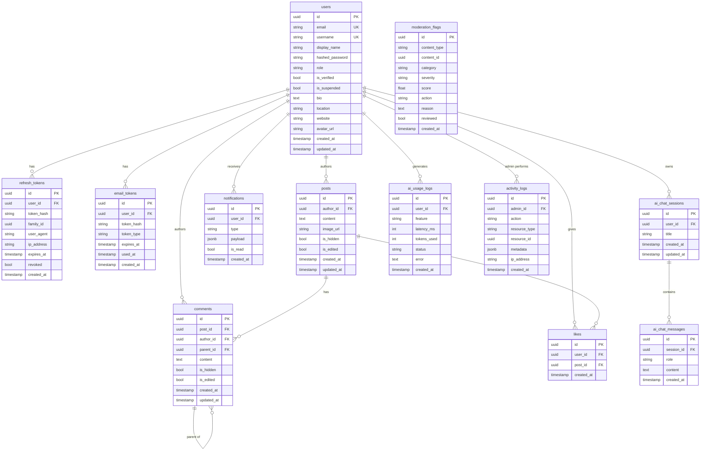

# ER Diagram — Nexus Social Database

> **Status:** Skeleton — full diagram generated in Stage 1 after all models are defined.

---

## Entity Relationship Diagram

---

## Table Reference

Full column documentation is in `docs/stages/STAGE_01.md` (written in Stage 1).

### Key Constraints

| Table | Constraint | Type |
|-------|-----------|------|
| `users` | `email` | UNIQUE |
| `users` | `username` | UNIQUE |
| `likes` | `(user_id, post_id)` | UNIQUE — prevents duplicate likes |
| `posts` | `len(content) <= 1000` | CHECK constraint |
| `refresh_tokens` | `(user_id, family_id)` | INDEX — for family revocation |

### Key Indexes

| Table | Index | Purpose |
|-------|-------|---------|
| `posts` | `(created_at DESC)` | Feed ordering |
| `posts` | `(author_id, created_at DESC)` | Profile feed |
| `notifications` | `(user_id, is_read)` | Unread count query |
| `moderation_flags` | `(reviewed, action)` | Moderation queue |
| `ai_usage_logs` | `(user_id, created_at)` | Daily quota check |

### ON DELETE Rules

| FK | Rule | Reason |
|----|------|--------|
| `posts.author_id → users.id` | CASCADE | Delete user removes their posts |
| `comments.post_id → posts.id` | CASCADE | Delete post removes its comments |
| `comments.author_id → users.id` | SET NULL | Preserve comment thread structure; mark as [deleted user] |
| `likes.user_id → users.id` | CASCADE | Delete user removes their likes |
| `likes.post_id → posts.id` | CASCADE | Delete post removes its likes |
| `notifications.user_id → users.id` | CASCADE | Delete user removes their notifications |
| `refresh_tokens.user_id → users.id` | CASCADE | Delete user revokes all their sessions |
| `ai_chat_messages.session_id → ai_chat_sessions.id` | CASCADE | Delete session removes messages |
