# Database Design & Entity Relationship Diagram
## Nexus Social — PostgreSQL Architecture

> **Stage 1 Verification:** Complete schema definitions, indexes, constraints, and cascade behaviors.

---

## 1. Visual Entity Relationship Diagram

```mermaid
erDiagram
    users {
        uuid id PK "Primary Key (UUID v4)"
        string email UK "Unique, Index"
        string username UK "Unique, Index"
        string usn UK "Unique, Index (Student USN / College ID)"
        string display_name "Display Name"
        string hashed_password "Argon2id Hash"
        string role "user | admin"
        bool is_verified "Email verification status"
        bool is_suspended "Administrative suspension flag"
        text bio "Profile bio"
        string location "Geographic location"
        string website "Personal website URL"
        string avatar_url "Avatar image URL"
        timestamp created_at "Creation timestamp (UTC)"
        timestamp updated_at "Update timestamp (UTC)"
    }

    refresh_tokens {
        uuid id PK "Primary Key (UUID v4)"
        uuid user_id FK "FK -> users.id (CASCADE)"
        string token_hash UK "SHA-256 Hash of Token"
        uuid family_id "Rotation family UUID"
        string user_agent "Client user agent"
        string ip_address "Client IP address"
        timestamp expires_at "Expiry timestamp"
        bool revoked "Revocation status flag"
        timestamp created_at "Issuance timestamp"
    }

    email_tokens {
        uuid id PK "Primary Key (UUID v4)"
        uuid user_id FK "FK -> users.id (CASCADE)"
        string token_hash UK "SHA-256 Hash of Token"
        string token_type "verify_email | reset_password"
        timestamp expires_at "Expiry timestamp (1h / 24h)"
        timestamp used_at "Consumed timestamp"
        timestamp created_at "Creation timestamp"
    }

    posts {
        uuid id PK "Primary Key (UUID v4)"
        uuid author_id FK "FK -> users.id (CASCADE)"
        text content "Post body (len <= 1000)"
        string image_url "Optional media URL"
        bool is_hidden "Moderation / Admin hide flag"
        bool is_edited "Edited indicator"
        timestamp created_at "Feed index (DESC)"
        timestamp updated_at "Update timestamp"
    }

    comments {
        uuid id PK "Primary Key (UUID v4)"
        uuid post_id FK "FK -> posts.id (CASCADE)"
        uuid author_id FK "FK -> users.id (SET NULL)"
        uuid parent_id FK "FK -> comments.id (CASCADE)"
        text content "Comment text (len <= 500)"
        bool is_hidden "Moderation hide flag"
        bool is_edited "Edited indicator"
        timestamp created_at "Creation timestamp"
        timestamp updated_at "Update timestamp"
    }

    likes {
        uuid id PK "Primary Key (UUID v4)"
        uuid user_id FK "FK -> users.id (CASCADE)"
        uuid post_id FK "FK -> posts.id (CASCADE)"
        timestamp created_at "Like timestamp"
    }

    notifications {
        uuid id PK "Primary Key (UUID v4)"
        uuid user_id FK "FK -> users.id (CASCADE)"
        string type "like | comment | reply | moderation | admin_login"
        jsonb payload "Structured metadata"
        bool is_read "Read status flag (Index)"
        timestamp created_at "Notification timestamp"
    }

    moderation_flags {
        uuid id PK "Primary Key (UUID v4)"
        string content_type "post | comment"
        uuid content_id "Post or Comment UUID"
        string category "hate | harassment | sexual | violence | spam"
        string severity "low | medium | high | critical"
        float score "Confidence / severity score"
        string action "allow | flag | block"
        text reason "AI / report explanation"
        bool reviewed "Admin review status flag"
        timestamp created_at "Flag timestamp"
    }

    ai_chat_sessions {
        uuid id PK "Primary Key (UUID v4)"
        uuid user_id FK "FK -> users.id (CASCADE)"
        string title "Session title"
        timestamp created_at "Creation timestamp"
        timestamp updated_at "Update timestamp"
    }

    ai_chat_messages {
        uuid id PK "Primary Key (UUID v4)"
        uuid session_id FK "FK -> ai_chat_sessions.id (CASCADE)"
        string role "user | model | system"
        text content "Message content"
        timestamp created_at "Timestamp"
    }

    ai_usage_logs {
        uuid id PK "Primary Key (UUID v4)"
        uuid user_id FK "FK -> users.id (CASCADE)"
        string feature "post_generate | summarize | chat | moderation"
        int latency_ms "Execution latency in ms"
        int tokens_used "Tokens consumed"
        string status "success | error | rate_limited"
        text error "Error message if failed"
        timestamp created_at "Usage timestamp (Quota Index)"
    }

    activity_logs {
        uuid id PK "Primary Key (UUID v4)"
        uuid admin_id FK "FK -> users.id (SET NULL)"
        string action "suspend_user | hide_post | delete | etc"
        string resource_type "user | post | comment | moderation_flag"
        uuid resource_id "Affected resource UUID"
        jsonb details "Contextual audit metadata"
        string ip_address "Admin IP address"
        timestamp created_at "Action timestamp"
    }

    users ||--o{ refresh_tokens : "has sessions"
    users ||--o{ email_tokens : "receives"
    users ||--o{ posts : "authors"
    users ||--o{ comments : "authors"
    users ||--o{ likes : "places"
    users ||--o{ notifications : "receives"
    users ||--o{ ai_chat_sessions : "starts"
    users ||--o{ ai_usage_logs : "records usage"
    users ||--o{ activity_logs : "performs (if admin)"
    posts ||--o{ comments : "receives"
    posts ||--o{ likes : "receives"
    comments ||--o{ comments : "threaded reply to"
    ai_chat_sessions ||--o{ ai_chat_messages : "contains"
```

---

## 2. Table Specifications & Schema Details

### 2.1 `users`
Primary user account and profile table.
- **Constraints:** `email` UNIQUE, `username` UNIQUE.
- **Role:** `"user"` (default) or `"admin"`.
- **Security:** `hashed_password` stores Argon2id formatted string (`$argon2id$...`). Passwords never stored in plain text.

### 2.2 `refresh_tokens`
Opaque refresh tokens for session rotation and reuse detection.
- **Security:** Plaintext tokens never stored. `token_hash` stores SHA-256 hash.
- **Rotation:** `family_id` links consecutive rotations of the same session. If a revoked token is presented, all tokens sharing `family_id` are revoked immediately.

### 2.3 `email_tokens`
Single-use tokens for email verification (`token_type="verify_email"`) and password resets (`token_type="reset_password"`).
- **Expiry:** 24 hours for email verification, 1 hour for password reset.
- **Idempotency:** Marked with `used_at` timestamp on consumption; cannot be reused.

### 2.4 `posts`
User post entities.
- **Content Limits:** Enforced via database check constraint `ck_posts_content_length`: `length(content) <= 1000`.
- **Feed Performance:** Indexed on `(created_at DESC)` and `(author_id, created_at DESC)` to power high-speed keyset pagination without table scans.

### 2.5 `comments`
Threaded discussion comments.
- **Threading Model:** Supports 1-level nested replies via `parent_id` foreign key referencing `comments.id`.
- **Constraint:** `length(content) <= 500`.
- **Cascade Behavior:** When a user is deleted, `author_id` is set to `NULL` (`ON DELETE SET NULL`) so conversation threads remain intact with "[Deleted User]" placeholder. When a post is deleted, all comments cascade delete (`ON DELETE CASCADE`).

### 2.6 `likes`
User post reactions.
- **Uniqueness:** Unique composite constraint `uq_likes_user_post (user_id, post_id)` guarantees a user can only like a post once.
- **Cascade:** Deleting either the user or the post cascades and removes the associated likes.

### 2.7 `notifications`
Real-time and persistent user notifications.
- **Payload:** Stored in PostgreSQL `JSONB` for schema flexibility (actor IDs, post snippets, links) with high-performance GIN/B-tree index support.
- **Index:** `ix_notifications_user_read (user_id, is_read)` optimizes the frequent "unread notification count badge" query.

### 2.8 `moderation_flags`
Automated and manual content moderation records.
- **Queue Index:** `ix_moderation_queue (reviewed, action)` allows the admin moderation dashboard to query pending flagged items with zero latency.

### 2.9 `ai_chat_sessions` & `ai_chat_messages`
Conversational memory for the AI assistant widget.
- **Structure:** 1-to-many relationship with cascade delete. `role` column holds `"user"`, `"model"`, or `"system"`.

### 2.10 `ai_usage_logs`
Fine-grained telemetry and rate limiting for Gemini AI requests.
- **Quota Checking:** Index `ix_ai_usage_user_date (user_id, created_at)` enables rapid aggregation of daily requests per user to enforce `AI_DAILY_QUOTA`.

### 2.11 `activity_logs`
Immutable audit trail for all administrative actions.
- **Traceability:** Records admin ID, action type (`suspend_user`, `hide_post`, `delete_post`), affected resource ID, IP address, and JSON details.

---

## 3. Foreign Key Cascades & Deletion Matrix

| Parent Table | Child Table | FK Column | ON DELETE Rule | Reason |
|:---|:---|:---|:---|:---|
| `users` | `posts` | `author_id` | **CASCADE** | User removal deletes their authored posts |
| `users` | `comments` | `author_id` | **SET NULL** | Preserves public thread hierarchy |
| `users` | `likes` | `user_id` | **CASCADE** | User removal removes their likes |
| `users` | `refresh_tokens` | `user_id` | **CASCADE** | User removal invalidates all sessions |
| `users` | `email_tokens` | `user_id` | **CASCADE** | User removal invalidates pending links |
| `users` | `notifications` | `user_id` | **CASCADE** | User removal cleans up their notifications |
| `users` | `ai_chat_sessions` | `user_id` | **CASCADE** | Deletes user assistant chat histories |
| `users` | `ai_usage_logs` | `user_id` | **CASCADE** | Cleans up user AI telemetry |
| `users` | `activity_logs` | `admin_id` | **SET NULL** | Retains administrative audit records |
| `posts` | `comments` | `post_id` | **CASCADE** | Post deletion removes all its comments |
| `posts` | `likes` | `post_id` | **CASCADE** | Post deletion removes all its likes |
| `comments` | `comments` | `parent_id` | **CASCADE** | Deleting parent comment deletes child replies |
| `ai_chat_sessions` | `ai_chat_messages` | `session_id` | **CASCADE** | Deleting session deletes messages |
