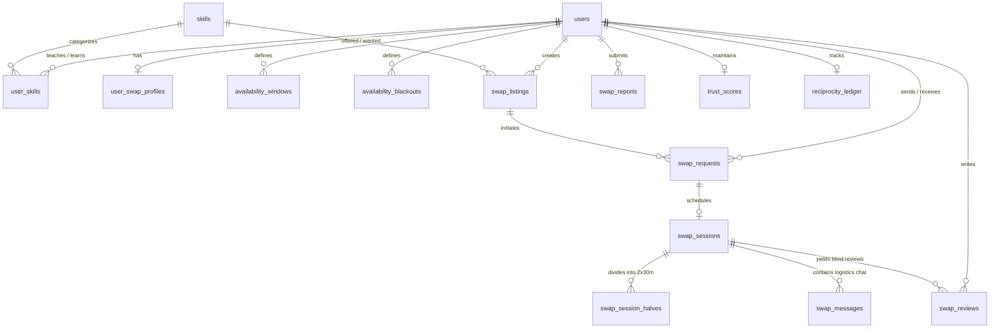

# 🔄 Hyper-Local Skill Swap Economy — Implementation Plan

> **Add-on Module to Nexus Social** · 6 Stage-Gated Vertical Slices · Living Plan  
> **Status:** Stage 1 (Taxonomy & Profiles) Complete · Awaiting Approval to Proceed to Stage 2  
> **Last Updated:** 2026-10-31

---

## 1. Executive Summary & Mission

The **Hyper-Local Skill Swap Economy** is a flagship micro-mentorship exchange integrated into the Nexus Social platform. It enables users to exchange 30-minute peer help sessions on a strictly reciprocal barter basis—**with zero money involved**.

### Core Value Proposition
- **Pure Reciprocal Barter:** 30 minutes of peer help for 30 minutes of peer help (e.g., Python algorithms tutoring in exchange for resume proofreading, or guitar chords for conversational Spanish).
- **No Financial Friction:** No currency, subscriptions, tips, or cash-convertible credits. Strict moderation prevents payment solicitation, escrow fraud, and commercial advertising.
- **Privacy-by-Design Hyper-Local Discovery:** Users can find peers nearby without compromising physical safety. Only coarse coordinates (~1 km grid) and distance buckets ("under 1 km", "1–3 km", "3–5 km", "5–10 km", "10–25 km") are computed. Precise coordinates, geohashes, and residential addresses are **never exposed** through any API endpoint.
- **Deep Platform Integration:** Native look and feel reusing existing Nexus Social authentication, role-based access control, SSE notification infrastructure, Brevo SMTP transactional emails, Gemini AI service, and admin layout.

---

## 2. Tech Stack Justification & Additions

The module reuses the existing Nexus Social technology stack to maintain architectural consistency and operational simplicity.

| Component | Technology | Justification / Integration Strategy |
|---|---|---|
| **Frontend Framework** | Next.js 14+ (App Router), TypeScript | Native compatibility with existing app structure, SSR/client boundaries, and routing. |
| **Styling & Components** | Tailwind CSS, shadcn/ui, Radix UI | Reuses the established warm indigo-violet and rose design tokens, ensuring cohesive visual identity. |
| **State & Data Fetching** | TanStack Query v5 | Efficient server state caching, optimistic updates for requests and reviews, and pagination. |
| **Animation & Charts** | Framer Motion, Recharts | Smooth transition effects on modal wizards and interactive analytics in the admin console. |
| **Interactive Map View (NEW)** | `leaflet` + `react-leaflet` + OpenStreetMap tiles | **Justification:** Essential for intuitive local discovery. Zero external API keys required; OpenStreetMap tiles provide free, reliable global mapping. Only coarse area circles/clusters are rendered—never exact user pins. |
| **Slot Picker (NEW)** | Custom UI built from existing primitives (`Button`, `Popover`, `ScrollArea`) | **Justification:** Avoids heavy third-party calendar libraries (like FullCalendar). Built natively using Tailwind and Radix primitives for timezone-aware 30-minute slot selection. |
| **Backend Framework** | FastAPI, Python 3.12, Pydantic v2 | High-performance asynchronous API, auto-generated OpenAPI schemas, strict input validation. |
| **Database & ORM** | PostgreSQL, SQLAlchemy 2.0 async, Alembic | Async relational persistence. Uses indexed rounded lat/lng bounding box prefilter + Haversine SQL formula. **No PostGIS or pgvector required.** |
| **Geocoding** | Open-Meteo Geocoding API + Browser Geolocation | Free, open-source, requires zero API keys. Resolves user-entered area names into coarse bounding areas. |
| **Video Infrastructure** | Jitsi Meet (`https://meet.jit.si`) | Auto-generated unguessable room tokens (`https://meet.jit.si/nexus-swap-{uuid}-{random_token}`). Zero external API keys or paid tiers required. |
| **AI Capabilities** | Google Gemini (`gemini-2.5-flash`) via `ai_service` | Skill normalization, match explanations, listing drafting, session planning, recap generation, fairness advice, and safety moderation. |
| **Background Scheduling** | Secret-authenticated endpoints + Render Cron | Idempotent endpoints (`POST /internal/jobs/{job_name}`) secured via `X-Cron-Secret` header, invoked by Render Cron Jobs. |

---

## 3. Core Principles & Safety Architecture

```
                    ┌────────────────────────────────────────┐
                    │    Hyper-Local Skill Swap Economy      │
                    └───────────────────┬────────────────────┘
                                        │
         ┌──────────────────────────────┼──────────────────────────────┐
         ▼                              ▼                              ▼
 ┌───────────────┐              ┌───────────────┐              ┌───────────────┐
 │ No Money Ever │              │ Fixed 30-Min  │              │ Coarse Geo &  │
 │  Policy & AI  │              │ Halves Barter │              │ Privacy First │
 └───────────────┘              └───────────────┘              └───────────────┘
```

1. **Strictly Non-Monetary:**
   - Any mention of currency ($/€/₹, Venmo, PayPal, CashApp, crypto) is strictly prohibited.
   - The AI moderation pipeline automatically blocks listings, messages, and reviews containing payment solicitation.
2. **Fixed 30-Minute Halves (`SWAP_SESSION_MINUTES = 30`):**
   - Each swap comprises two distinct 30-minute segments:
     - **Half 1:** Participant A mentors Participant B (30 min).
     - **Half 2:** Participant B mentors Participant A (30 min).
   - Sessions can be conducted back-to-back (60 min total) or as separate scheduled slots within 14 days.
3. **Reciprocity with Grace:**
   - Default exchange is balanced 1:1.
   - **Grace Balance:** Users may learn up to 2 sessions without teaching before receiving warm UI nudges to offer a session. Users are never hard-blocked, promoting a supportive community atmosphere.
   - Users can designate listings as "Pay it forward" / "Open to anything" to mentor newcomers.
4. **Location Privacy by Design:**
   - Users specify their general area via Open-Meteo geocoding search or opt-in browser location.
   - Coordinates are aggressively coarsened (~1 km grid: `round(lat, 2)`, `round(lng, 2)`) prior to storage.
   - **Zero Coordinate Leakage:** API endpoints **never return latitude, longitude, or geohash** to any client. Responses only include distance buckets:
     - `"under 1 km"`
     - `"1–3 km"`
     - `"3–5 km"`
     - `"5–10 km"`
     - `"10–25 km"`
     - `"remote"`
   - Map view renders generalized circular area bubbles, never pinpoint locations.
   - In-person meetups enforce public place selection (libraries, university lounges, coffee shops) and explicitly warn against residential addresses.
5. **Safety & Trust Framework:**
   - 18+ confirmation checkbox during onboarding.
   - Safety banner and emergency checklist on all in-person session rooms.
   - User blocking & reporting (3 distinct reports in 24 hours triggers automatic unpublishing pending admin review).
   - Trust score (0–100) calculated from verified email/USN, attendance rate, blind review averages, and promptness.

---

## 4. Codebase Audit & Architectural Integration

### 4.1 Audit Summary (Base Project & Recent Additions)
- **Base Project Status:** Stages 0 through 12 complete.
- **User Commits Verified & Preserved:**
  - `d388399`: Added friendship system (`Friendship` model, `/api/v1/friends`), direct messaging (`DirectMessage`, `Conversation` models, `/api/v1/messages`), and Alembic migration `0003_add_friends_and_messages.py`.
  - `5ed625f`: Added official brand logo `drupal.png` across navigation, auth, landing, and admin.
- **Current Quality Status:**
  - Backend Pytest: **50/50 tests passing (100%)**.
  - Frontend TypeScript: **0 errors (`tsc --noEmit`)**.
  - Frontend ESLint: **0 errors, 0 warnings**.
  - Backend Ruff: 14 minor cosmetic lint warnings (long docstring lines in prompts and boolean equality comparisons in user's `messages.py`). Will be addressed safely without breaking user features.

### 4.2 Module Categorization: Extended vs. Newly Created

```
Existing Platform                                   Skill Swap Module (New)
┌─────────────────────────┐                         ┌─────────────────────────┐
│ backend/app/            │                         │ backend/app/            │
│  ├── core/config.py     │◄─── [Extends Config] ───│  ├── models/swap.py     │
│  ├── models/__init__.py │◄─── [Registers Models] ─│  ├── api/v1/swaps.py   │
│  ├── services/          │                         │  ├── api/v1/swap_admin.py│
│  │    ├── pubsub.py     │◄─── [Reuses SSE Bus] ───│  ├── services/          │
│  │    ├── email_service │◄─── [Reuses Brevo SMTP]─│  │    ├── swap_service  │
│  │    └── ai/           │                         │  │    ├── matching      │
│  │         ├── base.py  │                         │  │    └── taxonomy      │
│  │         └── prompts  │◄─── [Adds 7 Prompts] ───│  └── schemas/swap.py   │
└─────────────────────────┘                         └─────────────────────────┘
```

#### Extended Modules:
1. `backend/app/core/config.py`: Add `SWAP_*`, `MATCH_WEIGHT_*`, `CRON_SECRET`, and `JITSI_BASE_URL` settings.
2. `backend/app/models/__init__.py`: Register all 17 new swap models and export them.
3. `backend/app/api/v1/__init__.py` & `backend/app/main.py`: Mount `/api/v1/swaps`, `/api/v1/internal/jobs`, and `/api/v1/admin/swaps`.
4. `backend/app/services/ai/prompts.py`: Add 7 versioned prompt templates with prompt injection sanitization.
5. `backend/app/services/ai/moderation.py`: Add content types `swap_listing`, `swap_request`, and `swap_review` with policy checks for payment solicitation.
6. `backend/app/services/email_service.py`: Add transactional email templates for swap requests, acceptances, and 24h/15m session reminders.
7. `frontend/src/components/layout/sidebar.tsx` & `navbar.tsx`: Add "Skill Swaps" navigation link.
8. `frontend/src/app/admin/layout.tsx`: Add "Skill Swaps" tab into the Admin console navigation.
9. `backend/scripts/seed.py`: Add `--demo-swaps` flag to populate canonical taxonomy, profiles, listings, requests, and reviews.

#### Newly Created Modules:
1. `backend/alembic/versions/0004_add_skill_swap_economy.py`: Clean additive migration for all 17 swap tables.
2. `backend/app/models/swap.py`: Complete SQLAlchemy ORM definitions for the skill swap domain.
3. `backend/app/schemas/swap.py`: Comprehensive Pydantic v2 schemas for requests, responses, filters, and state transitions.
4. `backend/app/services/swap_service.py`: State machines for requests and sessions, slot overlap validation, review processing, and trust calculation.
5. `backend/app/services/swap_matching.py`: Multi-criteria weighted matching engine and Haversine distance calculator.
6. `backend/app/services/swap_taxonomy.py`: Skill normalization, fuzzy matching, and alias graph management.
7. `backend/app/services/swap_jobs.py`: Idempotent background job runners for auto-expiry, reminders, auto-completion, and review reveals.
8. `backend/app/api/v1/swaps.py`: User-facing REST endpoints for profiles, listings, discovery, requests, sessions, and reviews.
9. `backend/app/api/v1/swap_admin.py`: Admin endpoints for taxonomy curation, dispute resolution, and job dispatch.
10. `backend/app/api/v1/internal_jobs.py`: Secret-protected job execution endpoint (`POST /internal/jobs/{job_name}`).
11. `frontend/src/app/(app)/swaps/*`: Discovery feed, map view, listing creation wizard, matches, requests inbox, and session room.
12. `frontend/src/app/(app)/settings/swaps/page.tsx`: Skill profile, availability calendar, and coarse location preferences.
13. `frontend/src/app/admin/swaps/page.tsx`: Admin console for KPIs, listings, disputes, taxonomy, and cron execution.
14. `frontend/src/components/swaps/*`: Custom slot picker, Leaflet map component, session room timer, and blind review modal.

---

## 5. Detailed Database Architecture

A single additive Alembic migration `0004_add_skill_swap_economy.py` defines the 17 domain tables with UUID primary keys, explicit foreign key cascades, and high-performance indexes.



### 5.1 Tables Summary

| # | Table Name | Key Columns | Purpose |
|---|---|---|---|
| 1 | `skills` | `id`, `slug`, `display_name`, `category`, `aliases`, `status`, `created_at` | Canonical skill taxonomy. Status: `active`, `pending`, `rejected`. |
| 2 | `user_skills` | `id`, `user_id`, `skill_id`, `skill_type` (teach/learn), `level`, `years_experience`, `notes` | User-declared teaching and learning capabilities. |
| 3 | `user_swap_profiles` | `id`, `user_id`, `bio`, `coarse_lat`, `coarse_lng`, `area_label`, `radius_km`, `modes`, `languages`, `is_invisible`, `accepts_newcomers`, `is_18_confirmed` | Swap profile and privacy settings. `coarse_lat`/`lng` stored at ~1 km resolution. |
| 4 | `availability_windows` | `id`, `user_id`, `day_of_week` (0–6), `start_time_utc`, `end_time_utc` | Weekly recurring availability windows stored in UTC. |
| 5 | `availability_blackouts` | `id`, `user_id`, `start_datetime_utc`, `end_datetime_utc`, `reason` | One-off blackout intervals when the user is unavailable. |
| 6 | `swap_listings` | `id`, `user_id`, `title`, `skill_offered_id`, `skill_wanted_id`, `description`, `modes`, `area_label`, `status`, `expires_at`, `created_at` | Active/paused swap offers displayed in discovery. |
| 7 | `swap_requests` | `id`, `listing_id`, `requester_id`, `recipient_id`, `offered_skill_id`, `wanted_skill_id`, `mode`, `status`, `message`, `proposed_slots`, `expires_at` | Swap proposals. State machine: `pending`, `accepted`, `declined`, `countered`, `cancelled`, `expired`. |
| 8 | `swap_sessions` | `id`, `request_id`, `user_a_id`, `user_b_id`, `status`, `mode`, `public_place_name`, `public_place_address`, `jitsi_room_token`, `ics_uid` | Scheduled swap sessions. State machine: `scheduled`, `active`, `completed`, `disputed`, `cancelled`. |
| 9 | `swap_session_halves` | `id`, `session_id`, `half_number` (1 or 2), `mentor_id`, `learner_id`, `skill_id`, `start_time_utc`, `end_time_utc`, `status` | The two fixed 30-minute halves of every swap. |
| 10 | `swap_messages` | `id`, `session_id`, `sender_id`, `content`, `created_at` | Session-scoped logistics chat with SSE broadcasting. |
| 11 | `swap_reviews` | `id`, `session_id`, `reviewer_id`, `reviewee_id`, `rating`, `tags`, `public_comment`, `private_feedback`, `is_revealed`, `created_at` | Double-blind peer reviews revealed after both submit or 7 days elapse. |
| 12 | `user_blocks` | `id`, `blocker_id`, `blocked_id`, `created_at` | Bi-directional mutual exclusion in discovery, matching, and messaging. |
| 13 | `swap_reports` | `id`, `reporter_id`, `target_type`, `target_id`, `category`, `notes`, `status`, `admin_resolution` | User reports on listings, users, or sessions. Auto-hides on 3 reports. |
| 14 | `trust_scores` | `id`, `user_id`, `score` (0–100), `completed_count`, `no_show_count`, `cancellation_count`, `avg_rating`, `badges`, `updated_at` | Quantitative trust metrics and accomplishment badges. |
| 15 | `reciprocity_ledger` | `id`, `user_id`, `minutes_taught`, `minutes_learned`, `net_balance_minutes`, `grace_used`, `updated_at` | Reciprocity balance tracking. Grace allows up to -60 minutes (-2 sessions). |
| 16 | `match_explanations` | `id`, `user_a_id`, `user_b_id`, `input_hash`, `explanation`, `created_at`, `expires_at` | Cached Gemini "Why you match" one-sentence explanations. |
| 17 | `job_runs` | `id`, `job_name`, `status`, `records_processed`, `details`, `started_at`, `completed_at` | Audit trail for scheduled cron job runs. |

### 5.2 Haversine Distance & Bounding Box SQL Strategy

To deliver fast local discovery on standard PostgreSQL without requiring the PostGIS extension, the engine uses a two-tier spatial filter:

1. **Tier 1: Indexed Bounding Box Prefilter:**
   ```sql
   WHERE coarse_lat BETWEEN (target_lat - delta_lat) AND (target_lat + delta_lat)
     AND coarse_lng BETWEEN (target_lng - delta_lng) AND (target_lng + delta_lng)
   ```
   Composite index `ix_swap_profiles_lat_lng` on `(coarse_lat, coarse_lng)` provides millisecond index seeks.
2. **Tier 2: SQL Haversine Distance Calculation:**
   ```sql
   6371 * 2 * ASIN(SQRT(
       POWER(SIN(RADIANS(coarse_lat - :target_lat) / 2), 2) +
       COS(RADIANS(:target_lat)) * COS(RADIANS(coarse_lat)) *
       POWER(SIN(RADIANS(coarse_lng - :target_lng) / 2), 2)
   )) AS distance_km
   ```
3. **Distance Bucket Conversion (Backend API):**
   Exact `distance_km` is categorized into buckets before JSON serialization:
   - `< 1.0 km` $\rightarrow$ `"under 1 km"`
   - `1.0 – 3.0 km` $\rightarrow$ `"1–3 km"`
   - `3.0 – 5.0 km` $\rightarrow$ `"3–5 km"`
   - `5.0 – 10.0 km` $\rightarrow$ `"5–10 km"`
   - `10.0 – 25.0 km` $\rightarrow$ `"10–25 km"`
   - `> 25.0 km` $\rightarrow$ `"remote"`

---

## 6. Stage-by-Stage Implementation Plan (S0–S5)

### Stage 0: Audit & Planning (COMPLETED)
- [x] Comprehensive codebase audit (Base stages 0–12 verified, user commits `d388399` & `5ed625f` verified).
- [x] Health checks: pytest (50/50 passing), TypeScript clean, ESLint clean.
- [x] Write living plan `docs/SWAP_IMPLEMENTATION_PLAN.md`.
- [x] Produce Implementation Plan artifact in workspace brain.
- [x] Commit `docs(swap): S0 complete - audit and skill swap implementation plan` & tag `swap-stage-00-complete`.
- [x] Post Stage 0 Report and await user `CONTINUE`.

---

### Stage 1: Skill Taxonomy & Profiles Vertical Slice (COMPLETED)
*Goal: Enable users to define what they teach/learn, set availability windows, configure privacy-preserving coarse location, and complete the 4-step onboarding wizard.*

#### Sub-Milestone S1a: Database Layer & Models
- [x] Create Alembic migration `0004_add_skill_swap_economy.py` with the 17 core swap tables.
- [x] Implement SQLAlchemy ORM models in `backend/app/models/swap.py`.
- [x] Add indexes on `skills(slug)`, `skills(category)`, and composite index on `(coarse_lat, coarse_lng)`.
- [x] Implement seed data in `backend/scripts/seed.py` with `--demo-swaps` creating 25 canonical skills and 10 realistic profiles.
- [x] Test migration upgrade and downgrade on clean and populated test databases.
- [x] **Commit:** `feat(swap): S1a - database schema, models, and demo seed data` (`e570a26`)

#### Sub-Milestone S1b: Backend Services & API
- [x] Implement `swap_taxonomy.py`: fuzzy matching with canonical skills, auto-approval moderation check, and alias lookup.
- [x] Implement `swap_service.py` profile operations: upsert profile, validate timezone, manage availability windows, and manage blackout dates.
- [x] Implement coarse geocoding service using Open-Meteo Geocoding API (`round(lat, 2)`, `round(lng, 2)`).
- [x] Create Pydantic v2 schemas in `backend/app/schemas/swap.py` ensuring coordinate privacy (never serializing raw coordinates for other users).
- [x] Implement REST endpoints in `backend/app/api/v1/swaps.py`:
  - `GET /api/v1/swaps/taxonomy`: List active canonical skills & categories.
  - `POST /api/v1/swaps/taxonomy/suggest`: Suggest new skill (auto-approve or queue).
  - `GET /api/v1/swaps/profile/me`: Get own full profile with raw settings.
  - `PUT /api/v1/swaps/profile/me`: Update swap profile, availability, and coarse area.
  - `GET /api/v1/swaps/profile/{username}`: Get public swap profile with distance bucket only.
- [x] Write backend unit & integration tests in `backend/tests/test_swap_profiles.py` (privacy verification, timezone handling, taxonomy fuzzy match).
- [x] **Commit:** `feat(swap): S1b - taxonomy, profile services, and privacy-guaranteed endpoints` (`ff76df2`)

#### Sub-Milestone S1c: Frontend Onboarding & Settings UI
- [x] Create 4-step Onboarding Wizard at `/swaps/onboarding`:
  1. *Teach:* Select skills, levels, and notes with fuzzy search + "add new" pill.
  2. *Learn:* Select skills wanted with current level.
  3. *Availability:* Interactive weekly slot picker (Mon–Sun, 30-min intervals) in local timezone.
  4. *Preferences:* Mode toggles (in-person, video, chat), coarse location search with Open-Meteo, distance radius, 18+ confirmation checkbox.
- [x] Build `/settings/swaps` management page to update skills, availability, and location anytime.
- [x] Extend User Profile page (`/profile/[username]`) with a dedicated "Skills & Swaps" tab showcasing skills taught/learned and trust badges.
- [x] Verify accessibility, mobile responsiveness, and dark mode styling.
- [x] **Commit:** `feat(swap): S1c - onboarding wizard, swap settings UI, and profile tab` (`73a9892`)

---

### Stage 2: Listings & Discovery Vertical Slice (COMPLETED)
*Goal: Allow users to create AI-assisted swap listings, browse listings via an interactive Leaflet map and list view with distance buckets, and view personalized "Matches for You" with Gemini explanations.*

#### Sub-Milestone S2a: Listings Backend & Feed Integration
- [x] Extend migration with `swap_listings` table.
- [x] Implement listing CRUD in `swap_service.py` enforcing active limit (`SWAP_MAX_ACTIVE_LISTINGS = 5`).
- [x] Integrate background AI moderation on listing titles and descriptions (flagging payment solicitation).
- [x] Add ability to share a listing into the main Nexus Social feed as a special "Swap Offer" post card.
- [x] Endpoints:
  - `POST /api/v1/swaps/listings`: Create new listing with AI moderation.
  - `GET /api/v1/swaps/listings/me`: View and manage own listings.
  - `GET /api/v1/swaps/listings/{id}`: View listing details.
  - `PUT /api/v1/swaps/listings/{id}`: Update/pause/close own listing.
  - `POST /api/v1/swaps/listings/{id}/share`: Share to main social feed.
- [x] Tests for listing lifecycle, limits, and moderation flags (`backend/tests/test_swap_listings.py`).
- [x] **Commit:** `feat(swap): S2a-c - listing CRUD, limits, moderation, feed sharing, discovery and matching engine` (`a06a81a`)

#### Sub-Milestone S2b: Discovery Query Engine & Distance Buckets
- [x] Implement discovery search query in `swap_service.py`:
  - Bounding box prefilter + Haversine distance formula.
  - Filters: skill category, mode (in-person/video), availability day, distance bucket, level, and language.
  - Sorting: nearest, newest, highest trust, best match.
  - Cursor-based pagination.
- [x] Bi-directional blocking exclusion (never return listings from blocked users or to users who blocked the viewer).
- [x] Unit tests verifying that API output contains **zero exact coordinates** and only valid distance buckets.
- [x] **Commit:** `feat(swap): S2a-c - listing CRUD, limits, moderation, feed sharing, discovery and matching engine` (`a06a81a`)

#### Sub-Milestone S2c: Matching Engine & Gemini Match Explanations
- [x] Implement `swap_matching.py`:
  - Weighted composite matching score:
    1. Mutual skill match ($W_1 = 0.35$): Exact match = 1.0; category/related match = 0.6.
    2. Proximity ($W_2 = 0.25$): In-range or remote-compatible.
    3. Availability overlap in next 14 days ($W_3 = 0.20$): Shared 30-min slots.
    4. Trust score ($W_4 = 0.15$): Higher trust boosts rank.
    5. Freshness / activity ($W_5 = 0.05$): Active in last 7 days; recency decay.
- [x] Implement Gemini match explanation prompt in `backend/app/services/ai/prompts.py`.
- [x] Implement explanation caching in `match_explanations` table based on SHA-256 hash of match inputs.
- [x] Endpoint `GET /api/v1/swaps/matches`: Returns top recommendations with cached "Why you match" one-liner.
- [x] **Commit:** `feat(swap): S2a-c - listing CRUD, limits, moderation, feed sharing, discovery and matching engine` (`a06a81a`)

#### Sub-Milestone S2d: Frontend Discovery & Map UI
- [x] Install `leaflet`, `react-leaflet@^4.2.1`, `@types/leaflet` with OpenStreetMap tile layer.
- [x] Build `/swaps` Discovery page:
  - Header with search bar and filter popovers (Mode, Category, Distance, Sort).
  - Togglable view: List view and interactive Leaflet Map view.
  - Map renders **coarse area circles/clusters** (700m–1.4km radius bubbles), never individual exact pins.
- [x] Build `/swaps/new` listing creation form with Gemini "AI Draft Helper".
- [x] Build `/swaps/matches` page showcasing recommended swap partners with "Why you match" badge.
- [x] Build "Swap Offer" card component embedded in the main social feed with a "Propose Swap" CTA.
- [x] **Commit:** `feat(swap): S2d - Leaflet map discovery, listing wizard, and matches UI` (`2480518`)

---

### Stage 3: Swaps & Sessions Vertical Slice (CURRENT STAGE)
*Goal: Full end-to-end exchange lifecycle: request state machine, slot scheduling, Jitsi video room generation, real-time logistics chat, double-blind reviews, trust score calculations, and background reminder jobs.*

#### Sub-Milestone S3a: Request State Machine
- [ ] Implement `swap_requests` table and state machine in `swap_service.py`:
  - Transitions: `pending → accepted | declined | countered | cancelled | expired`.
  - Max active pending requests per user (`SWAP_MAX_PENDING_REQUESTS = 5`).
  - Auto-expiry after 72 hours of inactivity.
  - Counter-proposals with alternate proposed slots or modes.
- [ ] Endpoints:
  - `POST /api/v1/swaps/requests`: Propose swap.
  - `GET /api/v1/swaps/requests`: List incoming and outgoing requests.
  - `POST /api/v1/swaps/requests/{id}/accept`: Accept request and auto-create session.
  - `POST /api/v1/swaps/requests/{id}/decline`: Decline request.
  - `POST /api/v1/swaps/requests/{id}/counter`: Send counter-proposal.
  - `POST /api/v1/swaps/requests/{id}/cancel`: Cancel pending request.
- [ ] Tests for all legal and illegal state transitions.
- [ ] **Commit:** `feat(swap): S3a - swap request state machine and counter-offers`

#### Sub-Milestone S3b: Sessions, Slots & Jitsi Room Generation
- [ ] Implement `swap_sessions` and `swap_session_halves` tables.
- [ ] Slot overlap validation: Ensure neither user has conflicting scheduled sessions or blackout intervals.
- [ ] Implement auto-generation of unguessable Jitsi Meet room URLs (`https://meet.jit.si/nexus-swap-{uuid}-{random_token}`).
- [ ] Implement `.ics` iCalendar file generator for seamless addition to Google Calendar / Apple Calendar.
- [ ] Implement internal cron runner in `swap_jobs.py` and endpoint `POST /api/v1/internal/jobs/{job_name}` authenticated via `X-Cron-Secret`.
- [ ] **Commit:** `feat(swap): S3b - session halves, slot overlap guard, Jitsi rooms, and cron jobs`

#### Sub-Milestone S3c: Completion, Blind Reviews & Trust Engine
- [ ] Implement double-blind review system:
  - Reviews remain private until both parties submit or 7 calendar days elapse.
  - Rating (1–5 stars), peer tags ("Patient Teacher", "Prepared", "Great Explanations"), public feedback, private feedback.
- [ ] Implement dispute / no-show reporting:
  - Reporting no-show pauses auto-completion and flags for admin review.
- [ ] Implement trust score engine (0–100 scale):
  - Weighted algorithm: completion rate (40%), average review (30%), response time (15%), verified credentials (10%), account age (5%). Severe penalty (-20 pts) for confirmed no-shows.
  - Automatic badge assignment ("Top Mentor", "Fast Responder", "Reliable Swapper").
- [ ] Reciprocity ledger balance tracking (tracks taught vs learned minutes; alerts when balance drops below -60 min).
- [ ] Real-time session logistics chat (`swap_messages` table + SSE channel `session:{id}`).
- [ ] **Commit:** `feat(swap): S3c - blind reviews, trust score engine, and session logistics chat`

#### Sub-Milestone S3d: Real-Time & Email Notifications
- [ ] Extend SSE pub/sub event bus with 17 swap notification types (e.g., `swap_request_received`, `swap_accepted`, `swap_reminder_24h`, `swap_reminder_15m`, `review_revealed`).
- [ ] Add Brevo SMTP HTML email templates for transactional swap updates.
- [ ] Background job `send-session-reminders` running every 15 minutes to trigger 24h and 15m alerts.
- [ ] **Commit:** `feat(swap): S3d - real-time SSE alerts and Brevo email notifications`

#### Sub-Milestone S3e: Frontend Request Inbox & Session Room UI
- [ ] Build `/swaps/requests` inbox: tabs for "Incoming" and "Outgoing" with action buttons (Accept, Decline, Counter, Cancel).
- [ ] Build interactive 30-minute Slot Picker component with timezone conversion and conflict highlighting.
- [ ] Build `/swaps/sessions` calendar & upcoming sessions view.
- [ ] Build `/swaps/sessions/[id]` Session Room:
  - Split halves countdown timer (Half 1: 30 min, Half 2: 30 min).
  - Video Mode: Embedded responsive Jitsi Meet iframe with "Open in New Tab" fallback.
  - In-Person Mode: Verified public place details, map directions link, and safety checklist banner.
  - Logistics Chat sidebar powered by SSE.
  - Action bar: "Confirm Completed", "Report Issue / No-Show", "Download .ics Calendar Invite".
  - Double-Blind Review Modal with star rating and accomplishment tags.
- [ ] **Commit:** `feat(swap): S3e - request inbox, slot picker, and interactive session room`

---

### Stage 4: Safety, Admin & AI Helpers Vertical Slice
*Goal: Comprehensive trust & safety suite (18+ verification, public place validator, reporting, auto-moderation), Gemini AI productivity helpers (Session Planner, Recap Helper, Fairness Advisor), and complete Admin Swaps management console.*

#### Sub-Milestone S4a: AI Assistants & Extended Content Moderation
- [ ] Implement Gemini Session Planner prompt: Generates a structured 30-minute agenda with time allocations and milestones based on user goals.
- [ ] Implement Gemini Post-Session Recap Helper prompt: Converts quick rough notes into polished takeaways.
- [ ] Implement Gemini Fairness Advisor prompt: Recommends reciprocal actions and skills to balance user trade ratios.
- [ ] Extended moderation detector for swap content: flags payment solicitation ("$20", "Venmo", "cash"), off-platform contact harvesting (external messaging handles in initial requests), and unsafe meetup proposals.
- [ ] **Commit:** `feat(swap): S4a - AI session planner, recap helper, and extended safety moderation`

#### Sub-Milestone S4b: User Safety, Reporting & In-Person Verification
- [ ] Implement user blocking (`user_blocks`) and reporting (`swap_reports`).
- [ ] Automatic threshold: 3 distinct reports in 24 hours automatically unpublishes listings and sets profile to invisible pending admin triage.
- [ ] Public place address validator: Checks against residential patterns (e.g., "Apt", "Unit", "Suite", residential street numbers) and requires public venues for in-person swaps.
- [ ] In-person safety checklist component presented before confirming an in-person exchange.
- [ ] **Commit:** `feat(swap): S4b - blocking, reporting, auto-hide threshold, and public place verification`

#### Sub-Milestone S4c: Admin Swap Management Console
- [ ] Backend admin endpoints in `backend/app/api/v1/swap_admin.py`:
  - `GET /api/v1/admin/swaps/stats`: Overview KPIs (active listings, swaps this week, completion rate, dispute rate, top skills).
  - `GET /api/v1/admin/swaps/listings`: Search and manage listings (suspend/reinstate).
  - `GET /api/v1/admin/swaps/disputes`: Review active disputes and no-show reports with session chat audit logs.
  - `POST /api/v1/admin/swaps/disputes/{id}/resolve`: Resolve dispute, adjust trust scores, or issue bans.
  - `GET /api/v1/admin/swaps/taxonomy`: Curation interface to approve pending skills, merge synonyms, and edit categories.
  - `POST /api/v1/admin/swaps/jobs/{job_name}/run`: Manually trigger cron maintenance tasks.
- [ ] Frontend Admin Console at `/admin/swaps` with 5 dedicated tabs: Overview, Listings, Disputes, Taxonomy, and Cron Jobs.
- [ ] **Commit:** `feat(swap): S4c - admin swap console, taxonomy curation, and dispute resolution`

---

### Stage 5: Polish, Performance & Documentation Vertical Slice
*Goal: Rigorous security and privacy testing, spatial query performance benchmarking on 10,000 synthetic listings, full Playwright E2E testing, Render cron job deployment configuration, and comprehensive documentation rebuild.*

#### Sub-Milestone S5a: Security Audit, Privacy Tests & Performance Benchmarks
- [ ] Security & Privacy Automated Test Suite:
  - Verify zero coordinates, geohashes, or residential addresses are ever leaked across all public endpoints.
  - Verify RBAC boundaries (non-participants cannot view session details or private chats).
  - Verify anti-money laundering and off-platform contact moderation filters.
- [ ] Performance Benchmark:
  - Generate 10,000 synthetic listings with distributed coordinates.
  - Benchmark spatial bounding box + Haversine SQL queries ($< 50\text{ ms}$ response time target).
- [ ] Accessibility (a11y) audit: WCAG 2.1 AA compliance on all new swap pages.
- [ ] Playwright E2E smoke test covering onboarding, listing creation, search, swap proposal, acceptance, and review.
- [ ] **Commit:** `test(swap): S5a - privacy leak tests, 10k listing spatial benchmark, and E2E tests`

#### Sub-Milestone S5b: Production Configuration & Cron Deployment
- [ ] Configure Render Cron Job schedule definitions for `/internal/jobs/*` using `CRON_SECRET`.
- [ ] Add all new environment variables to `DEPLOYMENT.md` and startup configuration validation.
- [ ] Run full backend test suite (`pytest`) and frontend verification (`npm run lint`, `tsc --noEmit`).
- [ ] **Commit:** `chore(swap): S5b - deployment configs, cron definitions, and production checks`

#### Sub-Milestone S5c: Documentation & PDF Rebuild
- [ ] Author Stage Documentation: `docs/stages/SWAP_STAGE_1.md` through `SWAP_STAGE_5.md`.
- [ ] Update `docs/REQUIREMENTS_TRACEABILITY.md` with all SWAP requirements.
- [ ] Add Skill Swap chapters (Chapters 17–24) to `docs/pdf/build_pdf.py` and rebuild complete documentation PDF.
- [ ] Perform automated secret scan across repository.
- [ ] Post Final Submission Report.
- [ ] **Commit:** `docs(swap): S5c - complete documentation update and PDF rebuild`

---

## 7. Requirements Traceability Matrix (SWAP Module)

| ID | Requirement | Target Stage | Verification Method |
|---|---|---|---|
| **SWAP-01** | Canonical skill taxonomy with fuzzy match & pending moderation | S1 | Unit test `test_taxonomy_matching` & admin curation UI |
| **SWAP-02** | User skill profiles (teach/learn, level, experience, notes) | S1 | API tests in `test_swap_profiles.py` & `/settings/swaps` |
| **SWAP-03** | Timezone-aware recurring weekly availability & blackouts | S1 | Integration test `test_availability_overlap` |
| **SWAP-04** | Privacy-by-design coarse location (~1 km) & distance buckets | S1, S2 | Automated privacy leak test asserting zero lat/lng in JSON |
| **SWAP-05** | 4-step onboarding wizard with 18+ confirmation | S1 | Playwright E2E test `onboarding.spec.ts` |
| **SWAP-06** | Swap listing creation with limits (`SWAP_MAX_ACTIVE_LISTINGS=5`) | S2 | API test `test_listing_limits` |
| **SWAP-07** | Automated AI moderation blocking payment & commercial solicitation | S2, S4 | Pytest `test_swap_moderation_no_money` |
| **SWAP-08** | Feed integration: share swap listing as social post with CTA | S2 | Frontend component test & feed rendering |
| **SWAP-09** | Interactive discovery map (Leaflet) with coarse area bubbles | S2 | Browser verification & map render test |
| **SWAP-10** | Multi-filter discovery (category, mode, distance, day, level) | S2 | API test `test_discovery_filters` |
| **SWAP-11** | Transparent 5-criteria weighted matching engine | S2 | Pytest `test_matching_algorithm` |
| **SWAP-12** | Cached Gemini "Why you match" one-sentence explanation | S2 | Mocked AI test with input hash verification |
| **SWAP-13** | Swap request state machine with counter-proposals & 72h expiry | S3 | State machine transition test suite |
| **SWAP-14** | Fixed 30-min halves barter with slot overlap prevention | S3 | Overlap guard test `test_slot_conflict_prevention` |
| **SWAP-15** | Auto-generated unguessable Jitsi Meet video room tokens | S3 | URL format and entropy unit test |
| **SWAP-16** | Public place validation & warning for in-person swaps | S3, S4 | Address validator unit test |
| **SWAP-17** | Downloadable `.ics` calendar invite files for scheduled halves | S3 | `.ics` format validator test |
| **SWAP-18** | Real-time session-scoped logistics chat over SSE | S3 | SSE stream test in `test_swap_chat.py` |
| **SWAP-19** | Double-blind review system with 7-day auto-reveal | S3 | Test `test_blind_review_reveal_conditions` |
| **SWAP-20** | Quantitative trust score (0–100) & badge assignment | S3 | Test `test_trust_score_calculation` |
| **SWAP-21** | Reciprocity ledger tracking with 2-session grace balance | S3 | Test `test_reciprocity_grace_balance` |
| **SWAP-22** | Automated session reminder jobs (24h & 15m) via SSE & Brevo SMTP | S3 | Cron job test `test_session_reminders` |
| **SWAP-23** | Secret-protected internal cron endpoint (`X-Cron-Secret`) | S3 | Security test asserting 401 on missing/invalid secret |
| **SWAP-24** | Gemini Session Planner: 30-minute structured agenda | S4 | Prompt generation test in `test_swap_ai.py` |
| **SWAP-25** | Gemini Post-Session Recap helper | S4 | Prompt generation test in `test_swap_ai.py` |
| **SWAP-26** | Gemini Fairness & Reciprocity Advisor | S4 | Prompt generation test in `test_swap_ai.py` |
| **SWAP-27** | User blocking & reporting with 3-strike auto-hide | S4 | Test `test_auto_hide_on_reports` |
| **SWAP-28** | Admin Swaps Console: KPI dashboard & analytics | S4 | Admin endpoint test & `/admin/swaps` UI |
| **SWAP-29** | Admin dispute resolution & trust score adjustment | S4 | Test `test_admin_dispute_resolution` |
| **SWAP-30** | Admin taxonomy curation (approve, rename, merge skills) | S4 | Test `test_admin_taxonomy_curation` |
| **SWAP-31** | High-performance spatial query benchmark (10k listings) | S5 | Benchmark execution script ($< 50\text{ ms}$) |
| **SWAP-32** | Zero coordinate/geohash API leakage security audit | S5 | Automated response body scanner test |
| **SWAP-33** | Full Playwright E2E swap lifecycle smoke test | S5 | Playwright test execution |
| **SWAP-34** | Render Cron Job production configuration | S5 | Verified config files in `DEPLOYMENT.md` |
| **SWAP-35** | Complete documentation update & PDF rebuild (Chapters 17–24) | S5 | PDF generated and inspected |

---

## 8. Environment Variables Reference (Additions)

### Backend (`backend/.env`)
| Variable | Required | Default | Description |
|---|---|---|---|
| `CRON_SECRET` | **Yes** | — | Min 32 chars. Shared secret for authenticating Render Cron jobs hitting `/api/v1/internal/jobs/*`. |
| `JITSI_BASE_URL` | No | `https://meet.jit.si` | Base URL for generated Jitsi Meet video rooms. |
| `SWAP_SESSION_MINUTES` | No | `30` | Duration in minutes of each swap half (fixed standard: 30). |
| `SWAP_MAX_ACTIVE_LISTINGS` | No | `5` | Maximum active listings permitted per user. |
| `SWAP_MAX_PENDING_REQUESTS` | No | `5` | Maximum concurrent pending swap requests per user. |
| `MATCH_WEIGHT_SKILL` | No | `0.35` | Matching engine weight for mutual skill alignment. |
| `MATCH_WEIGHT_PROXIMITY` | No | `0.25` | Matching engine weight for geographic proximity. |
| `MATCH_WEIGHT_AVAILABILITY` | No | `0.20` | Matching engine weight for calendar overlap in next 14 days. |
| `MATCH_WEIGHT_TRUST` | No | `0.15` | Matching engine weight for user trust score. |
| `MATCH_WEIGHT_FRESHNESS` | No | `0.05` | Matching engine weight for recent activity. |

---

## 9. Risk Register & Mitigation Strategy

| # | Risk Description | Severity | Likelihood | Mitigation Strategy |
|---|---|---|---|---|
| **R1** | **User Coordinate Leakage:** Accidental exposure of raw user coordinates through public profile, search, or map endpoints. | **Critical** | Low | Strict Pydantic serialization models that omit raw coordinates. Automated test in S1 & S5 scans every API response for numeric latitude/longitude patterns. |
| **R2** | **Commercial or Cash Solicitation:** Users attempting to sell tutoring, request payments, or solicit off-platform transfers. | **High** | Medium | Multi-layer defense: upfront onboarding warning, regex scanning, and automated Gemini moderation of all listing descriptions, request notes, and chat messages. |
| **R3** | **In-Person Safety Concerns:** Users proposing meetups at private residences or unsafe isolated locations. | **High** | Medium | In-person swaps require selecting a recognized public place. Address validator warns against residential keywords ("Apt", "Unit"). Mandatory safety checklist before confirmation. |
| **R4** | **Timezone and Daylight Saving Discrepancies:** Users in different zones booking ambiguous or overlapping slots. | **Medium** | High | All database availability and session times are strictly stored and computed in UTC. Conversions to viewer timezone occur purely at the client presentation layer. |
| **R5** | **Cold-Start Low Listing Density:** Initial sparsity in a user's local radius discouraging participation. | **Medium** | High | Dynamic remote fallback toggle ("Also show remote listings"), friendly "Pay it forward" suggestions, and rich demo seed data with 25 skills across categories. |

---

## 10. Operational Protocol & Definition of Done

Each stage (S1–S5) follows this strict execution workflow:
1. **Sub-Milestones (e.g., S1a, S1b, S1c):**
   - Implement database, backend, and frontend vertical slice components.
   - Run automated unit and integration tests.
   - Execute conventional git commit (`feat(swap): ...`).
2. **Stage Definition of Done:**
   - [ ] All code implemented with zero `TODO` or placeholder blocks.
   - [ ] All automated tests passing (`pytest backend/tests`).
   - [ ] Clean static analysis (`tsc --noEmit`, `npm run lint`, `ruff check`).
   - [ ] Manual verification in browser and terminal.
   - [ ] Stage documentation written (`docs/stages/SWAP_STAGE_X.md`).
   - [ ] Living plan and traceability matrix updated.
   - [ ] Git commit and tag `swap-stage-X-complete`.
   - [ ] Comprehensive Stage Report posted to chat.
   - [ ] **STOP and wait for user's `CONTINUE` before proceeding to the next stage.**
