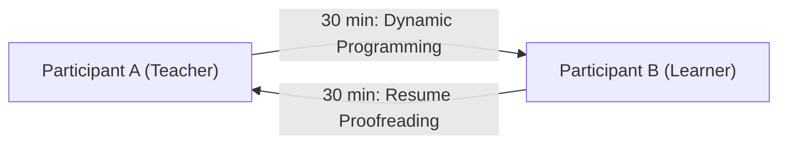
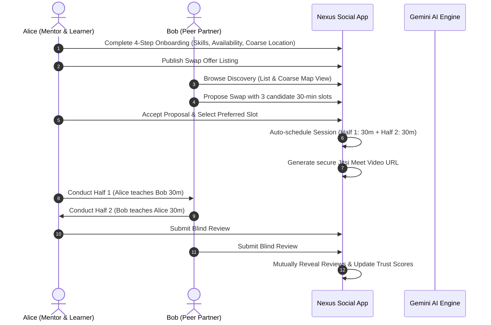

# Chapter 17: Skill Swap Product Overview

## 1. Concept & Mission

The **Hyper-Local Skill Swap Economy** is a flagship micro-mentorship exchange integrated natively into Nexus Social. It enables members to exchange 30-minute peer help sessions on a strictly reciprocal barter basis—**with zero money involved**.

In traditional freelance or tutoring platforms, monetary friction, transaction fees, and pricing disparities discourage spontaneous knowledge sharing. Nexus Skill Swap removes financial friction entirely:
- "I will explain dynamic programming in exchange for resume proofreading."
- "30 minutes of beginner acoustic guitar in exchange for conversational Spanish practice."
- "Python backend architecture in exchange for Figma UI design feedback."

Every swap is structured around a fundamental unit of exchange: **30 minutes of focused peer assistance**.

---

## 2. Target Personas

### 2.1 The Collegiate Coder (Alex)
- **Goal:** Master complex distributed systems and technical interview patterns.
- **Offering:** Deep expertise in Python, FastAPI, and database indexing.
- **Seeking:** Resume reviews and behavioral interview coaching from senior students.

### 2.2 The Creative Transitioner (Maya)
- **Goal:** Learn conversational Japanese for a study-abroad program.
- **Offering:** Graphic design, Figma component design systems, and illustration.
- **Seeking:** Native Japanese conversational exchange.

### 2.3 The Self-Taught Musician (David)
- **Goal:** Understand machine learning fundamentals and calculus basics.
- **Offering:** Acoustic guitar fingerpicking, music theory, and chord progression.
- **Seeking:** Math tutoring and beginner PyTorch guidance.

---

## 3. End-to-End User Journey

1. **Onboarding:** The user specifies what they can teach, what they want to learn, their weekly availability windows, and their coarse neighborhood area (~1 km resolution).
2. **Discovery & Matching:** Users explore peer offerings through an interactive Leaflet map (rendering coarse area bubbles) or filtered list view, with transparent compatibility scores and AI match explanations.
3. **Proposal & Scheduling:** The requester proposes an exchange with up to 3 candidate 30-minute slots. Upon acceptance, a 60-minute calendar event is booked with two labeled 30-minute halves.
4. **Session Execution:** Partners join the unguessable Jitsi Meet video room or meet at an approved public venue, guided by a split timer and AI-generated session agenda.
5. **Double-Blind Feedback:** After the exchange, both participants submit private reviews, which are mutually revealed only after both parties submit or after 7 days elapse.
