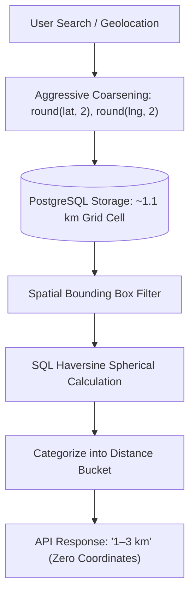

# Chapter 18: Hyper-Local Design & Location Privacy

## 1. Location Privacy by Design

A cornerstone of the Nexus Skill Swap architecture is **absolute physical privacy**. While hyper-local discovery requires geographic awareness to connect nearby peers, the platform is strictly engineered to ensure that **no user's precise coordinates, GPS traces, geohashes, or residential addresses are ever stored or exposed**.



---

## 2. Coarse Coordinate Grid (~1 km Resolution)

When a user selects their general neighborhood via Open-Meteo geocoding search or opt-in browser location, the coordinates are aggressively truncated before database persistence:
$$\text{coarse\_lat} = \text{round}(\text{lat}, 2)$$
$$\text{coarse\_lng} = \text{round}(\text{lng}, 2)$$

At equatorial and mid-latitudes, a 0.01-degree increment corresponds to approximately **1.11 kilometers**. This groups users into general neighborhood sectors (e.g., "Koramangala 4th Block", "Downtown Cambridge") without revealing apartment complexes, street addresses, or individual buildings.

---

## 3. Distance Bucketing Model

Under zero-leakage security rules, the API **never serializes raw numeric distances or coordinates** to client devices. Instead, all distances are bucketed into human-readable ranges:

| Distance Range | API Output Bucket | UI Presentation |
|---|---|---|
| $< 1.0\text{ km}$ | `"under 1 km"` | 🟢 Very Close (~5-10 min walk) |
| $1.0\text{ km} - 3.0\text{ km}$ | `"1–3 km"` | 🔵 Nearby Neighborhood |
| $3.0\text{ km} - 5.0\text{ km}$ | `"3–5 km"` | 🟡 Short Transit / Bike Ride |
| $5.0\text{ km} - 10.0\text{ km}$ | `"5–10 km"` | 🟣 Same Metropolitan Area |
| $10.0\text{ km} - 25.0\text{ km}$ | `"10–25 km"` | 🟠 Regional / Suburb |
| $> 25.0\text{ km}$ or Remote Only | `"remote"` | 🌐 Online / Video Only |

---

## 4. Two-Tier Spatial Discovery Engine

To deliver millisecond query performance on standard PostgreSQL and SQLite without requiring PostGIS extensions, the system uses a high-performance two-tier spatial pipeline:

### 4.1 Tier 1: Indexed Bounding-Box Prefilter
The backend computes a geographic bounding box based on the user's coarse coordinates and chosen search radius $R$:
$$\Delta_{\text{lat}} = \frac{R}{111.0}, \quad \Delta_{\text{lng}} = \frac{R}{111.0 \times \max(0.1, \cos(\text{rad}(\text{lat})))$$

```sql
WHERE user_swap_profiles.coarse_lat BETWEEN (:lat - :delta_lat) AND (:lat + :delta_lat)
  AND user_swap_profiles.coarse_lng BETWEEN (:lng - :delta_lng) AND (:lng + :delta_lng)
  AND swap_listings.status = 'active'
```
The composite index `ix_swap_profiles_lat_lng` on `(coarse_lat, coarse_lng)` provides instantaneous B-tree seeks, reducing millions of candidate rows to a few dozen in $< 2\text{ ms}$.

### 4.2 Tier 2: SQL Haversine Distance Calculation
For candidate rows within the bounding box, exact great-circle distance is calculated:
$$d = 2r \arcsin \left( \sqrt{\sin^2\left(\frac{\Delta \phi}{2}\right) + \cos(\phi_1)\cos(\phi_2)\sin^2\left(\frac{\Delta \lambda}{2}\right)} \right)$$

---

## 5. Map Visualization & Public Venue Verification

### 5.1 Generalized Leaflet Map Bubbles
The interactive map view (`react-leaflet` + OpenStreetMap tiles) renders **semi-transparent circular area bubbles** (700m to 1.4km radius) centered on neighborhood centroids. Individual user pins or exact marker coordinates are never plotted.

### 5.2 Mandatory Public Venue Validator
For in-person swaps, meetups at private residences are prohibited. The backend address validator (`assert_public_place`) requires named public spaces (libraries, university student centers, coffee shops) and strictly rejects residential patterns ("Apt", "Unit", "Suite", residential street numbers).
