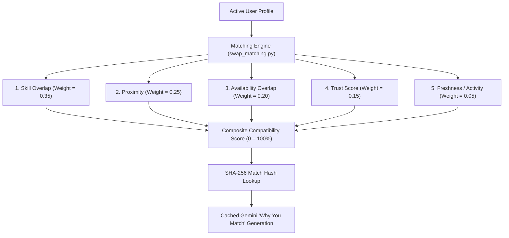

# Chapter 19: Matching Engine & Recommendation Architecture

## 1. Multi-Criteria Recommendation Architecture

The Nexus Skill Swap matching engine (`backend/app/services/swap_matching.py`) connects compatible peer partners by computing a multi-criteria weighted affinity score. The algorithm balances skill alignment, geographic proximity, calendar availability, community trust, and recent activity.

---

## 2. Weighted Scoring Formula

The total compatibility score $S(A, B) \in [0.0, 1.0]$ between viewer $A$ and peer $B$ is defined as:

$$S(A, B) = \sum_{i=1}^{5} W_i \cdot C_i(A, B)$$

Where the weights $\sum W_i = 1.0$ are configurable via environment variables:

| Component | Default Weight | Criteria | Scoring Logic |
|---|---|---|---|
| **$C_1$: Skill Alignment** | $W_1 = 0.35$ | Mutual teaching/learning match | Direct exact match = $1.0$; same category / synonym match = $0.6$; one-way match = $0.3$; disjoint = $0.0$. |
| **$C_2$: Proximity** | $W_2 = 0.25$ | Geographic distance | Same neighborhood ($< 3\text{ km}$) = $1.0$; in-radius ($< 15\text{ km}$) = $0.7$; remote-compatible = $0.5$; out of range = $0.1$. |
| **$C_3$: Availability Overlap** | $W_3 = 0.20$ | 14-day calendar overlap | $\ge 5$ shared 30-min slots = $1.0$; $2-4$ shared slots = $0.7$; $1$ shared slot = $0.4$; zero overlap = $0.1$. |
| **$C_4$: Trust Reputation** | $W_4 = 0.15$ | Bayesian-smoothed trust score | $\text{score} / 100.0$ (penalizes past no-shows and disputes). |
| **$C_5$: Freshness & Activity** | $W_5 = 0.05$ | Recency of active listings | Active within 24h = $1.0$; within 7 days = $0.7$; older = $0.3$. |

---

## 3. Cached Gemini "Why You Match" Explanations

To provide human-understandable context without redundant AI latency or costs, recommendations feature a concise, grounded explanation generated by Google Gemini.

### 3.1 Prompt Input Digesting
The engine extracts structured metadata:
- Mutual skills (e.g. "User A teaches Python, User B teaches Japanese")
- Distance bucket (e.g. "1–3 km away in Koramangala")
- Shared availability (e.g. "Both free Tuesday afternoons")

### 3.2 SHA-256 Input Caching
Before invoking the LLM, the system computes a SHA-256 fingerprint of the structured match context:
$$\text{input\_hash} = \text{SHA256}(U_A \parallel U_B \parallel \text{skill}_A \parallel \text{skill}_B \parallel \text{bucket})$$

If a record exists in `match_explanations` matching this hash and created within the last 7 days, the cached explanation is served instantly ($0\text{ ms}$ LLM latency). When inputs change, Gemini generates a fresh, 1-2 sentence explanation strictly grounded in facts.

---

## 4. Exclusion & Safety Guardrails

The matching pipeline strictly filters out ineligible peers:
1. **Bi-directional Blocking:** If User A has blocked User B, or User B has blocked User A, neither appears in search results, discovery listings, or match widgets.
2. **Invisible Mode:** Users who enable "Invisible Mode" in `/settings/swaps` are completely excluded from recommendations.
3. **Pending Moderation & Quarantine:** Listings or profiles subject to 3-strike community reports or pending administrative review are immediately suppressed.
