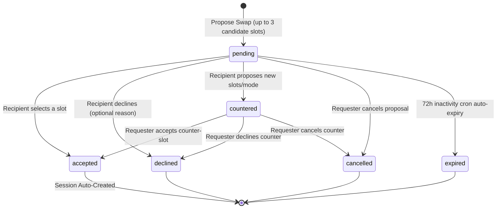
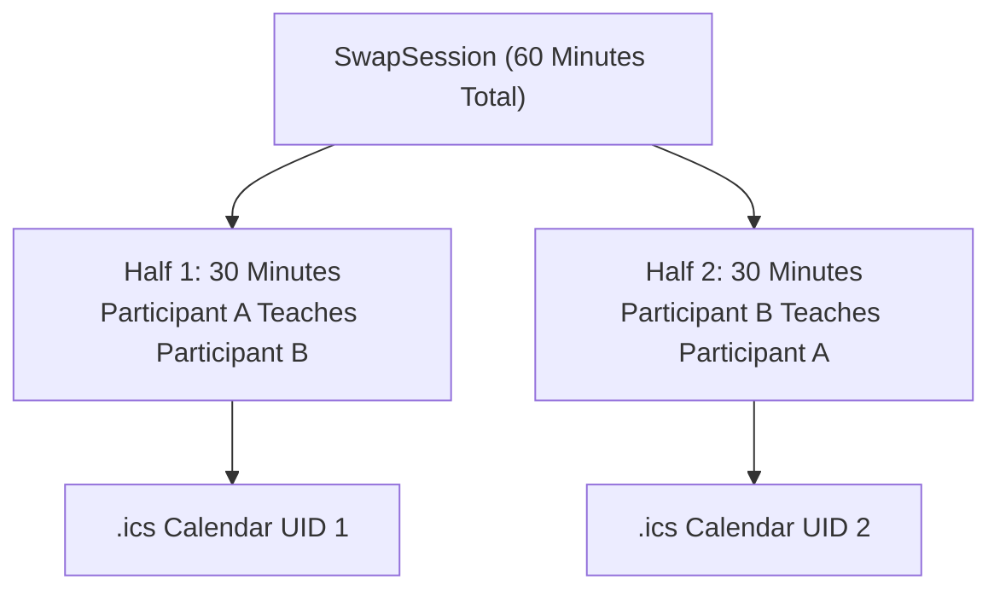
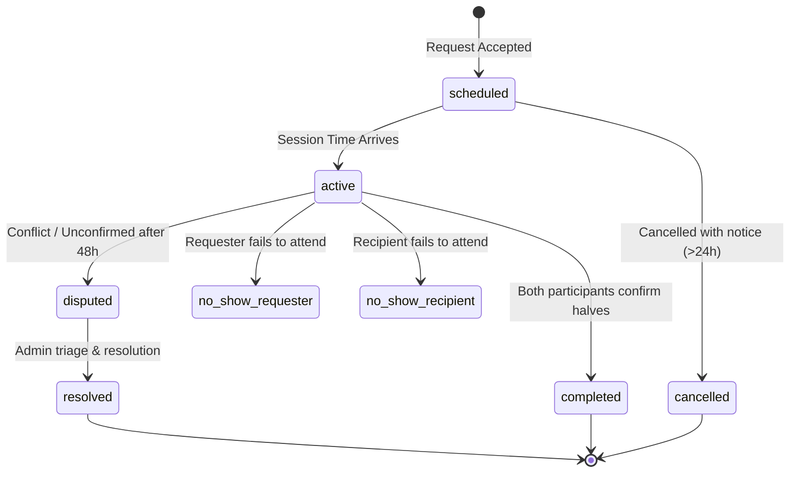

# Chapter 20: Swap Lifecycle & Scheduling Engine

## 1. Request State Machine

Swap proposals are governed by an explicit, deterministic finite state machine implemented in `backend/app/services/swap_service.py`. Every state transition is strictly validated against illegal actions.

### 1.1 Candidate Slot Selection
When initiating a request, the sender proposes up to 3 candidate 30-minute intervals. The recipient accepts by specifying the index of their preferred slot (`POST /api/v1/swaps/requests/{id}/accept`), automatically locking in the calendar time.

### 1.2 Anti-Spam & Quota Guardrails
- **Max Active Pending Requests:** Enforced limit (`SWAP_MAX_PENDING_REQUESTS = 5`).
- **Duplicate Request Guard:** A user cannot have multiple active pending requests with the same recipient.
- **72-Hour Auto-Expiry:** Background cron jobs automatically transition unresponded proposals to `expired`.

---

## 2. Session Architecture: Two Fixed 30-Minute Halves

When a proposal is accepted, the system instantiates a `SwapSession` record linked to two distinct `SwapSessionHalf` entries:

### 2.1 Justification for Two 30-Minute Halves
1. **Equal Reciprocity:** Guaranteed 1:1 time balance eliminates unfair exchanges.
2. **Predictable Scheduling:** Sessions fit comfortably into a standard 1-hour block.
3. **Structured Halves:** Explicit mentor/learner roles prevent one party from dominating the entire time.

---

## 3. Session State Machine

---

## 4. Timezone & DST-Safe Scheduling

All availability windows, blackout dates, proposed slots, and session start/end timestamps are **strictly stored and calculated in UTC**:
- **Database Layer:** Standardized `TIMESTAMP WITH TIME ZONE` stored in UTC.
- **Client Presentation Layer:** Converted dynamically into the viewer's local browser timezone using standard ECMAScript `Intl.DateTimeFormat`.
- **Slot Conflict Validation:** Overlap algorithms (`check_schedule_conflicts`) operate on normalized UTC epoch timestamps, neutralizing Daylight Saving Time transitions and multi-timezone ambiguities.

---

## 5. Unguessable Video Room Generation

For online swaps, the platform generates unguessable Jitsi Meet video rooms without requiring paid external API subscriptions:
$$\text{URL} = \text{https://meet.jit.si/nexus-swap-} \parallel \text{session\_uuid} \parallel \text{-} \parallel \text{secrets.token\_urlsafe(16)}$$

Video room tokens possess over 128 bits of cryptographic entropy, preventing brute-force room probing. Only validated session participants receive the room link through authenticated endpoints.

---

## 6. Background Maintenance Jobs & Reminders

Background tasks run via Render Cron Jobs calling secret-protected endpoints (`POST /api/v1/internal/jobs/{job_name}`):

1. **Session Reminders (`send-session-reminders`):**
   - Runs every 15 minutes.
   - Evaluates scheduled sessions starting in $24\text{ hours} \pm 15\text{m}$ and $15\text{ minutes} \pm 5\text{m}$.
   - Dispatches SSE push notifications and Brevo SMTP transactional emails with direct room links.
2. **Request Auto-Expiry (`auto-expire-requests`):**
   - Runs hourly.
   - Transitions pending proposals older than 72 hours to `expired`.
3. **Review Auto-Reveal (`reveal-swap-reviews`):**
   - Runs daily at 02:00 UTC.
   - Reveals single-submitted blind reviews after 7 days to prevent feedback hostage situations.
4. **Trust Score Recalculation (`recalculate-trust-scores`):**
   - Runs daily at 03:00 UTC.
   - Recalculates Bayesian-smoothed community trust scores.
