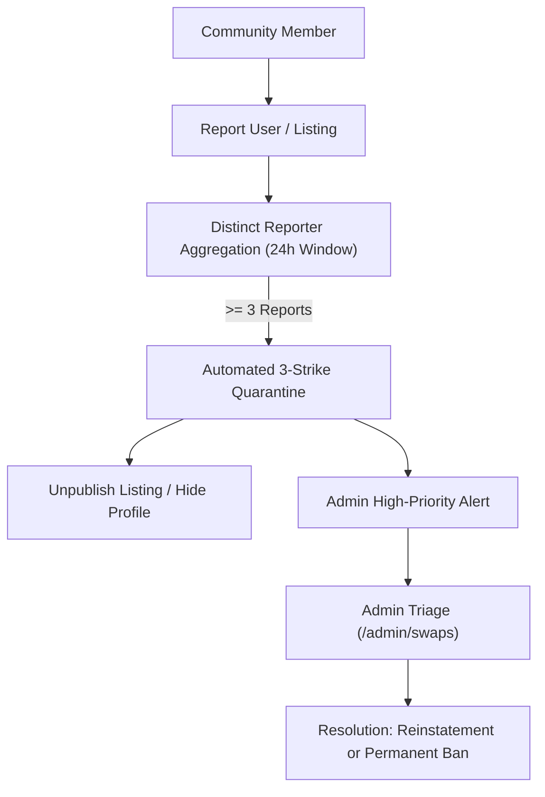

# Chapter 21: Trust, Reputation & Safety Systems

## 1. Double-Blind Mutual Reviews

To prevent retaliatory ratings and feedback hostage situations, Nexus Skill Swap implements a **double-blind review mechanism**:

```mermaid
sequenceDiagram
    autonumber
    actor Alice as Alice (Mentor)
    actor Bob as Bob (Learner)
    participant DB as Database (swap_reviews)
    participant Cron as Cron Service

    Alice->>DB: Submit Review (Rating: 5/5, "Great learner", is_revealed=False)
    Note over Alice,DB: Review remains private and invisible to Bob
    alt Bob submits within 7 days
        Bob->>DB: Submit Review (Rating: 5/5, "Clear teacher", is_revealed=False)
        DB->>DB: Both reviews exist -> Set is_revealed=True
        Note over DB: Reviews published & Trust Scores updated immediately
    else 7 days elapse without Bob's review
        Cron->>DB: reveal-swap-reviews job runs
        DB->>DB: Set Alice's review is_revealed=True
        Note over DB: Alice's feedback published; Bob forfeits review opportunity
    end
```

### Review Components
- **Quantitative Rating:** 1 to 5 stars across punctuality, clarity, and respect.
- **Peer Tags:** Curated behavioral endorsements ("Clear Explanations", "Patient", "Well Prepared", "Inspiring Mentor").
- **Public Comment:** Moderated feedback visible on the public swap profile after reveal.
- **Private Constructive Feedback:** Shared only with the partner to foster skill improvement.

---

## 2. Trust Score Formula (0–100 Scale)

The platform computes a Bayesian-smoothed trust score $T \in [0, 100]$:

$$T = w_c \cdot R_{\text{completion}} + w_r \cdot \bar{S}_{\text{bayesian}} + w_t \cdot R_{\text{response}} + w_v \cdot B_{\text{verified}} - P_{\text{penalties}}$$

### Component Weights & Factors
1. **Completion Rate ($w_c = 40\%$):** Percentage of scheduled sessions successfully completed without cancellation.
2. **Bayesian-Smoothed Rating ($w_r = 30\%$):**
   $$\bar{S}_{\text{bayesian}} = \frac{C \cdot m + \sum r_i}{C + n}$$
   Where prior count $C = 5$ and prior mean $m = 4.0$. This prevents newcomers with a single 5-star review from outranking seasoned contributors.
3. **Punctuality & Reliability ($w_t = 15\%$):** Promptness joining Jitsi rooms and responding to proposals within 24h.
4. **Verified Account Badges ($w_v = 15\%$):** Verified university email/USN and phone verification.
5. **Penalties ($P_{\text{penalties}}$):**
   - Confirmed No-Show: **-20 points**
   - Late Cancellation ($< 24\text{h}$ notice): **-10 points**
   - Behavioral Dispute: **-25 to -50 points** (via admin resolution)

### Reputation Badges

| Badge | Criteria | Visual Treatment |
|---|---|---|
| **New Member** | $\le 2$ completed sessions | 🟢 Subdued Emerald Pill |
| **Reliable** | $\ge 3$ sessions, 0 no-shows, trust score $\ge 75$ | 🔵 Indigo Shield Badge |
| **Trusted Mentor** | $\ge 10$ sessions, avg rating $\ge 4.7$, trust $\ge 88$ | 🟣 Violet Star Icon |
| **Community Pillar** | $\ge 25$ sessions, top 5% completion, trust $\ge 95$ | 🟡 Gold Crown Emblem |

---

## 3. Non-Monetary Reciprocity Ledger

To track barter fairness without creating a spendable shadow currency, the system maintains a **reputation-only reciprocity ledger** (`reciprocity_ledger` table):

```
Minutes Taught:   +120 min  (4 sessions)
Minutes Learned:  -150 min  (5 sessions)
----------------------------------------
Net Balance:       -30 min  (Status: Within Grace Window)
```

### 3.1 Why the Ledger is Never Spendable or Tradable
Treating swap minutes as a currency creates speculative hoarding, black-market sales, and regulatory burdens. The ledger is purely an **equilibrium indicator**:
- **Grace Buffer (-60 Minutes):** Users may learn up to 2 sessions without teaching before receiving warm UI nudges.
- **Deficit Alert:** If balance reaches $\le -60\text{ min}$, incoming request privileges are paused until the user offers a mentoring session to restore balance.

---

## 4. Multi-Layer Safety Architecture



1. **18+ Age Confirmation:** Mandatory verification checkbox during onboarding.
2. **Bi-Directional User Blocking:** Completely eliminates discovery and messaging visibility between blocked peers.
3. **Automated 3-Strike Community Quarantine:** 3 distinct user reports in 24 hours immediately unpublishes listings pending administrator review.
4. **Emergency "Cancel Safely":** Allows immediate cancellation without trust penalty if a user reports a safety concern.
5. **In-Person Public Venue Verification:** Enforces recognized public venues and warns against residential address patterns.
