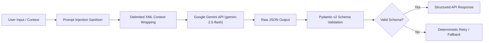

# Chapter 22: Skill Swap AI Features & Prompt Engineering

## 1. Architectural Integration with Gemini 1.5 Flash

The Skill Swap economy integrates with Google Gemini (`gemini-2.5-flash` / `gemini-1.5-flash`) through the platform's central, versioned AI service architecture (`backend/app/services/ai/`).

All prompts reside in `backend/app/services/ai/prompts.py` with strict prompt injection sanitization, schema enforcement, retry mechanics, and quota monitoring.

---

## 2. Versioned Prompt Registry (7 Capabilities)

### 2.1 Skill Normalization Prompt (`SWAP_NORMALIZE_SKILL_PROMPT_V1`)
- **Purpose:** Maps noisy freeform user text (e.g. "DP in C++", "leetcode dynamic programming", "reactjs hooks") into a canonical skill slug, display name, category, and confidence score.
- **Output Schema:** `NormalizedSkillSchema` (`canonical_slug`, `display_name`, `category`, `confidence`, `related_slugs`).

### 2.2 Match Explanation Prompt (`SWAP_MATCH_EXPLANATION_PROMPT_V1`)
- **Purpose:** Generates a friendly, grounded 1–2 sentence explanation of why two peers are complementary barter partners.
- **Guardrail:** Strictly restricted to structured input facts (skills, distance bucket, availability); prohibited from inventing biographical details.

### 2.3 Listing Drafting & Improvement Prompt (`SWAP_LISTING_WRITER_PROMPT_V1`)
- **Purpose:** Converts bullet points or rough drafts into 3 compelling listing title and description variants across selectable tones (Professional, Casual, Mentor-Focused).
- **Output Schema:** `ListingDraftResponse` with 3 previewable variants.

### 2.4 Session Planner Prompt (`SWAP_SESSION_PLAN_PROMPT_V1`)
- **Purpose:** Generates a structured **30-minute lesson agenda** partitioned into 4 distinct phases:
  - Warm-up & Goal Setting: 0–5 minutes
  - Core Demonstration / Instruction: 5–20 minutes
  - Interactive Practice & Pairing: 20–27 minutes
  - Wrap-up & Next Steps: 27–30 minutes
- **Output Schema:** `SwapSessionPlanResponse` (`objective`, `agenda_items`, `suggested_questions`, `preparation_tips`).

### 2.5 Post-Session Recap Helper Prompt (`SWAP_SESSION_RECAP_PROMPT_V1`)
- **Purpose:** Analyzes rough mentor/learner notes taken during the swap and transforms them into organized takeaways, practice tasks, and recommended resources.
- **Privacy Rule:** Recaps remain private to the participant unless explicitly shared.

### 2.6 Reciprocity & Fairness Advisor Prompt (`SWAP_FAIRNESS_ADVISOR_PROMPT_V1`)
- **Purpose:** Evaluates a user's minutes taught vs. learned balance and provides proactive recommendations (e.g. suggesting specific high-demand skills to offer).

### 2.7 Extended Safety & Non-Monetary Moderation Prompt (`MODERATION_SYSTEM_PROMPT_V2`)
- **Purpose:** Specialized moderation classifier detecting:
  - `payment_solicitation`: Cash requests, Venmo, PayPal, hourly rates, or tip solicitation.
  - `off_platform_contact_harvesting`: Attempts to divert communication to WhatsApp, Telegram, or external emails in initial proposals.
  - `unsafe_meetup`: Residential addresses or isolated private meeting places.
  - `impersonation_as_professional`: False representation as licensed therapist, physician, or attorney.

---

## 3. Security, Injection Defense & Quotas

1. **XML Data Delimitation:** All user-supplied inputs are wrapped in explicit XML boundary tags (e.g. `<session_notes>...</session_notes>`). The system prompt instructs Gemini to treat data within these tags exclusively as passive strings, neutralizing prompt override attacks.
2. **Quota & Rate Limit Enforcement:** Every user interaction is governed by `settings.AI_DAILY_QUOTA = 100` and rate-limited via slowapi (`20/minute`). Usage is logged in `ai_usage_logs` with latency and token metrics.
3. **Fail-Open / Fail-Closed Configuration:** If Gemini API experiences cloud outages, the `MODERATION_FAIL_MODE` setting controls platform behavior:
   - `open` (Default in dev): Content is published and queued for asynchronous review.
   - `closed` (Enterprise safety): Potentially sensitive content is temporarily held until moderation service resumes.
