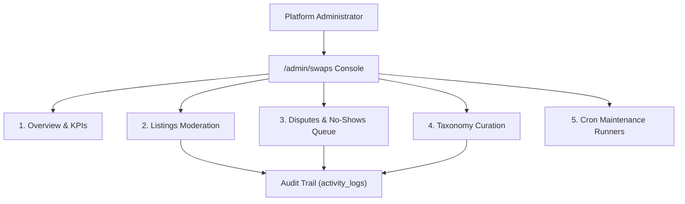

# Chapter 23: Skill Swap Admin Console & Analytics

## 1. Unified Administrative Architecture

The Skill Swap management console is mounted under `/admin/swaps` and strictly protected by role-based access control (`require_admin` dependency on FastAPI endpoints and Next.js middleware cookie verification).

It provides community operators with real-time analytics, content moderation, dispute resolution, taxonomy curation, and background job maintenance.

---

## 2. Admin Console Views

### 2.1 Overview & Analytics KPI Dashboard
Displays platform-wide health metrics computed live via `GET /api/v1/admin/swaps/stats`:
- **Active Listings:** Total published swap offers currently discoverable.
- **Weekly Completed Swaps:** Velocity of completed 60-minute peer barter sessions.
- **Platform Completion Rate:** Percentage of scheduled sessions completed without conflict.
- **Dispute & No-Show Rate:** Percentage of sessions requiring administrative intervention.
- **Top Traded Skills:** Ranked bar chart of highest-volume teaching and learning categories.
- **Supply / Demand Gap Analysis:** Skills with high learner demand but few active mentors (highlighted for community recruitment campaigns).

### 2.2 Listings Moderation Directory
A filterable table of all listings across `active`, `paused`, and `removed` statuses:
- Displays cumulative report counts and distinct reporter metrics.
- One-click **Suspend** (sets `status = 'removed'`) and **Reinstate** controls.
- Full inspection of description, offered skills, wanted skills, and author history.

### 2.3 Disputes & No-Show Resolution Center
Triage interface for sessions flagged as `disputed` or marked with no-shows:
- **Evidence Inspection:** Displays both participants' confirmations, stated reasons, and session logistics chat history.
- **Resolution Actions:**
  - Mark Valid Completion (restores reciprocity balance).
  - Confirm No-Show (imposes a configurable trust score penalty between 0 and 50 points and increments user's `no_show_count`).
  - Quarantine / Suspend Bad Actor account.

### 2.4 Taxonomy Curation Interface
Allows operators to curate the canonical skill taxonomy (`skills` table):
- **Pending Review Queue:** Community-suggested skills created during onboarding or listing creation.
- **One-Click Approval:** Transitions `status = 'pending'` to `active`.
- **Synonym Merging:** Merges redundant or misspelled skills (e.g. merging "FastAPI Python" into canonical "Python Backend Development") by reassigning foreign keys across `user_skills`, `swap_listings`, and `swap_session_halves`.

### 2.5 Cron Maintenance Jobs Interface
Enables administrators to manually trigger background routines with instant feedback:
- `send-session-reminders`: Dispatches upcoming 24h/15m session alerts.
- `auto-expire-requests`: Expires stale proposals older than 72 hours.
- `reveal-swap-reviews`: Reveals 7-day-old single-submitted reviews.
- `recalculate-trust-scores`: Triggers full Bayesian trust score recalculation.

---

## 3. Comprehensive Audit Logging

All administrative actions (suspending a listing, resolving a dispute, adjusting a trust score, merging a skill) are recorded in `activity_logs` with the administrator's ID, client IP address, action type, target entity UUID, and JSON before/after state snapshots.
