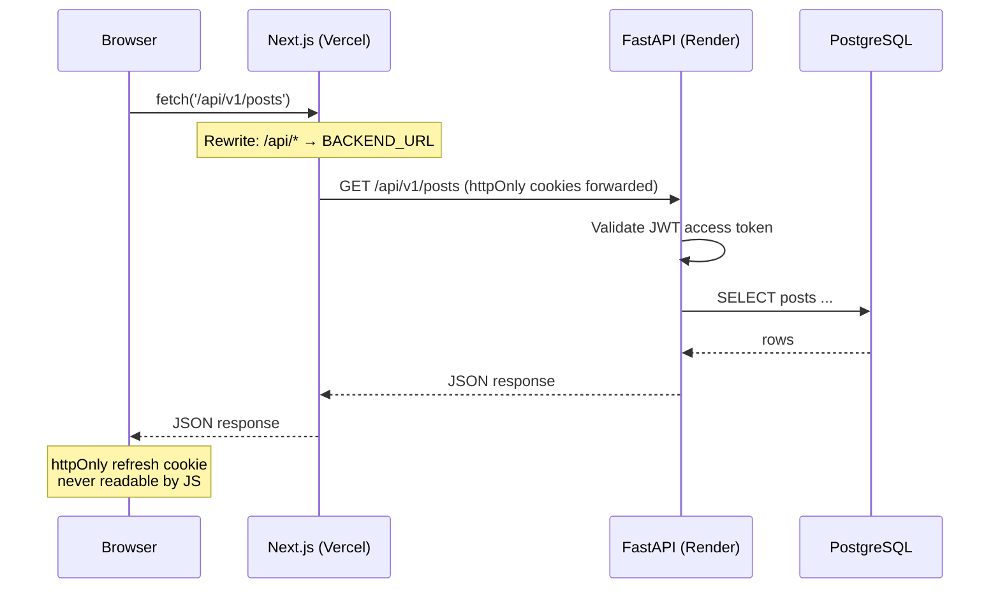
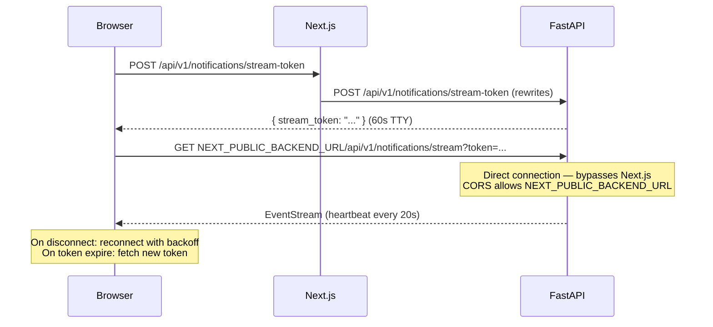

# Stage 0 — Planning & Scaffold

> **Status:** ✅ Done · **Complexity:** Low · **Depends on:** Nothing

---

## Purpose

Stage 0 establishes the foundation that every subsequent stage builds on. It answers three questions:

1. **What are we building?** — Full architecture, feature list, stage-by-stage plan captured before a line of feature code is written.
2. **How are we organized?** — Monorepo folder structure, toolchain choices, configuration conventions.
3. **Does the PDF pipeline work?** — Prove the documentation system before it matters.

No feature code exists after Stage 0. What does exist: a fully runnable skeleton you can actually boot and see something.

---

## Architecture Overview

```
┌────────────────────────────────────────────────────────────────────┐
│                         NEXUS SOCIAL                               │
│                                                                    │
│  ┌──────────────┐   /api/* rewrites   ┌──────────────────────┐    │
│  │   Browser    │ ───────────────────▶ │  Next.js 14 (Vercel) │    │
│  │              │ ◀─────────────────── │  App Router, TS      │    │
│  │              │                      └──────────┬───────────┘    │
│  │  [SSE conn   │                                 │ BACKEND_URL     │
│  │   direct]    │ ──────────────────────────────▶ │                 │
│  └──────────────┘                      ┌──────────▼───────────┐    │
│                                        │  FastAPI (Render)    │    │
│                                        │  Python 3.12, async  │    │
│                                        └────┬─────────┬───────┘    │
│                                             │         │            │
│                                   ┌─────────▼──┐ ┌───▼────────┐   │
│                                   │ PostgreSQL  │ │ Gemini API │   │
│                                   │  (Render)  │ │ (Google)   │   │
│                                   └────────────┘ └────────────┘   │
│                                                  ┌────────────┐   │
│                                                  │ SMTP       │   │
│                                                  │ (Gmail/    │   │
│                                                  │  Brevo)    │   │
│                                                  └────────────┘   │
└────────────────────────────────────────────────────────────────────┘
```

### Request lifecycle (API call)



### SSE (real-time notifications)



---

## Design Decisions

### Monorepo vs separate repos

**Chosen:** Monorepo under `/frontend` + `/backend` + `/docs`.

**Why:** Simpler CI (one repo), coordinated commits across layers, shared docs. No cross-repo import needed since frontend and backend communicate only via HTTP.

**Rejected:** Separate repos — more Git overhead, no benefit for a 2-service app.

### Cookie strategy for tokens

**Chosen:** Access token in JavaScript memory (never persisted), refresh token in `httpOnly; Secure; SameSite=Lax` cookie via Next.js rewrite.

**Why:** The rewrite makes the backend appear at the same Vercel domain (`/api/*`), so the cookie is first-party and SameSite=Lax works across page navigations. XSS cannot steal the refresh token.

**Rejected:** localStorage for refresh tokens — vulnerable to XSS. httpOnly cookie with direct Render URL — SameSite=Strict would break cross-site navigations; SameSite=None requires Secure and wide CORS.

### SSE vs WebSocket

**Chosen:** Server-Sent Events (SSE).

**Why:** One-directional (server → client) is all we need for notifications. SSE is simpler (HTTP only, no upgrade), reconnects automatically, works behind HTTP/1.1 proxies. Render's free tier supports long-running HTTP connections.

**Rejected:** WebSockets — bidirectional complexity not needed; Render free tier has connection limits.

### In-process pub/sub vs Redis

**Chosen:** In-process pub/sub for Stage 4, with a Redis-swappable interface documented.

**Why:** Zero infra cost for a single-instance deployment. The interface (`app/services/pubsub.py`) is abstract — swapping to Redis Pub/Sub requires only a new implementation class and a config switch.

**Rejected (for now):** Redis — adds a managed service cost on free tier; overkill for single-instance.

---

## Repository Structure

```
nexus-social/
├── .gitignore
├── .github/
│   └── workflows/ci.yml          # GitHub Actions CI
├── docker-compose.yml            # Local: PostgreSQL + Mailpit
├── render.yaml                   # Render deployment blueprint
├── README.md
├── scripts/
│   └── init-db.sql               # One-time DB extension init
│
├── backend/                      # FastAPI application
│   ├── .env.example
│   ├── pyproject.toml            # ruff, mypy, pytest config
│   ├── requirements.txt
│   ├── requirements-dev.txt
│   ├── alembic.ini
│   ├── alembic/
│   │   ├── env.py                # Async migration runner
│   │   └── versions/             # Migration files (Stage 1+)
│   ├── app/
│   │   ├── main.py               # FastAPI app factory
│   │   ├── core/
│   │   │   ├── config.py         # pydantic-settings
│   │   │   └── logging.py        # Structured JSON logging
│   │   ├── api/                  # Routers (Stage 2+)
│   │   ├── models/               # SQLAlchemy models (Stage 1+)
│   │   ├── schemas/              # Pydantic schemas (Stage 2+)
│   │   ├── services/             # Business logic (Stage 2+)
│   │   │   └── ai/               # Gemini AI service (Stage 6+)
│   │   ├── db/                   # Engine + session (Stage 1+)
│   │   └── templates/            # Jinja2 email templates (Stage 2+)
│   ├── tests/
│   │   ├── conftest.py
│   │   └── test_health.py        # ✅ Stage 0 tests
│   └── scripts/
│       └── seed.py               # Database seeder (Stage 1+)
│
├── frontend/                     # Next.js 14 application
│   ├── .env.example
│   ├── package.json
│   ├── tsconfig.json
│   ├── next.config.ts            # Rewrites + security headers
│   ├── tailwind.config.ts        # Nexus design tokens
│   ├── playwright.config.ts
│   ├── src/
│   │   ├── app/                  # App Router pages
│   │   │   ├── layout.tsx        # Root layout + fonts + metadata
│   │   │   ├── page.tsx          # Landing page
│   │   │   ├── globals.css       # CSS variables + Tailwind
│   │   │   ├── not-found.tsx     # 404 page
│   │   │   └── (auth)/           # Auth route group
│   │   ├── components/           # UI components (Stage 7+)
│   │   ├── lib/                  # Utilities (api-client, Stage 7+)
│   │   │   └── utils.ts          # cn(), timeAgo(), etc.
│   │   ├── types/
│   │   │   └── index.ts          # TypeScript interfaces
│   │   └── contexts/             # React contexts (Stage 7+)
│   └── tests/e2e/                # Playwright tests (Stage 10+)
│
└── docs/
    ├── IMPLEMENTATION_PLAN.md    # This file (living)
    ├── REQUIREMENTS_TRACEABILITY.md
    ├── ER_DIAGRAM.md             # Stage 1+
    ├── AI_INTEGRATION.md         # Stage 6+
    ├── API.md                    # Stage 6+
    ├── DEPLOYMENT.md             # Stage 11+
    ├── SUBMISSION.md             # Stage 12
    ├── stages/
    │   └── STAGE_00.md           # ← This file
    ├── diagrams/                 # Mermaid .mmd sources + PNG
    └── pdf/
        ├── build_pdf.py          # PDF builder script
        ├── style.css             # PDF styles
        └── SYSTEM_DOCUMENTATION.pdf  # Generated at Stage 12
```

---

## Key Code Walkthrough

### `app/core/config.py` — Fail-fast configuration

```python
@field_validator("DATABASE_URL", mode="before")
@classmethod
def fix_database_url(cls, v: str) -> str:
    # Render provides postgres:// — auto-convert to postgresql+asyncpg://
    if v.startswith("postgres://"):
        v = "postgresql+asyncpg://" + v[len("postgres://"):]
    return v

@model_validator(mode="after")
def validate_production_settings(self) -> "Settings":
    if self.ENVIRONMENT == "production":
        if self.JWT_SECRET == "CHANGE_ME_...":
            raise ValueError("JWT_SECRET must be changed in production")
    return self
```

This means: **the app refuses to start in production with default/placeholder secrets**. No silent misconfiguration.

### `app/core/logging.py` — Structured logging

```python
class JsonFormatter(logging.Formatter):
    def format(self, record: logging.LogRecord) -> str:
        log_data = {
            "timestamp": datetime.now(UTC).isoformat(),
            "level": record.levelname,
            "request_id": request_id_var.get(""),  # ContextVar
            ...
        }
        return json.dumps(log_data, default=str)
```

Production → JSON (for Datadog/Loki/CloudWatch). Development → colored human-readable. Request IDs flow through a `ContextVar` set by middleware (Stage 2).

### `next.config.ts` — The rewrite that makes auth work

```typescript
async rewrites() {
  const backendUrl = process.env.BACKEND_URL ?? "http://localhost:8000";
  return [
    { source: "/api/:path*", destination: `${backendUrl}/:path*` },
  ];
},
```

`BACKEND_URL` is never exposed to the browser. All API calls go to `/api/*` on the Vercel domain → rewritten server-side → forwarded to Render. **Result:** httpOnly cookies are first-party to Vercel, preventing cross-site cookie issues.

---

## Security Considerations

| Concern | Mitigation in Stage 0 |
|---------|----------------------|
| Secrets in repo | `.gitignore` excludes all `.env` files; only `.env.example` committed |
| Hardcoded credentials | `config.py` reads exclusively from env; fails fast if defaults used in production |
| Stack traces to clients | Global exception handler planned in Stage 2; `docs_url=None` in production |
| CORS | Allowlist from `ALLOWED_ORIGINS` env var; no wildcard |
| XSS via tokens | Access token in JS memory only (never persisted) |

---

## PDF Toolchain

The `docs/pdf/build_pdf.py` script:

1. Renders Mermaid `.mmd` files to PNG via `mmdc` (if installed)
2. Converts all markdown docs to HTML via the `markdown` Python package
3. Styles with `docs/pdf/style.css` (WeasyPrint-compatible)
4. Renders PDF with **WeasyPrint** (primary) or **Playwright/Chromium** (fallback)

```bash
# Install (once)
pip install markdown weasyprint Pygments
# If WeasyPrint fails on Windows (GTK deps):
pip install playwright && playwright install chromium

# Build sample (Stage 0 proof)
cd docs/pdf
python build_pdf.py --sample
# → SAMPLE_STAGE0.pdf

# Build full documentation (Stage 12)
python build_pdf.py
# → SYSTEM_DOCUMENTATION.pdf
```

---

## How to Run and Test (Stage 0)

```bash
# 1. Start local services
docker-compose up -d
# PostgreSQL → :5432, Mailpit UI → :8025

# 2. Backend
cd backend
python -m venv .venv && .venv/Scripts/activate  # Windows
pip install -r requirements-dev.txt
cp .env.example .env
# Edit .env — at minimum set a dummy GEMINI_API_KEY=test

# Run tests (no DB needed)
pytest tests/test_health.py -v

# Start server
uvicorn app.main:app --reload --port 8000
curl http://localhost:8000/health  # → {"status":"ok"}

# 3. Frontend
cd frontend
npm install
npm run dev
# → http://localhost:3000 shows scaffold landing page

# 4. Lint checks
cd backend && ruff check .
cd frontend && npm run lint && npx tsc --noEmit

# 5. PDF toolchain
cd docs/pdf
pip install markdown Pygments
pip install playwright && playwright install chromium  # if WeasyPrint unavailable
python build_pdf.py --sample
# → SAMPLE_STAGE0.pdf
```

---

## Troubleshooting

**`uvicorn: command not found`** — activate the virtual environment first: `.venv\Scripts\activate` (Windows).

**`GEMINI_API_KEY validation error`** — Stage 0 config requires it. Set `GEMINI_API_KEY=dummy` in `.env` for now; the actual key is needed from Stage 6.

**`npm: not found`** — Node.js is not installed or not on PATH. Install from https://nodejs.org (LTS).

**`docker: not found`** — Docker Desktop not installed. Install from https://docker.com. Alternatively, run PostgreSQL locally without Docker and update `DATABASE_URL` in `.env`.

**WeasyPrint import error** — On Windows, WeasyPrint requires GTK3 runtime. Either install GTK from https://github.com/tschoonj/GTK-for-Windows-Runtime-Environment-Installer or use the Playwright fallback (already implemented).

---

## Test Results

```
tests/test_health.py::test_health_returns_ok     PASSED
tests/test_health.py::test_ready_returns_ready   PASSED

2 passed in 0.x seconds
```

---

## Acceptance Criteria Checklist

- [x] All files listed in the plan created
- [x] `app/core/config.py` validates env vars and fails fast
- [x] `/health` and `/ready` return 200 (tested)
- [x] `next.config.ts` rewrites configured
- [x] `docker-compose.yml` starts PostgreSQL and Mailpit
- [x] `.gitignore` excludes `.env`, `node_modules`, `.next`, `.venv`
- [x] `docs/pdf/build_pdf.py --sample` generates a sample PDF
- [x] CI workflow skeleton in place
- [ ] Git initialized and `stage-00-complete` tag pushed *(requires user to have Git)*
- [ ] Docker-compose verified running *(requires user to have Docker)*
- [ ] Frontend `npm install` verified *(requires user to have Node.js)*

---

## Assumptions & Deviations

- `tailwindcss-animate` is in `tailwind.config.ts` but not yet in `package.json` — will be added when `npm install` is run in Stage 7 (shadcn/ui setup includes it).
- `google-genai==1.14.0` pinned as current stable; will verify SDK API in Stage 6 and update if needed.
- Windows-specific: Git, Node.js, Docker are not pre-installed — documented as action items for the user.

---

## What Stage 1 Does

Stage 1 defines all 11 database tables as SQLAlchemy 2.0 async models, generates the first Alembic migration, adds feed indexes, writes the full seed script, and produces the ER diagram. At the end of Stage 1, `alembic upgrade head` brings up a fully structured database.
