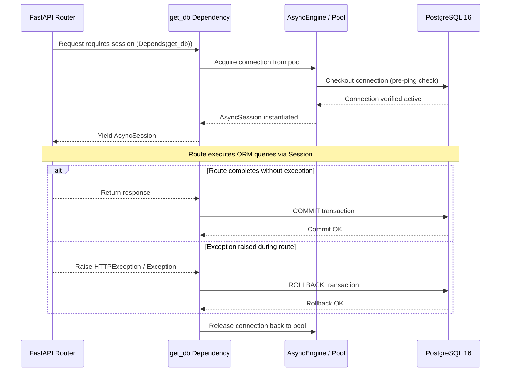

# Stage 1 — Database Layer

> **Status:** ✅ Done · **Complexity:** Medium · **Depends on:** Stage 0

---

## 1. Purpose & Problem Solved

Stage 1 designs, defines, and establishes the persistent relational backbone for the Nexus Social platform. Social networks are relational by nature: users author posts, posts attract threaded comments and likes, administrators moderate flagged items, and AI assistants record conversation histories and rate quotas.

Without a well-designed schema:
- Duplicate reactions can cause race conditions or inflated metrics.
- Unindexed feeds force expensive $O(N)$ sequential table scans under load.
- Inconsistent foreign key cascade behaviors lead to orphaned records or accidental data loss.
- Sequential integer IDs expose platform volume and invite enumeration attacks.

Stage 1 solves these challenges by implementing **11 normalized tables** using **SQLAlchemy 2.0 async ORM**, **UUID v4 primary keys**, **PostgreSQL JSONB payloads**, **Alembic migration automation**, and a **production-ready seed script**.

---

## 2. Architecture & Design Decisions

### UUID v4 vs Auto-Incrementing BigInt

**Chosen:** UUID v4 across all 11 tables (`as_uuid=True`).

**Why:** Sequential IDs (`1, 2, 3...`) leak business intelligence (e.g. total users, total posts per day) and facilitate URL scraping attacks (`/api/v1/posts/1042`). UUIDs are unpredictable, globally unique across databases and microservices, and safe for client-side generation if needed.

**Rejected:** Sequential BigInt or nanoid integers.

### Keyset (Cursor) Feed Indexing vs Offset/Limit

**Chosen:** Compound B-tree indexes on `(created_at DESC)` and `(author_id, created_at DESC)`.

**Why:** Keyset pagination queries the database with `WHERE created_at < :cursor ORDER BY created_at DESC LIMIT :limit`. This utilizes index seeks with $O(1)$ constant time performance regardless of feed depth, avoiding the severe performance degradation of `OFFSET 100000`.

**Rejected:** Traditional `OFFSET/LIMIT` for the main feed.

### Soft Deletion vs Cascading Hard Deletion

**Chosen:** Hybrid deletion model:
- `is_hidden` boolean flags on posts and comments for moderation / user hide actions.
- Hard delete on `posts` cascades to `comments` and `likes`.
- Hard delete on `users` sets `comments.author_id` to `NULL` (`ON DELETE SET NULL`) while cascading to their authored posts and tokens.

**Why:** Preserves the structural integrity of conversation threads so other users' discussions do not collapse when an individual deletes their account.

### Dual-Dialect JSON Support

**Chosen:** `JSONB().with_variant(JSON(), "sqlite")` on `notifications.payload` and `activity_logs.details`.

**Why:** Delivers native binary JSON indexing (`JSONB`) in PostgreSQL on Render while seamlessly supporting in-memory `SQLite` (`JSON`) during rapid local and CI test execution.

---

## 3. Runtime Walkthrough: Database Session Lifecycle



---

## 4. Data Model Specifications

The database consists of **11 tables**:

| Table | Primary Key | Key Foreign Keys | Key Constraints & Indexes |
|:---|:---|:---|:---|
| `users` | `id` (UUID) | None | `UNIQUE(email)`, `UNIQUE(username)` |
| `refresh_tokens` | `id` (UUID) | `user_id -> users.id (CASCADE)` | `UNIQUE(token_hash)`, `INDEX(family_id, revoked)` |
| `email_tokens` | `id` (UUID) | `user_id -> users.id (CASCADE)` | `UNIQUE(token_hash)`, `INDEX(user_id)` |
| `posts` | `id` (UUID) | `author_id -> users.id (CASCADE)` | `CHECK(length(content) <= 1000)`, `INDEX(created_at)` |
| `comments` | `id` (UUID) | `post_id -> posts.id (CASCADE)`, `parent_id -> comments.id (CASCADE)` | `CHECK(length(content) <= 500)`, `INDEX(post_id, created_at)` |
| `likes` | `id` (UUID) | `user_id -> users.id (CASCADE)`, `post_id -> posts.id (CASCADE)` | `UNIQUE(user_id, post_id)` |
| `notifications` | `id` (UUID) | `user_id -> users.id (CASCADE)` | `INDEX(user_id, is_read)`, `INDEX(created_at)` |
| `moderation_flags` | `id` (UUID) | None (loose content ref) | `INDEX(reviewed, action)`, `INDEX(content_type, content_id)` |
| `ai_chat_sessions` | `id` (UUID) | `user_id -> users.id (CASCADE)` | `INDEX(user_id)` |
| `ai_chat_messages` | `id` (UUID) | `session_id -> ai_chat_sessions.id (CASCADE)` | `INDEX(session_id)` |
| `ai_usage_logs` | `id` (UUID) | `user_id -> users.id (CASCADE)` | `INDEX(user_id, created_at)`, `INDEX(feature, status)` |
| `activity_logs` | `id` (UUID) | `admin_id -> users.id (SET NULL)` | `INDEX(admin_id, created_at)`, `INDEX(resource_type, resource_id)` |

### Health & Readiness Endpoints Touchpoint

| Method | Path | Auth | Purpose | Response |
|:---|:---|:---|:---|:---|
| `GET` | `/health` | None | Liveness probe | `200 {"status": "ok", "service": "nexus-social-api"}` |
| `GET` | `/ready` | None | Readiness probe (verifies DB) | `200 {"status": "ready", "database": "connected"}` or `503 {"status": "not_ready"}` |

---

## 5. Security Considerations

1. **Password Hashing:** Passwords are never stored in plain text. The seeder and future auth services utilize **Argon2id** (`PasswordHasher`), configured to resist GPU/ASIC cracking.
2. **Token Hash Storage:** Neither refresh tokens nor email verification tokens are stored as plaintext in the database. Only their SHA-256 digests (`token_hash`) are persisted. Even in the event of a full database leak, attackers cannot forge authentication headers.
3. **Strict Parameterization:** All queries use SQLAlchemy 2.0 ORM expressions (`select()`, `insert()`). Raw string formatting in SQL is prohibited, completely eliminating SQL injection vectors.
4. **Content Length Constraints:** Database-level `CheckConstraint` limits enforce `<= 1000` chars for posts and `<= 500` chars for comments, preventing payload-bloat attacks.

---

## 6. Annotated Walkthrough of Key Code

### Declarative Base with UUID & Timestamp Mixins (`app/db/base.py`)
```python
class Base(DeclarativeBase):
    metadata = MetaData(naming_convention=POSTGRES_NAMING_CONVENTION)

class UUIDMixin:
    id: Mapped[uuid.UUID] = mapped_column(
        Uuid(as_uuid=True), primary_key=True, default=uuid.uuid4, index=True
    )

class TimestampMixin:
    created_at: Mapped[datetime] = mapped_column(
        DateTime(timezone=True), default=lambda: datetime.now(UTC), nullable=False
    )
    updated_at: Mapped[datetime] = mapped_column(
        DateTime(timezone=True), default=lambda: datetime.now(UTC), onupdate=lambda: datetime.now(UTC)
    )
```

### Unique Reaction Constraint (`app/models/like.py`)
```python
class Like(Base, UUIDMixin):
    __tablename__ = "likes"
    user_id: Mapped[uuid.UUID] = mapped_column(Uuid(as_uuid=True), ForeignKey("users.id", ondelete="CASCADE"), nullable=False)
    post_id: Mapped[uuid.UUID] = mapped_column(Uuid(as_uuid=True), ForeignKey("posts.id", ondelete="CASCADE"), nullable=False)

    __table_args__ = (
        UniqueConstraint("user_id", "post_id", name="uq_likes_user_post"),
    )
```

### Feed Keyset Optimization (`app/models/post.py`)
```python
    __table_args__ = (
        CheckConstraint("length(content) <= 1000", name="content_length"),
        Index("ix_posts_feed_created_at", "created_at"),
        Index("ix_posts_author_created_at", "author_id", "created_at"),
    )
```

---

## 7. Testing Approach & Verification

Automated test suite (`backend/tests/`):
- `tests/test_models.py`: 9 unit tests verifying all 11 model metadata registrations, default column constraints, and token validation methods.
- `tests/test_db_integration.py`: 4 async integration tests verifying real in-memory SQLite schema creation, user creation/querying, duplicate email constraint errors, like uniqueness enforcement, and threaded comment reply hierarchies.

### How to reproduce:
```powershell
cd d:\Code\Social_Media\backend
.\.venv\Scripts\python.exe -m pytest -v tests/test_models.py tests/test_db_integration.py
```

### Seeding:
```powershell
cd d:\Code\Social_Media\backend
.\.venv\Scripts\python.exe scripts/seed.py --demo
```

---

## 8. Troubleshooting Notes

- **Alembic autogenerate name collisions:** Always define explicit naming conventions in `MetaData(naming_convention=...)` so constraint names match predictably across PostgreSQL and SQLite.
- **Asyncpg vs SQLite Dialect in Tests:** Use `.with_variant(JSON(), "sqlite")` when declaring PostgreSQL `JSONB` columns to ensure test compatibility with lightweight SQLite memory instances.
