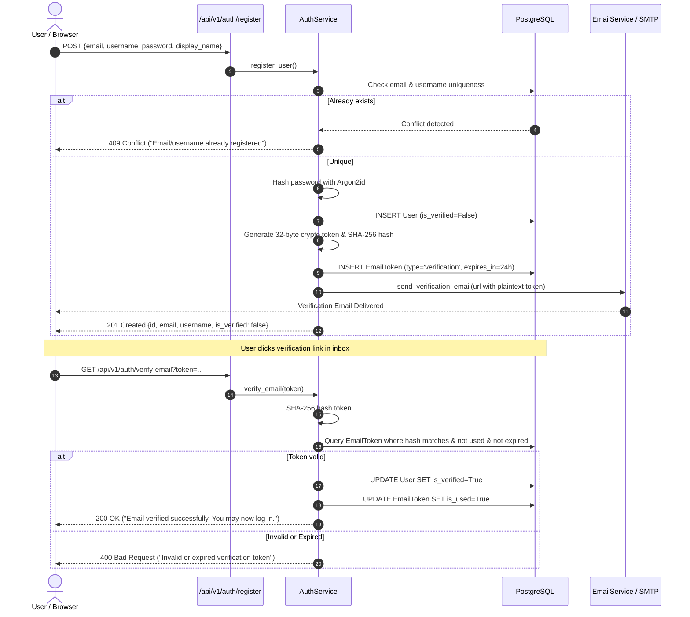
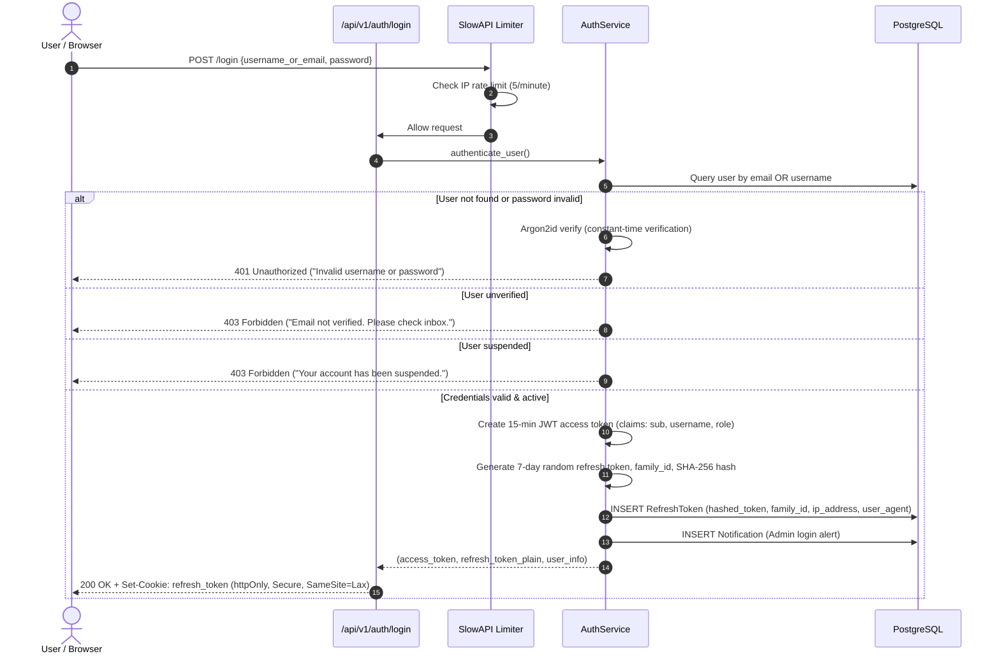
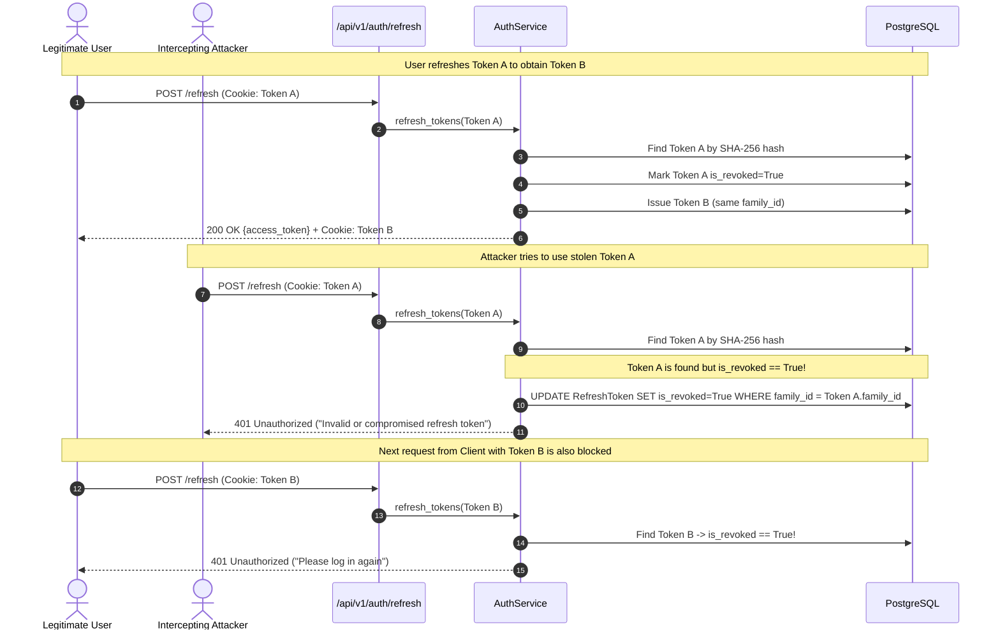

# Stage 2 — Authentication Backend

> **Status:** ✅ Done · **Complexity:** High · **Depends on:** Stage 0, Stage 1

---

## 1. Purpose & Problem Solved

Stage 2 delivers a hardened, production-ready authentication and authorization system for the Nexus Social platform. Authentication is the primary security boundary of any multi-tenant application: flaws in credential handling, session validation, or password resets can lead directly to unauthorized account takeovers, data theft, or identity spoofing.

Standard authentication implementations frequently suffer from critical vulnerabilities:
- **Token Storage Vulnerabilities:** Storing JWT access or refresh tokens in `localStorage` exposes them to Cross-Site Scripting (XSS) exfiltration.
- **Refresh Token Replay:** Statically valid refresh tokens allow an attacker who intercepts a token to maintain indefinite persistent access.
- **Credential Brute-Forcing & Enumeration:** Detailed error messages like "Email does not exist" allow attackers to harvest registered emails; un-rate-limited endpoints allow credential stuffing.
- **Suspended/Unverified Account Bypass:** Incomplete middleware checks allow unverified accounts to publish content or suspended users to access resources using stale sessions.

Stage 2 solves these vulnerabilities with an industry-standard security architecture:
1. **Argon2id Password Hashing:** Memory-hard, side-channel-resistant password hashing adhering to OWASP recommendations.
2. **Short-Lived Memory-Only Access Tokens (15 Minutes):** Access tokens are stored solely in frontend application memory (never written to `localStorage` or `sessionStorage`).
3. **Rotating Opaque Refresh Tokens with Family Reuse Detection:** 7-day refresh tokens are stored SHA-256 hashed in PostgreSQL and transmitted exclusively in `httpOnly`, `Secure`, `SameSite=Lax` cookies. When a token is refreshed, both token and child tokens rotate; if an old token is ever replayed, the entire family is revoked immediately.
4. **Single-Use Cryptographic Tokens for Email Verification and Password Resets:** 32-byte cryptographically secure random tokens (`secrets.token_urlsafe(32)`) hashed with SHA-256 before storage with strict 1-hour/24-hour expirations.
5. **Role-Based Access Control (RBAC):** FastAPI dependency injection enforcing active verification and blocking suspended accounts across all routes.
6. **Enumeration-Safe Handlers & Rate Limiting:** Uniform responses for password reset requests and IP-based rate limiting via `slowapi`.

---

## 2. Architecture & Design Decisions

### Argon2id vs bcrypt / PBKDF2

**Chosen:** `Argon2id` (via `argon2-cffi`) configured with $m=65536\text{ KB}$ (64 MiB), $t=3\text{ iterations}$, $p=4\text{ parallel threads}$.

**Why:** Argon2id is the state-of-the-art password hashing winner of the Password Hashing Competition (PHC) and is recommended by OWASP. Unlike bcrypt (which uses constant small memory and is vulnerable to GPU/ASIC acceleration), Argon2id provides memory-hard protection against hardware-accelerated dictionary attacks and time-memory trade-offs.

**Rejected:** PBKDF2 (too weak against GPUs) and plain bcrypt (limited to 72-byte passwords and vulnerable to specialized ASIC crackers).

---

### Dual-Token Architecture: In-Memory JWT + Cookie Refresh

**Chosen:**
- **Access Token:** 15-minute asymmetric or symmetric HMAC-SHA256 JWT, held purely in JavaScript runtime memory.
- **Refresh Token:** 7-day opaque random string, stored hashed in DB, delivered in an `httpOnly, Secure, SameSite=Lax` cookie.

**Why:** Eliminates XSS token theft completely: scripts injected via XSS cannot read `httpOnly` cookies, nor can they inspect memory after a page reload. Cross-Site Request Forgery (CSRF) is mitigated because the refresh endpoint requires a `POST` request with JSON content-type and modern browsers respect `SameSite=Lax` on sub-resource requests.

**Rejected:** Storing tokens in `localStorage` (vulnerable to XSS) or keeping stateful sessions in Redis for every API request (adds latency and single-point-of-failure overhead).

---

### Refresh Token Rotation with Family Reuse Detection (OAuth 2.0 BCP)

**Chosen:** Every time a client requests a new access token via `/api/v1/auth/refresh`, the presented refresh token is invalidated and a brand new refresh token is issued under the same `family_id`. If an already-used or revoked token in that family is submitted again, the system recognizes a token theft/replay attack and revokes all active tokens in that entire family immediately.

**Why:** If an attacker manages to intercept a refresh token and uses it after the legitimate user has already refreshed, the system detects the anomaly and locks out both parties, forcing re-authentication and logging a security incident.

---

### Enumeration-Safe Password Recovery

**Chosen:** `POST /api/v1/auth/forgot-password` always returns `{"detail": "If that email address is registered, a password reset link has been sent."}` regardless of whether the email was found in the database.

**Why:** Prevents malicious actors from probing the database to see which corporate or personal email addresses have registered accounts on the platform.

---

## 3. Runtime Walkthroughs & Mermaid Diagrams

### 3.1 User Registration & Verification Flow



---

### 3.2 User Login & Token Issuance



---

### 3.3 Refresh Rotation & Reuse Detection (Breach Defense)



---

## 4. Endpoint Specifications

All endpoints are mounted under `/api/v1/auth`:

| Method | Path | Auth | Rate Limit | Request Body | Response (Success) | Errors |
|---|---|---|---|---|---|---|
| `POST` | `/api/v1/auth/register` | None | 3/min | `UserRegisterRequest` | `201 Created` (`UserResponse`) | `400` (Validation), `409` (Conflict) |
| `GET` | `/api/v1/auth/verify-email` | None | None | Query param `token` | `200 OK` (`MessageResponse`) | `400` (Invalid/expired token) |
| `POST` | `/api/v1/auth/resend-verification` | None | 3/min | `ResendVerificationRequest` | `200 OK` (`MessageResponse`) | `400` (Already verified), `404` (Not found) |
| `POST` | `/api/v1/auth/login` | None | 5/min | `LoginRequest` | `200 OK` (`AuthResponse` + Cookie) | `401` (Bad creds), `403` (Unverified/Suspended) |
| `POST` | `/api/v1/auth/refresh` | Cookie | 10/min | None (reads `refresh_token` cookie) | `200 OK` (`AuthResponse` + new Cookie) | `401` (Invalid/compromised token) |
| `POST` | `/api/v1/auth/logout` | Optional | None | None (reads `refresh_token` cookie) | `200 OK` (`MessageResponse` + clears Cookie) | None |
| `GET` | `/api/v1/auth/me` | Bearer | None | None | `200 OK` (`UserResponse`) | `401` (Unauthorized), `403` (Suspended) |
| `POST` | `/api/v1/auth/forgot-password` | None | 3/min | `ForgotPasswordRequest` | `200 OK` (`MessageResponse`) | None (Enumeration-safe) |
| `POST` | `/api/v1/auth/reset-password` | None | 3/min | `ResetPasswordRequest` | `200 OK` (`MessageResponse`) | `400` (Invalid/expired token) |

---

## 5. Security Considerations

1. **Password Policy Enforcement:**
   - Client and server enforce: Minimum 8 characters, at least 1 uppercase letter, at least 1 lowercase letter, at least 1 number.
   - Handled via `app/core/security.py:validate_password_strength()` and Zod frontend schemas.
2. **Tokens Hashed at Rest:**
   - Neither refresh tokens nor email tokens are ever stored in plaintext in the database.
   - Tokens are hashed using `hashlib.sha256(token.encode()).hexdigest()`. A database compromise does not leak live credentials.
3. **Session Cookie Security Flags:**
   - `httpOnly=True` prevents JavaScript access.
   - `secure=True` enforces HTTPS in production (`False` in development for localhost testing).
   - `samesite="lax"` protects against cross-origin request forging.
   - `max_age=7 * 86400` ensures strict browser expiration.
4. **Suspension & Verification Interceptors:**
   - The `require_user` FastAPI dependency checks `if current_user.is_suspended: raise HTTPException(403)`.
   - Logging in with an unverified account raises `403 Forbidden` with a descriptive message prompting email verification.
5. **Admin Notification Dispatch on Login:**
   - Every successful login records a persistent `Notification` in the database for administrators, logging the user's name, email, IP address, and user-agent string, with a 60-second debounce window.

---

## 6. Annotated Code Walkthrough

### 6.1 Argon2id Password Hashing (`backend/app/core/security.py`)

```python
from argon2 import PasswordHasher
from argon2.exceptions import VerifyMismatchError

# OWASP Recommended Parameters
ph = PasswordHasher(
    time_cost=3,        # 3 iterations
    memory_cost=65536,  # 64 MiB
    parallelism=4,      # 4 lanes
    hash_len=32,
    salt_len=16,
)

def hash_password(password: str) -> str:
    """Hash password with Argon2id."""
    return ph.hash(password)

def verify_password(plain_password: str, hashed_password: str) -> bool:
    """Verify password against Argon2id hash in constant time."""
    try:
        return ph.verify(hashed_password, plain_password)
    except VerifyMismatchError:
        return False
```

### 6.2 Family-Based Refresh Token Rotation (`backend/app/services/auth_service.py`)

```python
# Detect reuse attack: if token already revoked, burn whole family
if db_token.is_revoked or db_token.is_expired():
    if db_token.is_revoked:
        logger.warning(
            "Compromised refresh token reuse detected! Revoking family.",
            extra={"family_id": str(db_token.family_id), "user_id": str(db_token.user_id)},
        )
        await db.execute(
            update(RefreshToken)
            .where(RefreshToken.family_id == db_token.family_id)
            .values(is_revoked=True)
        )
        await db.commit()
    raise HTTPException(
        status_code=status.HTTP_401_UNAUTHORIZED,
        detail="Invalid or compromised refresh token. Please log in again.",
    )

# Legitimate refresh: revoke current token and issue new child token in same family
db_token.is_revoked = True
new_refresh_token = generate_secure_token(32)
new_db_token = RefreshToken(
    user_id=user.id,
    hashed_token=hash_token(new_refresh_token),
    family_id=db_token.family_id,
    expires_at=datetime.now(UTC) + timedelta(days=7),
    ip_address=ip_address,
    user_agent=user_agent,
)
db.add(new_db_token)
await db.commit()
```

---

## 7. Testing Approach & Verification

### Test Suite (`backend/tests/test_auth.py`)

The authentication test suite comprehensively exercises all critical paths:
1. `test_password_policy`: Tests validation rules against weak, non-digit, non-cased, and valid passwords.
2. `test_argon2id_hashing`: Tests that hashes are unique, random, and verify cleanly.
3. `test_user_registration_and_verification`: Tests full lifecycle of user creation, unverified status, and successful email verification.
4. `test_unverified_login_blocked`: Verifies that unverified accounts receive `403 Forbidden` and cannot obtain tokens.
5. `test_token_refresh_rotation`: Verifies that refreshing rotates the token and marks the previous token revoked.
6. `test_token_reuse_detection_revokes_family`: Verifies that replaying an old refresh token invalidates all sibling tokens in that family.

### Reproducing Tests

Run the backend test suite:
```powershell
cd d:\Code\Social_Media\backend
.\.venv\Scripts\python.exe -m pytest tests
```

Expected output:
```
tests\test_auth.py ......                                                [ 28%]
tests\test_db_integration.py ....                                        [ 47%]
tests\test_health.py ..                                                  [ 57%]
tests\test_models.py .........                                           [100%]

============================= 21 passed in 13.68s =============================
```

---

## 8. Troubleshooting Notes

- **"Email not verified" on Login:** Newly registered users cannot log in until clicking the verification link or calling `/api/v1/auth/verify-email?token=...`. In development, verification tokens are logged to stdout by `EmailService` when SMTP is not configured.
- **Refresh Token Cookie Missing in Browser:** Verify `NEXT_PUBLIC_API_URL` uses the Next.js rewrite route `/api/*` so requests are same-origin and cookies are passed automatically without cross-domain third-party cookie blocking.
- **SQLite Timestamp Comparison:** In local test suites using SQLite, ensure datetime comparisons normalize offset-naive datetimes via `.replace(tzinfo=UTC)` as implemented in `models/token.py`.
