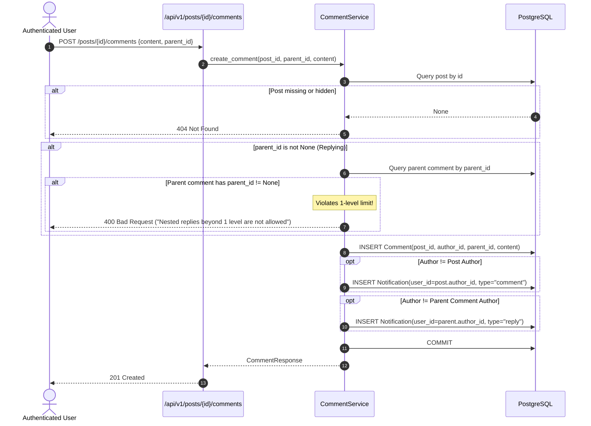
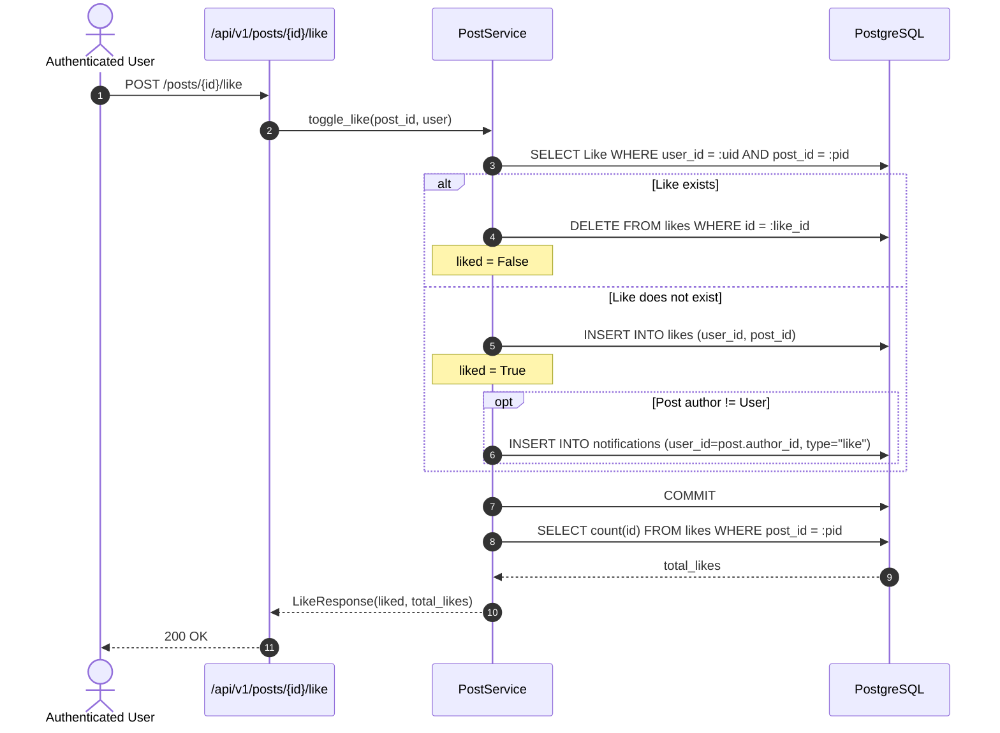

# Stage 3 — Core Social Backend

> **Status:** ✅ Done · **Complexity:** High · **Depends on:** Stage 0, Stage 1, Stage 2

---

## 1. Purpose & Problem Solved

Stage 3 builds the core social interaction engine of the Nexus Social platform. Social networks require fast, reliable, and scalable primitives for creating, consuming, and engaging with content:
- **User Profiles:** Distinct public identity, avatar support, bio, location, website, and activity stats.
- **Post Authoring & Moderation:** Publishing microblog posts ($\le 1000$ characters) with optional media URLs, in-place editing with change tracking (`is_edited`), and cascading deletion.
- **High-Performance Feeds:** Keyset cursor-based pagination that maintains constant $O(1)$ query time regardless of feed depth, eliminating duplicate or missing posts when new content is published concurrently.
- **Atomic Engagement:** Unique like toggling and real-time counter updates.
- **Structured Discussions:** Threaded comment sections enforcing a clean **1-level reply limit** to maintain mobile readability and prevent recursive tree queries.
- **Granular Authorization:** Multi-tenant ownership enforcement ensuring users can only modify their own content, while administrators retain platform-wide moderation authority.

---

## 2. Architecture & Design Decisions

### Keyset (Cursor-Based) Pagination vs Traditional Offset/Limit

**Chosen:** Compound keyset cursor based on `(created_at DESC, id DESC)`. The cursor is an opaque base64-encoded string: `base64(created_at.isoformat() + "|" + id)`.

**Why:**
- Traditional `OFFSET / LIMIT` forces the database to scan and discard $N$ rows sequentially before returning results ($O(N)$ query complexity). At page 1000, query latency spikes significantly.
- Offset pagination breaks under real-time concurrent insertions: if three new posts are added while a user scrolls from page 1 to page 2, the user sees duplicate posts on page 2.
- Keyset pagination executes indexed seeks using `WHERE (created_at < :cursor_dt) OR (created_at == :cursor_dt AND id < :cursor_id) ORDER BY created_at DESC, id DESC LIMIT :limit`. This runs in constant $O(1)$ time and guarantees zero duplicate or skipped records.

**Rejected:** `OFFSET / LIMIT` for feeds.

---

### Strict 1-Level Comment Replies vs Unbounded Tree Nesting

**Chosen:** Flat 1-level replies. Comments can have `parent_id = NULL` (top-level) or `parent_id = top_level_comment.id` (direct reply). Attempting to reply to a reply is rejected with `400 Bad Request`.

**Why:**
- Unbounded tree hierarchies (arbitrary nesting depth) create complex nested UI trees that degrade mobile UX.
- In database queries, unbounded trees necessitate recursive Common Table Expressions (CTEs) or complex adjacency list traversals.
- A 1-level model allows all comments for a post to be retrieved in a single indexed query (`WHERE post_id = :id ORDER BY created_at ASC`) and assembled in $O(N)$ linear time in memory.

**Rejected:** Deeply recursive comment trees and materialized path trees.

---

### Batch Aggregation vs N+1 Query Overhead

**Chosen:** Multi-item feed requests retrieve post entities and then perform exactly **3 targeted batch queries** using SQL `IN (:post_ids)` and `GROUP BY`:
1. Total likes count per post.
2. Total active comments count per post.
3. Viewer's liked post set (`user_id = :current_user_id AND post_id IN (:post_ids)`).

**Why:** Fetching likes and comments via naive ORM property lookups causes $2 \times N$ database round-trips for $N$ posts (the classic $N+1$ problem). The batch strategy maintains a constant query count ($O(1)$ database trips) whether loading 5 or 50 posts.

**Rejected:** Individual subqueries per post row or separate API calls from the client.

---

## 3. Runtime Walkthroughs & Mermaid Diagrams

### 3.1 Keyset Cursor Feed Retrieval

```mermaid
sequenceDiagram
    autonumber
    actor Client as Browser / Mobile
    participant API as /api/v1/posts
    participant Service as PostService
    participant DB as PostgreSQL

    Client->>API: GET /posts?limit=20&cursor=...&feed_type=all
    API->>Service: get_feed(cursor, limit=20, feed_type)
    alt Cursor provided
        Service->>Service: Decode base64 cursor -> (created_at, post_id)
        Service->>DB: SELECT Post WHERE created_at < cursor ORDER BY created_at DESC, id DESC LIMIT 21
    else No cursor (Initial page)
        Service->>DB: SELECT Post WHERE is_hidden=false ORDER BY created_at DESC, id DESC LIMIT 21
    end

    DB-->>Service: Return up to 21 posts
    Service->>Service: has_more = (len > 20); posts = posts[:20]
    Service->>Service: Extract post_ids list

    par Batch Counts & Likes
        Service->>DB: SELECT post_id, count(id) FROM likes WHERE post_id IN (ids) GROUP BY post_id
        Service->>DB: SELECT post_id, count(id) FROM comments WHERE post_id IN (ids) AND is_hidden=false GROUP BY post_id
        Service->>DB: SELECT post_id FROM likes WHERE post_id IN (ids) AND user_id = :viewer_id
    end

    DB-->>Service: Batch metrics returned
    Service->>Service: Compute next_cursor = base64(posts[-1].created_at + "|" + posts[-1].id)
    Service-->>API: FeedResponse(items, next_cursor, has_more)
    API-->>Client: 200 OK JSON
```

---

### 3.2 Comment Threading & 1-Level Reply Enforcement



---

### 3.3 Atomic Like Toggle & Notification Trigger



---

## 4. Endpoint Specifications

### Posts & Interactions (`/api/v1/posts`)

| Method | Path | Auth | Request Body | Response (Success) | Errors |
|---|---|---|---|---|---|
| `GET` | `/api/v1/posts` | Optional | None (`?cursor=&limit=&feed_type=`) | `200 OK` (`FeedResponse`) | `400` (Bad cursor) |
| `POST` | `/api/v1/posts` | Bearer | `PostCreate` | `201 Created` (`PostResponse`) | `400`, `401`, `403`, `422` |
| `GET` | `/api/v1/posts/{id}` | Optional | None | `200 OK` (`PostResponse`) | `404` (Not found / hidden) |
| `PUT` | `/api/v1/posts/{id}` | Bearer | `PostUpdate` | `200 OK` (`PostResponse`) | `403` (Unauthorized), `404` |
| `DELETE` | `/api/v1/posts/{id}` | Bearer | None | `204 No Content` | `403` (Unauthorized), `404` |
| `POST` | `/api/v1/posts/{id}/like` | Bearer | None | `200 OK` (`LikeResponse`) | `401`, `403`, `404` |
| `GET` | `/api/v1/posts/{id}/comments` | Optional | None | `200 OK` (`list[CommentResponse]`) | `404` |
| `POST` | `/api/v1/posts/{id}/comments` | Bearer | `CommentCreate` | `201 Created` (`CommentResponse`) | `400` (Nesting error), `404` |

### Comments (`/api/v1/comments`)

| Method | Path | Auth | Request Body | Response (Success) | Errors |
|---|---|---|---|---|---|
| `PUT` | `/api/v1/comments/{id}` | Bearer | `CommentUpdate` | `200 OK` (`CommentResponse`) | `403` (Unauthorized), `404` |
| `DELETE` | `/api/v1/comments/{id}` | Bearer | None | `204 No Content` | `403` (Unauthorized), `404` |

### User Profiles (`/api/v1/users`)

| Method | Path | Auth | Request Body | Response (Success) | Errors |
|---|---|---|---|---|---|
| `GET` | `/api/v1/users/me` | Bearer | None | `200 OK` (`UserResponse`) | `401`, `403` |
| `PUT` | `/api/v1/users/me` | Bearer | `UserUpdate` | `200 OK` (`UserResponse`) | `401`, `403`, `422` |
| `POST` | `/api/v1/users/me/change-password` | Bearer | `ChangePasswordRequest` | `200 OK` (`MessageResponse`) | `400` (Bad pass), `422` |
| `GET` | `/api/v1/users/{identifier}` | Optional | None | `200 OK` (`UserProfileResponse`) | `404` |
| `GET` | `/api/v1/users/{username}/posts` | Optional | None (`?cursor=&limit=`) | `200 OK` (`FeedResponse`) | `404` |

---

## 5. Security & Authorization Considerations

1. **Granular Ownership Enforcement:**
   - Both `PostService` and `CommentService` enforce strict authorization: only the record author (`author_id == user.id`) or a user with `role == "admin"` may edit or delete content. Attempted modifications by other authenticated users raise `403 Forbidden`.
2. **Input Validation & Sanitization:**
   - Post content is strictly bounded: $\ge 1$ and $\le 1000$ characters. Whitespace-only submissions are trimmed and rejected with `422 Unprocessable Entity`.
   - Comment content is bounded to $\le 500$ characters.
   - Pydantic validators reject excessive lengths before requests reach the database layer.
3. **Session Revocation on Password Change:**
   - Changing password via `POST /api/v1/users/me/change-password` immediately updates the user's Argon2id password hash and marks all active refresh tokens in `refresh_tokens` as `revoked=True`, preventing unauthorized persistence across existing sessions.
4. **Parameterized Query Safety:**
   - All database reads and writes execute via SQLAlchemy 2.0 ORM query builders and `asyncpg` parameter binding. No raw SQL concatenation exists anywhere in the codebase.
5. **Soft-Hide Visibility Controls:**
   - Posts or comments flagged with `is_hidden=True` return `404 Not Found` to standard users and unauthenticated visitors, hiding moderated content from public view while preserving records for administrative review.

---

## 6. Annotated Code Walkthrough

### 6.1 Compound Keyset Cursor Pagination (`backend/app/services/post_service.py`)

```python
def encode_cursor(created_at: datetime, item_id: uuid.UUID) -> str:
    """Encode created_at datetime and item UUID into an opaque base64 cursor."""
    raw = f"{created_at.isoformat()}|{item_id}"
    return base64.urlsafe_b64encode(raw.encode("utf-8")).decode("utf-8")

# In get_feed():
if cursor:
    decoded = decode_cursor(cursor)
    if decoded:
        cursor_dt, cursor_id = decoded
        query = query.where(
            (Post.created_at < cursor_dt)
            | ((Post.created_at == cursor_dt) & (Post.id < cursor_id))
        )
query = query.order_by(Post.created_at.desc(), Post.id.desc()).limit(limit + 1)
```

### 6.2 Strict 1-Level Reply Check (`backend/app/services/comment_service.py`)

```python
if data.parent_id:
    parent_query = (
        select(Comment)
        .options(selectinload(Comment.author))
        .where(Comment.id == data.parent_id, Comment.post_id == post_id)
    )
    parent_comment = (await db.execute(parent_query)).scalar_one_or_none()

    if not parent_comment or parent_comment.is_hidden:
        raise HTTPException(status_code=status.HTTP_404_NOT_FOUND, detail="Parent comment not found.")

    # Strict 1-level nesting check: replies cannot have replies
    if parent_comment.parent_id is not None:
        raise HTTPException(
            status_code=status.HTTP_400_BAD_REQUEST,
            detail="Nested replies beyond 1 level are not allowed.",
        )
```

---

## 7. Testing Approach & Verification

The Stage 3 test suite in [`backend/tests/test_social.py`](file:///d:/Code/Social_Media/backend/tests/test_social.py) covers all functional requirements:
- `test_create_post_success`: Post creation with metadata and author details.
- `test_post_length_and_whitespace_validation`: Rejection of content exceeding 1000 characters or consisting only of whitespace.
- `test_update_own_post`: Author edits with `is_edited=True` flag update.
- `test_post_authorization_edit_and_delete`: Ownership enforcement (stranger receives 403; admin receives 200/204).
- `test_cursor_feed_pagination_and_filtering`: Keyset pagination across multiple pages and "All" vs "Mine" filtering.
- `test_like_toggle_and_notifications`: Like toggle, atomic like count updates, and database notification persistence.
- `test_comments_and_one_level_replies`: Top-level comment, 1-level reply, 2nd-level reply rejection, and notification delivery.
- `test_user_profiles_and_password_changes`: Profile retrieval, profile updates, and password change with refresh token revocation.

### Reproducing Tests

```powershell
cd d:\Code\Social_Media\backend
.\.venv\Scripts\python.exe -m pytest tests
```

Expected output:
```
tests\test_auth.py ......                                                [ 20%]
tests\test_db_integration.py ....                                        [ 34%]
tests\test_health.py ..                                                  [ 41%]
tests\test_models.py .........                                           [ 72%]
tests\test_social.py ........                                            [100%]

============================= 29 passed in 14.73s =============================
```

---

## 8. Troubleshooting Notes

- **"Nested replies beyond 1 level are not allowed" (400):** If a client attempts to pass a `parent_id` pointing to an existing reply rather than a top-level comment, this error is thrown. The client UI should reply to the parent thread or top-level comment.
- **Empty Feed on `feed_type=mine`:** Ensure the request includes a valid `Authorization: Bearer <token>` header; unauthenticated calls to `feed_type=mine` return an empty list.
- **Unique Constraint Violation on Likes:** If concurrent like toggles occur, the database unique constraint `uq_likes_user_post` protects data integrity; callers should retry.
