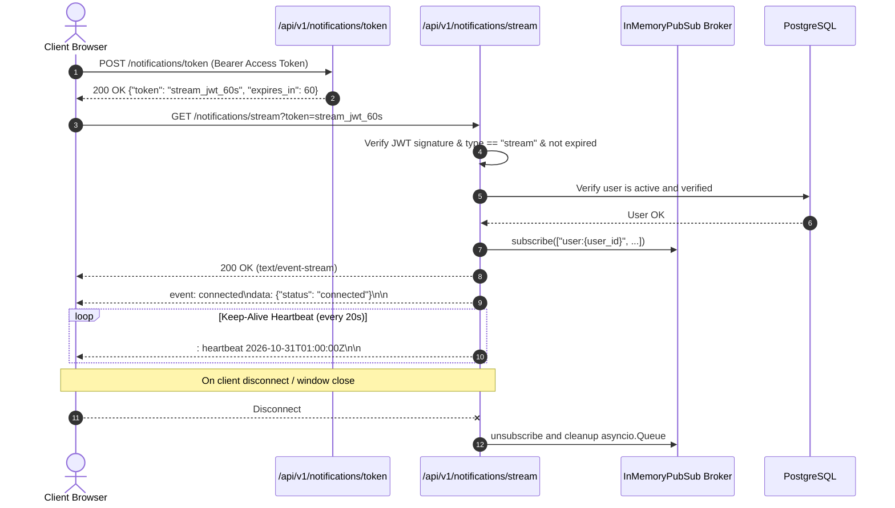
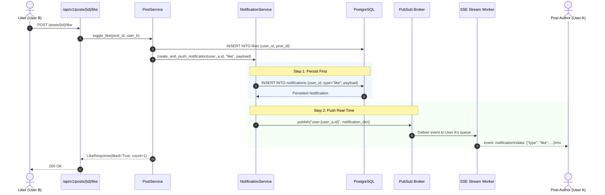

# Stage 4 — Notifications & Real-Time Server-Sent Events (SSE)

> **Status:** ✅ Done · **Complexity:** High · **Depends on:** Stage 0, Stage 1, Stage 2, Stage 3

---

## 1. Purpose & Problem Solved

Stage 4 equips Nexus Social with a resilient, low-latency real-time notification engine. Modern social networks demand immediate feedback: users expect to be notified instantaneously when someone likes their post, replies to their comment, or flags content, while platform administrators require immediate visibility into critical events such as successful user logins and safety escalations.

Traditional approaches suffer from notable trade-offs:
- **Aggressive REST Polling:** Polling every 2–5 seconds creates unnecessary database load, CPU wakeups, and high network egress costs with high latency.
- **WebSocket Overhead:** Full-duplex WebSockets introduce protocol upgrade complexity, stateful load balancer affinity requirements, and firewall traversal friction for what is primarily a unidirectional (server-to-client) push.
- **Delivery Guarantees:** Ephemeral push channels (e.g. pure WebSockets or message brokers without persistence) risk losing notifications if a user experiences a momentary network drop.

Stage 4 solves these challenges by combining:
1. **Always Persist First, Then Push:** Every event is committed to PostgreSQL before being published to the pub/sub bus, guaranteeing that missed events can be retrieved upon reconnection.
2. **Server-Sent Events (SSE):** Lightweight, unidirectional, HTTP-compliant streaming with native browser reconnect semantics.
3. **Short-Lived (60s) Single-Purpose Stream Tokens:** Resolves the browser `EventSource` limitation (which cannot attach custom HTTP headers) while preventing access token leakage in query strings or server access logs.
4. **Abstract Pub/Sub Bus:** Pluggable in-memory event bus behind `BasePubSub`, ready for horizontal scaling with Redis.
5. **Periodic Heartbeat Pings (~20s):** SSE comment lines (`: heartbeat`) maintain connection liveness across reverse proxies, load balancers, and NAT timeouts.
6. **Real-Time Admin Login Alerts:** Persisted login notifications dispatched live to connected administrators with 60-second duplicate debouncing per user.

---

## 2. Architecture & Design Decisions

### Server-Sent Events (SSE) vs WebSockets

**Chosen:** Server-Sent Events (`text/event-stream`) over standard HTTP/1.1 and HTTP/2.

**Why:**
- Notifications on a social platform are inherently unidirectional (server pushing events to the client).
- SSE runs over standard HTTP without requiring a protocol upgrade (`101 Switching Protocols`), traversing enterprise firewalls, CDN edges, and reverse proxies effortlessly.
- Standard browser `EventSource` provides automatic reconnection and stream resumption out of the box.
- Lower memory footprint per connection compared to bidirectional WebSocket frames.

**Rejected:** WebSockets (unnecessary bidirectional complexity and protocol overhead for notification feeds) and Long-Polling (redundant connection setup overhead).

---

### 60-Second Single-Purpose Stream Tokens vs URL Access Tokens

**Chosen:** `POST /api/v1/notifications/token` generates a short-lived (60s) JWT with claim `type: "stream"` used exclusively in `GET /api/v1/notifications/stream?token=...`.

**Why:**
- The standard browser `EventSource` API does not allow setting custom `Authorization: Bearer <token>` HTTP request headers.
- Placing 15-minute primary access tokens in URLs risks exposing them in browser histories, proxy logs, and `Referer` headers.
- The 60-second stream token is single-purpose: even if intercepted from an access log, it cannot be used to authenticate REST endpoints and expires in 60 seconds.

**Rejected:** Passing primary JWT access tokens in query parameters or relying on cross-origin cookies.

---

### Pluggable Pub/Sub Interface (`BasePubSub`) & Redis Upgrade Path

**Chosen:** In-process asyncio queue broker implementing `BasePubSub`, maintaining channel subscriptions for `user:{user_id}` and `admin`.

**Why:**
- Single-instance deployments run efficiently with zero external infrastructure dependencies.
- The abstract interface decouples notification dispatch from transport mechanics.

#### Horizontal Scaling / Redis Migration

To scale across multiple container instances (e.g. Render autoscaling, Kubernetes, or multi-dyno deployments), replace `InMemoryPubSub` with a `RedisPubSub` adapter backed by `redis.asyncio`:

```python
import redis.asyncio as redis
import json

class RedisPubSub(BasePubSub):
    def __init__(self, redis_url: str):
        self.redis = redis.from_url(redis_url)

    async def publish(self, channel: str, message: dict[str, Any]) -> None:
        await self.redis.publish(channel, json.dumps(message))

    async def subscribe(self, channel: str | list[str]) -> AsyncGenerator[dict[str, Any], None]:
        channels = [channel] if isinstance(channel, str) else list(channel)
        pubsub = self.redis.pubsub()
        await pubsub.subscribe(*channels)
        try:
            async for msg in pubsub.listen():
                if msg["type"] == "message":
                    yield json.loads(msg["data"])
        finally:
            await pubsub.unsubscribe(*channels)
            await pubsub.aclose()
```

---

## 3. Runtime Walkthroughs & Mermaid Diagrams

### 3.1 SSE Connection Lifecycle & Stream Token Authentication



---

### 3.2 Real-Time Event Dispatch: Like Notification



---

### 3.3 Real-Time Admin Login Alert Dispatch

```mermaid
sequenceDiagram
    autonumber
    actor User as Logging-In User
    participant AuthAPI as /api/v1/auth/login
    participant AuthSvc as AuthService
    participant NotifSvc as NotificationService
    participant DB as PostgreSQL
    participant PubSub as PubSub Broker
    actor Admin as Connected Admin

    User->>AuthAPI: POST /login {username, password}
    AuthAPI->>AuthSvc: authenticate_user()
    AuthSvc->>DB: Validate credentials & record refresh token
    AuthSvc->>NotifSvc: notify_admins_of_login(user, ip, ua)
    NotifSvc->>DB: Check if admin_login notification for this user exists within 60s
    alt Not debounced (First login in 60s)
        NotifSvc->>DB: Query active admin user IDs
        loop For each admin
            NotifSvc->>DB: INSERT INTO notifications (admin_id, "admin_login", payload)
        end
        NotifSvc->>PubSub: publish("admin", {"event": "admin_alert", ...})
        PubSub-->>Admin: event: admin_alert\ndata: {"login_user_id": ..., "username": ...}\n\n
    else Debounced (Within 60s)
        Note over NotifSvc: Duplicate suppressed; no DB write or broadcast
    end
    AuthSvc-->>AuthAPI: (access_token, refresh_token, user)
    AuthAPI-->>User: 200 OK + Set-Cookie
```

---

## 4. Endpoint Specifications

All endpoints are mounted under `/api/v1/notifications`:

| Method | Path | Auth | Description | Response (Success) | Errors |
|---|---|---|---|---|---|
| `GET` | `/api/v1/notifications` | Bearer | List paginated notifications (`?unread_only=&limit=&cursor=`) | `200 OK` (`NotificationListResponse`) | `401`, `403` |
| `GET` | `/api/v1/notifications/unread-count` | Bearer | Retrieve total unread notifications count for badge | `200 OK` (`UnreadCountResponse`) | `401`, `403` |
| `PATCH` | `/api/v1/notifications/{id}/read` | Bearer | Mark a single notification as read | `200 OK` (`NotificationResponse`) | `401`, `403`, `404` |
| `PATCH` | `/api/v1/notifications/read-all` | Bearer | Mark all unread notifications as read | `200 OK` (`MessageResponse`) | `401`, `403` |
| `POST` | `/api/v1/notifications/token` | Bearer | Generate a 60-second single-purpose stream token | `200 OK` (`StreamTokenResponse`) | `401`, `403` |
| `GET` | `/api/v1/notifications/stream` | Stream Token | Server-Sent Events stream (`?token=...`) | `200 OK` (`text/event-stream`) | `401`, `403` |

---

## 5. Security Considerations

1. **Short-Lived Stream Tokens:** Stream tokens expire in 60 seconds and only contain permission claim `type: "stream"`. If logged by intermediary HTTP proxies, they cannot be used to authenticate regular REST endpoints.
2. **Channel Isolation:** The pub/sub broker strictly segregates channels by user ID (`user:{user_id}`). A user can only receive events intended for their account. The shared `admin` broadcast channel is exclusively subscribed to if the user has `role == "admin"`.
3. **Heartbeat & Proxy Buffering Prevention:**
   - Responses include `X-Accel-Buffering: no` to instruct Nginx and cloud proxies not to buffer event chunks.
   - Comment heartbeats (`: heartbeat <timestamp>`) are sent every ~20 seconds to prevent NAT, gateway, and ELB idle timeout connection drops.
4. **Graceful Disconnect Cleanup:** When an SSE client disconnects or closes a browser tab, `asyncio.CancelledError` is handled, and the queue is removed from the pub/sub channel set, preventing memory leaks.
5. **Debouncing Sensitive Events:** Admin login notifications are debounced per user within a 60-second window, preventing notification storms during rapid re-authentication.

---

## 6. Annotated Code Walkthrough

### 6.1 Server-Sent Events Stream Generator (`backend/app/api/v1/notifications.py`)

```python
async def sse_event_generator(user: User, request: Request) -> AsyncGenerator[str, None]:
    channels = [f"user:{user.id}"]
    if user.role == "admin":
        channels.append("admin")

    initial_event = json.dumps({"status": "connected", "user_id": str(user.id)})
    yield f"event: connected\ndata: {initial_event}\n\n"

    subscriber = pubsub.subscribe(channels)
    try:
        while True:
            if await request.is_disconnected():
                break
            try:
                msg = await asyncio.wait_for(subscriber.__anext__(), timeout=20.0)
                event_type = msg.get("event", "notification")
                event_data = json.dumps(msg.get("data", {}))
                yield f"event: {event_type}\ndata: {event_data}\n\n"
            except TimeoutError:
                # Keep-alive comment line (ignored by EventSource parser)
                now_str = datetime.now(UTC).isoformat()
                yield f": heartbeat {now_str}\n\n"
            except StopAsyncIteration:
                break
    except asyncio.CancelledError:
        pass
    finally:
        await subscriber.aclose()
```

### 6.2 Guaranteed Delivery: Persist Before Push (`backend/app/services/notification_service.py`)

```python
# Step 1: Persist to PostgreSQL first
notif = Notification(
    id=uuid.uuid4(),
    user_id=user_id,
    type=type,
    payload=payload,
    is_read=False,
)
db.add(notif)
await db.commit()
await db.refresh(notif)

# Step 2: Push to pub/sub
event_dict = NotificationResponse.model_validate(notif).model_dump(mode="json")
await pubsub.publish(f"user:{user_id}", {"event": "notification", "data": event_dict})
```

---

## 7. Testing Approach & Verification

The test suite in [`backend/tests/test_notifications.py`](file:///d:/Code/Social_Media/backend/tests/test_notifications.py) exercises all critical paths:
1. `test_notifications_crud_and_read_status`: Verifies notification persistence, unread counting, single mark-as-read, unread-only filtering, and bulk mark-all-read.
2. `test_stream_token_generation_and_stream`: Verifies generating a 60s stream token, opening an HTTP streaming connection (`aiter_lines`), and receiving the initial `event: connected` payload.
3. `test_stream_invalid_token_rejected`: Verifies that invalid or forged stream tokens are rejected with `401 Unauthorized`.
4. `test_pubsub_realtime_event_delivery`: Verifies in-process pub/sub publish and subscribe delivery across async queues.
5. `test_admin_login_notification_and_debouncing`: Verifies that a normal user login generates an administrative alert notification, and that an immediate subsequent login within 60 seconds is cleanly debounced.

### Reproducing Tests

```powershell
cd d:\Code\Social_Media\backend
.\.venv\Scripts\python.exe -m pytest tests
```

Expected output:
```
tests\test_auth.py ......                                                [ 17%]
tests\test_db_integration.py ....                                        [ 29%]
tests\test_health.py ..                                                  [ 35%]
tests\test_models.py .........                                           [ 61%]
tests\test_notifications.py .....                                        [ 76%]
tests\test_social.py ........                                            [100%]

============================= 34 passed in 35.46s =============================
```

---

## 8. Troubleshooting Notes

- **Browser Closes Connection After 45 Seconds:** When running behind Nginx or AWS ALB, ensure proxies have `proxy_read_timeout 3600s;` and do not buffer chunks. The 20-second heartbeat comment lines prevent intermediate idle timeouts.
- **EventSource Not Passing Headers:** Browser `EventSource` cannot send custom headers. Always call `POST /api/v1/notifications/token` to acquire a 60-second token and append it as `?token=...`.
- **Duplicate Admin Notifications:** If multiple logins occur within 60 seconds, notifications are intentionally suppressed per the 60s debounce window.
