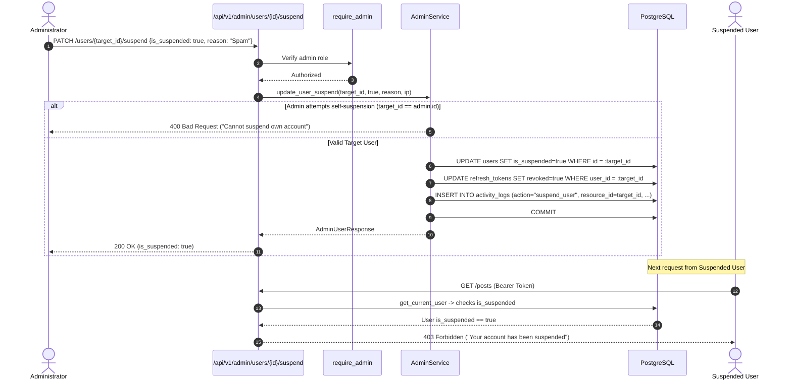
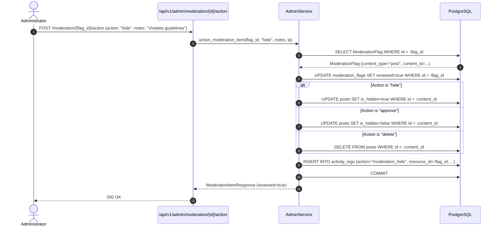

# Stage 5 — Admin Management Backend

> **Status:** ✅ Done · **Complexity:** High · **Depends on:** Stage 0, Stage 1, Stage 2, Stage 3, Stage 4

---

## 1. Purpose & Problem Solved

Stage 5 equips Nexus Social with a dedicated, secure administrative backend for platform supervision, moderation, and operational visibility. Without robust administrative controls:
- **Abusive or illegal content** cannot be quickly suppressed or remediated.
- **Bad actors and compromised accounts** cannot be locked out or de-authorized.
- **Platform health and activity trends** remain opaque without reliable metrics and time-series telemetry.
- **Administrative actions** lack an immutable audit trail, creating liability and compliance risks.

Stage 5 solves these operational requirements by delivering:
1. **Executive KPI Stat Cards:** Instantaneous aggregation of total users, verified users, new users (7-day window), posts, comments, likes, and unresolved moderation items.
2. **30-Day Time-Series Analytics:** Daily volume trends for user registrations and post creations, with dual-dialect database compatibility.
3. **User Administration:** Searchable, paginated user management with role elevation (`user` $\leftrightarrow$ `admin`), instant suspension (with immediate session token revocation), and permanent deletion.
4. **Content Moderation:** Search and filter tools for posts and comments, individual soft-hide toggles, cascading deletion, and atomic bulk moderation actions.
5. **Moderation Queue:** Central triage workspace for items flagged by AI scanners or user reports, displaying category, severity, confidence score, and contextual content snippet preview.
6. **Immutable Audit Trail:** Automatic recording of every administrative modification into `activity_logs` with admin identity, action name, resource details, and originating client IP address.
7. **Self-Action Safety Guards:** Strict logic preventing administrators from suspending, demoting, or deleting their own accounts.

---

## 2. Architecture & Design Decisions

### Dual-Dialect Time-Series Aggregation vs Database-Specific Date Truncation

**Chosen:** Query the 30-day time window (`created_at >= start_date`) and aggregate daily frequencies in-memory using Python's `datetime.strftime("%Y-%m-%d")` against a pre-initialized 30-day map.

**Why:**
- PostgreSQL utilizes `date_trunc('day', created_at)` or `TO_CHAR()`, whereas SQLite utilizes `strftime('%Y-%m-%d', created_at)`. Writing dialect-specific SQL functions complicates migrations and risks subtle test/prod discrepancies.
- Querying timestamps within the 30-day window and bucket-sorting in memory executes in sub-millisecond time for thousands of rows and guarantees that all 30 days are present in the response with `0` counts if no events occurred.

**Rejected:** Raw SQL `date_trunc` with PostgreSQL-only dependencies or complex database-level calendar generation views.

---

### Immediate Session Invalidation on User Suspension

**Chosen:** When an administrator suspends an account (`PATCH /api/v1/admin/users/{id}/suspend` with `is_suspended=True`), the system immediately executes `UPDATE refresh_tokens SET revoked=true WHERE user_id = :id`.

**Why:**
- Simply setting `users.is_suspended = True` prevents future logins and blocks API endpoints guarded by `get_current_user`. However, revoking all refresh tokens immediately ensures that the suspended client cannot rotate their session to acquire new tokens.
- Even if a suspended user possesses an active 15-minute access token, every protected route checks `user.is_suspended` on every request via FastAPI dependency injection, cutting off access instantly.

**Rejected:** Waiting for refresh tokens to naturally expire (up to 7 days).

---

### Centralized Immutable Audit Logging (`log_admin_action`)

**Chosen:** Every administrative mutating operation routes through a central helper `AdminService.log_action()`, recording the event into `activity_logs` within the same transaction or immediately upon commit.

**Why:** Ensures consistency across all administrative operations (user updates, post deletions, moderation actions, and bulk operations), preserving compliance details, metadata, and remote IP addresses.

---

## 3. Runtime Walkthroughs & Mermaid Diagrams

### 3.1 User Suspension & Session Revocation



---

### 3.2 Moderation Queue Item Resolution



---

## 4. Endpoint Specifications

All endpoints are mounted under `/api/v1/admin` and require `role == "admin"`:

| Method | Path | Description | Request Body | Response (Success) | Errors |
|---|---|---|---|---|---|
| `GET` | `/api/v1/admin/stats` | KPI dashboard metric cards | None | `200 OK` (`AdminStatsResponse`) | `401`, `403` |
| `GET` | `/api/v1/admin/charts` | 30-day signup & post time-series | None | `200 OK` (`ChartDataResponse`) | `401`, `403` |
| `GET` | `/api/v1/admin/users` | Search & paginate users | Query (`search`, `role`, `is_suspended`, `page`, `page_size`) | `200 OK` (`AdminUserListResponse`) | `401`, `403` |
| `PATCH` | `/api/v1/admin/users/{id}/suspend` | Suspend/unsuspend user & revoke tokens | `UserSuspendUpdate` | `200 OK` (`AdminUserResponse`) | `400` (Self-action), `404` |
| `PATCH` | `/api/v1/admin/users/{id}/role` | Promote/demote role (`user`/`admin`) | `UserRoleUpdate` | `200 OK` (`AdminUserResponse`) | `400` (Self-action), `404` |
| `DELETE` | `/api/v1/admin/users/{id}` | Permanently delete user | None | `204 No Content` | `400` (Self-action), `404` |
| `GET` | `/api/v1/admin/posts` | Search/filter posts (incl. hidden) | Query (`search`, `is_hidden`, `author_id`, `page`) | `200 OK` (`AdminPostListResponse`) | `401`, `403` |
| `PATCH` | `/api/v1/admin/posts/{id}/hide` | Toggle soft-hide on post | `ToggleHideRequest` | `200 OK` (`AdminPostResponse`) | `401`, `403`, `404` |
| `DELETE` | `/api/v1/admin/posts/{id}` | Permanently delete post | None | `204 No Content` | `401`, `403`, `404` |
| `POST` | `/api/v1/admin/posts/bulk` | Bulk hide/restore/delete posts | `BulkActionRequest` | `200 OK` (`MessageResponse`) | `400`, `401`, `403` |
| `GET` | `/api/v1/admin/comments` | Search/filter comments | Query (`search`, `is_hidden`, `post_id`, `page`) | `200 OK` (`AdminCommentListResponse`) | `401`, `403` |
| `PATCH` | `/api/v1/admin/comments/{id}/hide` | Toggle soft-hide on comment | `ToggleHideRequest` | `200 OK` (`AdminCommentResponse`) | `401`, `403`, `404` |
| `DELETE` | `/api/v1/admin/comments/{id}` | Permanently delete comment | None | `204 No Content` | `401`, `403`, `404` |
| `POST` | `/api/v1/admin/comments/bulk` | Bulk hide/restore/delete comments | `BulkActionRequest` | `200 OK` (`MessageResponse`) | `400`, `401`, `403` |
| `GET` | `/api/v1/admin/moderation` | List unreviewed moderation flags | Query (`category`, `severity`, `reviewed`, `page`) | `200 OK` (`ModerationQueueResponse`) | `401`, `403` |
| `POST` | `/api/v1/admin/moderation/{id}/action` | Resolve flagged item | `ModerationActionRequest` | `200 OK` (`ModerationItemResponse`) | `400`, `401`, `404` |
| `GET` | `/api/v1/admin/activity-logs` | Query administrative audit logs | Query (`action`, `resource_type`, `page`) | `200 OK` (`ActivityLogListResponse`) | `401`, `403` |

---

## 5. Security & Authorization Considerations

1. **Strict RBAC Enforcement:** Every route under `/api/v1/admin` enforces `Depends(require_admin)`. Non-admin users receive an immediate `403 Forbidden` response.
2. **Immutable Audit Trail:** Every administrative operation creates an `ActivityLog` entry recording `admin_id`, `action`, `resource_type`, `resource_id`, structured JSON details, and client IP address. Audit logs have no delete or update routes.
3. **Self-Action Prevention:** An administrator cannot suspend, demote, or delete their own account. Attempting to target one's own UUID raises `400 Bad Request`, preventing accidental administrative lockouts.
4. **Immediate Session Termination:** Suspending a user revokes all active refresh tokens in `refresh_tokens`, terminating all persistent sessions across all devices immediately.

---

## 6. Annotated Code Walkthrough

### 6.1 Dual-Dialect 30-Day Time-Series (`backend/app/services/admin_service.py`)

```python
start_date = (datetime.now(UTC) - timedelta(days=29)).date()
dates = [(start_date + timedelta(days=i)).strftime("%Y-%m-%d") for i in range(30)]
signups_map = {d: 0 for d in dates}
posts_map = {d: 0 for d in dates}

cutoff_dt = datetime.combine(start_date, datetime.min.time(), tzinfo=UTC)

# Query signups in last 30 days
users_stmt = select(User.created_at).where(User.created_at >= cutoff_dt)
for created_at in (await db.execute(users_stmt)).scalars():
    key = created_at.strftime("%Y-%m-%d")
    if key in signups_map:
        signups_map[key] += 1
```

### 6.2 Self-Suspension Prevention & Token Burn (`backend/app/services/admin_service.py`)

```python
if user_id == admin.id:
    raise HTTPException(
        status_code=status.HTTP_400_BAD_REQUEST,
        detail="Administrators cannot suspend their own account.",
    )

user.is_suspended = is_suspended

# If suspending, immediately invalidate all active refresh tokens
if is_suspended:
    await db.execute(
        update(RefreshToken).where(RefreshToken.user_id == user_id).values(revoked=True)
    )
await db.commit()
```

---

## 7. Testing Approach & Verification

The Stage 5 test suite in [`backend/tests/test_admin.py`](file:///d:/Code/Social_Media/backend/tests/test_admin.py) covers all functional areas:
1. `test_admin_stats_and_charts`: Verifies that regular users receive 403 Forbidden on `/stats`, administrators receive accurate counts for all 7 KPI cards, and `/charts` returns exactly 30 daily points.
2. `test_admin_user_management`: Verifies user search, suspension toggle (verifying suspended users receive 403 on login), unsuspension, role modification, self-suspension/self-deletion blocking (400), and permanent user deletion.
3. `test_admin_content_and_bulk_actions`: Verifies single post hide toggle (hidden posts disappear from public feeds), bulk hiding, and bulk post deletion.
4. `test_admin_moderation_queue`: Verifies moderation queue listing with content snippet preview and resolve action ("hide" sets target content hidden).
5. `test_admin_activity_audit_logs`: Verifies audit log generation and querying via `/activity-logs` with admin username and action details.

### Reproducing Tests

```powershell
cd d:\Code\Social_Media\backend
.\.venv\Scripts\python.exe -m pytest tests
```

Expected output:
```
tests\test_admin.py .....                                                [ 12%]
tests\test_auth.py ......                                                [ 28%]
tests\test_db_integration.py ....                                        [ 38%]
tests\test_health.py ..                                                  [ 43%]
tests\test_models.py .........                                           [ 66%]
tests\test_notifications.py .....                                        [ 79%]
tests\test_social.py ........                                            [100%]

============================= 39 passed in 36.35s =============================
```

---

## 8. Troubleshooting Notes

- **"Administrators cannot suspend their own account" (400):** Administrative APIs prevent self-targeting. To suspend an admin account, another administrator must execute the request.
- **Hidden Content Invisible to Normal Users:** Posts or comments flagged `is_hidden=True` return 404 to regular users. Administrators can view and unhide them via `/api/v1/admin/posts` or `/api/v1/admin/comments`.
