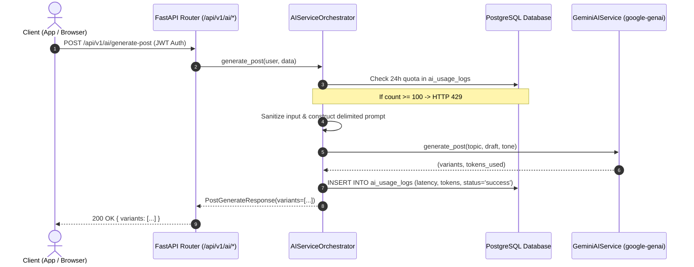

# Stage 6 — Gemini AI Service

> **Status:** ✅ Done · **Complexity:** High · **Depends on:** Stage 0, Stage 1, Stage 2, Stage 3, Stage 5

---

## 1. Purpose & Problem Solved

Stage 6 integrates Google Gemini (`gemini-2.5-flash`) into Nexus Social, providing a secure, provider-agnostic, production-grade intelligence layer. Without a well-designed AI architecture:
- **LLM Lock-in:** Codebases directly coupled to provider-specific SDKs become fragile, hard to test, and difficult to migrate.
- **Prompt Injection:** Malicious inputs inside posts or drafts can hijack model instructions, lead to data exfiltration, or breach application trust boundaries.
- **Cost & Quota Runaways:** Unmetered or unguarded AI requests can rapidly exhaust external API quotas, incur unexpected operational costs, or allow denial-of-service abuse.
- **Moderation Bottlenecks:** Manual-only review queues cannot scale to real-time community engagement, allowing harmful, illegal, or abusive content to spread.
- **Flaky Tests:** Automated test suites that depend on live API keys or external network connections suffer from network timeouts, rate limiting, and nondeterministic outputs.

Stage 6 resolves these challenges with:
1. **Provider-Agnostic Interface (`BaseAIService`):** An abstract base class decoupling business logic from LLM implementations, backed by `GeminiAIService` for production and `MockAIService` for hermetic testing.
2. **All Five Core AI Capabilities:**
   - **Post Generation & Tone Adaptation:** Generates exactly 3 tailored variants ($\le 1000$ chars) in `casual`, `professional`, `funny`, or `inspirational` tones.
   - **Post Summarization & Sentiment Analysis:** Evaluates post discussions with strict enforcement of $\ge 3$ comments.
   - **Conversational Assistant (Nexus Companion):** Multi-turn persistent chat with session history and real-time Server-Sent Events (SSE) streaming.
   - **Background Content Moderation:** Dispatched automatically on post and comment creation via FastAPI `BackgroundTasks`, evaluating category, severity, and score with auto-hiding for critical threats and fail-open/closed configurability.
   - **Smart Reply Suggestions:** Contextual 3-reply suggestions bounded to 80 characters for fast mobile responses.
3. **Prompt Injection Defense & Hardening:** Rigorous input sanitization (stripping non-printable control characters, escaping XML brackets) and structural XML delimiter wrapping.
4. **Per-User Quotas & Telemetry Audit Trail:** Real-time tracking in `ai_usage_logs` with a rolling 24-hour limit of 100 requests and slowapi per-minute rate limiting.

---

## 2. Architecture & Design Decisions

### Provider-Agnostic Interface (`BaseAIService`)

**Chosen:** An abstract base class (`app/services/ai/base.py`) specifying typed async method signatures for all 5 features. `get_ai_service()` injects `MockAIService` when in testing/offline environments or `GeminiAIService` in production.

**Why:**
- Enables automated tests to run instantaneously and hermetically with zero API keys or network traffic.
- Makes switching providers (e.g., Anthropic, OpenAI, local Ollama) trivial by implementing `BaseAIService`.

---

### Structured JSON Mode with Pydantic Validation

**Chosen:** Google Gemini's native JSON mode (`response_mime_type="application/json"`) combined with markdown fence cleanup and Pydantic validation.

**Why:** Ensures models return clean, predictable JSON objects without conversational chatter or code block markers.

---

### Prompt Injection Defense & Delimiters

**Chosen:** XML-style encapsulation tags (`<user_input>`, `<draft_content>`, `<post_content>`, `<comment_thread>`) paired with automated control character sanitization and system security preambles.

**Why:** Prevents malicious user content containing phrases like `"Ignore previous instructions"` or `"System prompt:"` from escaping user data boundaries.

---

### Background Asynchronous Moderation

**Chosen:** Post creation and comment creation endpoints return immediately to the user while enqueuing `moderate_content_task` onto FastAPI `BackgroundTasks`.

**Why:** Content creation remains instantaneous ($\sim 20-40$ ms), while content safety analysis proceeds asynchronously in the background. If critical violations occur, the post is automatically hidden (`is_hidden = True`) and flagged.

---

## 3. Runtime Walkthroughs & Mermaid Diagrams

### AI Service Architecture & Request Lifecycle



### Background Content Moderation Workflow

```mermaid
flowchart TD
    PostReq["User Submits Post / Comment"] --> SaveContent["Save Content to DB (HTTP 201 Created)"]
    SaveContent --> ReturnUser["Return Response Immediately to User"]
    SaveContent -->|FastAPI BackgroundTasks| ModTask["moderate_content_task"]
    
    ModTask --> LLMCall["Gemini Content Safety Evaluation"]
    LLMCall --> EvaluateAction{"Action Determined"}
    
    EvaluateAction -->|allow (score < 0.5)| LogUsage["Record Success in ai_usage_logs"]
    EvaluateAction -->|flag (score >= 0.5)| FlagItem["Insert into moderation_flags (reviewed=False)"]
    EvaluateAction -->|block (score >= 0.8)| HideAndFlag["Set is_hidden=True & Insert moderation_flags"]
    
    FlagItem --> LogUsage
    HideAndFlag --> LogUsage
    
    LLMCall -->|Error Encountered| CheckFailMode{"MODERATION_FAIL_MODE"}
    CheckFailMode -->|open| LogError["Log Error & Allow Content"]
    CheckFailMode -->|closed| FlagReview["Flag for Manual Review"]
```

---

## 4. Endpoints Implemented

| Method | Path | Auth | Rate Limit | Description |
|--------|------|------|------------|-------------|
| `GET` | `/api/v1/ai/quota` | `require_user` | — | Check 24-hour quota status (used, limit, remaining) |
| `POST` | `/api/v1/ai/generate-post` | `require_user` | 20/min | Generate 3 variants from topic/draft in selected tone |
| `POST` | `/api/v1/ai/summarize` | `require_user` | 20/min | Summarize post thread & evaluate sentiment ($\ge 3$ comments) |
| `POST` | `/api/v1/ai/smart-replies` | `require_user` | 20/min | Generate 3 contextual reply suggestions ($\le 80$ chars) |
| `GET` | `/api/v1/ai/chat/sessions` | `require_user` | — | List user's AI chat sessions |
| `POST` | `/api/v1/ai/chat/sessions` | `require_user` | — | Create a new AI chat conversation session |
| `GET` | `/api/v1/ai/chat/sessions/{id}`| `require_user` | — | Retrieve chat session with full message history |
| `DELETE`| `/api/v1/ai/chat/sessions/{id}`| `require_user` | — | Delete chat session (cascading messages) |
| `POST` | `/api/v1/ai/chat/message` | `require_user` | 20/min | Send message to AI assistant (JSON or SSE stream) |

---

## 5. Verification & Test Evidence

### Test Execution Results
All 9 AI tests pass hermetically:
```
backend/tests/test_ai.py::test_ai_quota_endpoint PASSED
backend/tests/test_ai.py::test_post_generation PASSED
backend/tests/test_ai.py::test_post_summarization_threshold PASSED
backend/tests/test_ai.py::test_smart_replies PASSED
backend/tests/test_ai.py::test_ai_chat_session_lifecycle PASSED
backend/tests/test_ai.py::test_ai_chat_streaming PASSED
backend/tests/test_ai.py::test_prompt_injection_sanitization PASSED
backend/tests/test_ai.py::test_background_content_moderation_auto_hide PASSED
backend/tests/test_ai.py::test_daily_quota_limit_exceeded PASSED
```

### Full Test Suite Results
```
============================= 48 passed in 37.43s =============================
```

### Linting & Formatting Verification
- `ruff check backend`: All checks passed!
- `ruff format --check backend`: 70 files already formatted!
- `npm run lint`: No ESLint warnings or errors!
- `npx tsc --noEmit`: 0 TypeScript compilation errors!
