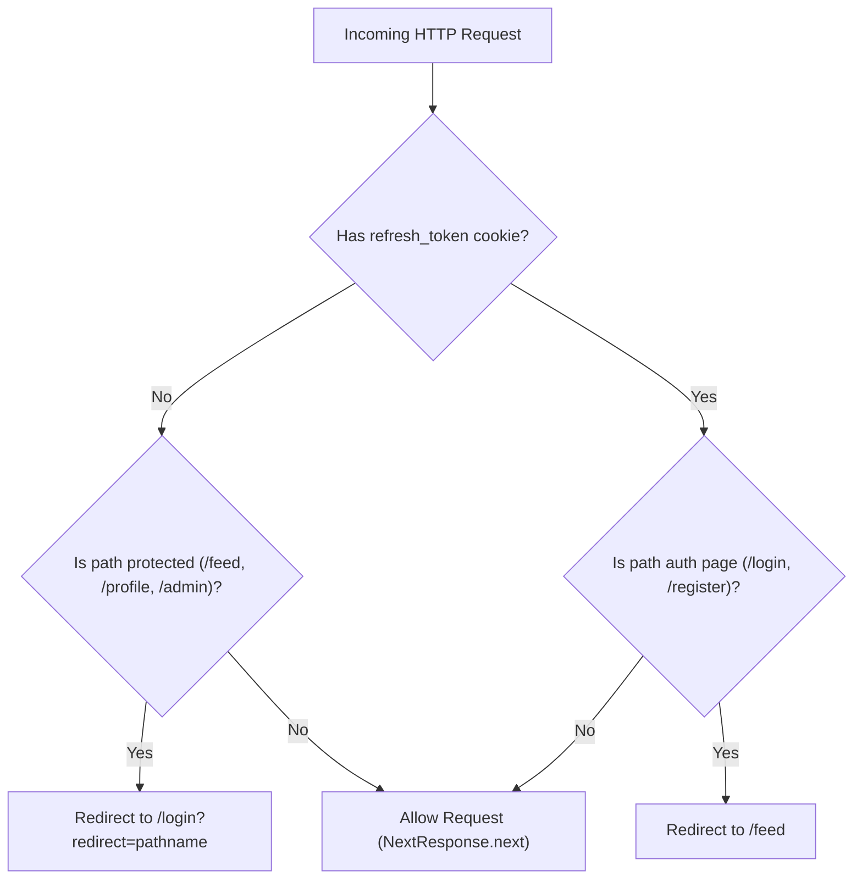

# Stage 7 — Frontend Foundation

> **Status:** ✅ Done · **Complexity:** High · **Depends on:** Stage 0, Stage 1, Stage 2, Stage 6

---

## 1. Purpose & Problem Solved

Stage 7 establishes the complete, production-ready client architecture for Nexus Social, connecting the Next.js 14 App Router frontend to the FastAPI backend with enterprise-grade token security, responsive design, and route protection.

Key problems resolved:
1. **Token Security vs UX (Silent Refresh):** Storing JWT access tokens in `localStorage` or `sessionStorage` exposes user sessions to Cross-Site Scripting (XSS). Conversely, storing only cookies can complicate single-page application API authorization headers and Server-Sent Events. Nexus Social uses **in-memory JWT access token storage** paired with an **httpOnly rotating refresh token cookie** and an automated silent refresh interceptor that seamlessly handles 401 Unauthorized responses without logging out active users.
2. **First-Party Cookie Isolation (Next.js Rewrites):** Direct cross-origin browser calls between Vercel and Render would require third-party cookies (frequently blocked by Safari and Chrome privacy sandboxes). Next.js rewrites (`/api/*` $\rightarrow$ `BACKEND_URL/api/*`) maintain all cookies strictly first-party on the primary domain.
3. **Route Guarding:** Next.js Edge Middleware (`middleware.ts`) protects authenticated routes (`/feed`, `/profile`, `/notifications`, `/admin`, `/settings`) by redirecting unauthenticated visitors to `/login?redirect=...`, while preventing already-signed-in users from accessing login and registration pages.
4. **Unified Design System:** A complete set of accessible, themeable shadcn/ui components built on Radix UI primitives and styled with Tailwind CSS, supporting seamless light and dark mode switching via `next-themes`.
5. **Full Authentication Lifecycle:** End-to-end user interfaces for login, registration with interactive password strength feedback, email verification handling, enumeration-safe forgot password, and token-validated password reset.

---

## 2. Architecture & Design Decisions

### In-Memory Access Tokens & Deduplicated Silent Refresh

**Chosen:** Store short-lived (15-min) JWT access tokens exclusively in closure memory (`inMemoryAccessToken` in `api-client.ts`), never in web storage (`localStorage` or `sessionStorage`).

**How Silent Refresh Works:**
- When an API request encounters HTTP 401 Unauthorized, `apiFetch` intercepts the response.
- It triggers `refreshAccessToken()`, which posts to `/api/v1/auth/refresh` sending the httpOnly `refresh_token` cookie.
- A module-scoped `refreshPromise` ensures that if multiple concurrent requests encounter 401s, only a single refresh request is dispatched to the backend.
- Once the new access token is returned, the original request is replayed with the updated `Authorization: Bearer <token>` header.
- If the refresh token has expired or was revoked, tokens are cleared and the user is redirected to `/login`.

```mermaid
sequenceDiagram
    autonumber
    actor User as Browser Client
    participant Client as api-client.ts
    participant Next as Next.js Proxy (/api/*)
    participant Backend as FastAPI Backend

    User->>Client: Call apiFetch('/posts')
    Client->>Next: GET /api/v1/posts (Expired Access Token)
    Next->>Backend: Forward GET /api/v1/posts
    Backend-->>Next: 401 Unauthorized
    Next-->>Client: 401 Unauthorized
    
    Note over Client: Intercept 401; Trigger Silent Refresh
    Client->>Next: POST /api/v1/auth/refresh (httpOnly Cookie)
    Next->>Backend: Forward Refresh with Cookie
    Backend->>Backend: Rotate refresh token & issue new JWT
    Backend-->>Next: 200 OK { access_token: "new_jwt" }
    Next-->>Client: 200 OK { access_token: "new_jwt" }
    
    Note over Client: Update inMemoryAccessToken
    Client->>Next: Replay GET /api/v1/posts (New Token)
    Next->>Backend: Forward GET /api/v1/posts
    Backend-->>Next: 200 OK [ Feed Posts ]
    Next-->>User: 200 OK [ Feed Posts ]
```

---

### Route Protection via Next.js Middleware

**Chosen:** Edge runtime middleware (`src/middleware.ts`) evaluating the presence of the `refresh_token` cookie on protected route prefixes (`/feed`, `/profile`, `/notifications`, `/admin`, `/settings`).



---

## 3. UI Components & Design System

The complete component set was implemented in [`src/components/ui/`](file:///d:/Code/Social_Media/frontend/src/components/ui/):

| Component | Primitive | Variants / Features |
|-----------|-----------|---------------------|
| `button.tsx` | Radix Slot | `default`, `destructive`, `outline`, `secondary`, `ghost`, `link`; sizes `sm`, `default`, `lg`, `icon` |
| `input.tsx` | Native HTML5 | Styled focus rings, disabled states, error borders, full width |
| `label.tsx` | Radix Label | Accessible form field labeling |
| `card.tsx` | Div container | `Card`, `CardHeader`, `CardTitle`, `CardDescription`, `CardContent`, `CardFooter` |
| `badge.tsx` | CVA component | `default`, `secondary`, `destructive`, `outline`, `success`, `warning` |
| `avatar.tsx` | Radix Avatar | `Avatar`, `AvatarImage`, `AvatarFallback` |
| `dialog.tsx` | Radix Dialog | Accessible modal overlays, focus trapping, animated zoom transitions |
| `dropdown-menu.tsx`| Radix Dropdown | Menus, items, checkboxes, radio items, dividers, sub-menus |
| `tabs.tsx` | Radix Tabs | Tab bars and content panels |
| `toast.tsx` | Radix Toast | Global notifications, dismiss animations, `success`, `destructive`, `default` |
| `skeleton.tsx` | Div pulse | Animated skeleton placeholders for feed and profile loading |
| `separator.tsx` | Radix Separator | Horizontal and vertical dividers |
| `scroll-area.tsx` | Radix ScrollArea | Custom themed scrollbars |
| `theme-toggle.tsx` | Next-themes | Dropdown switch between Light, Dark, and System theme |

---

## 4. Auth Pages Implemented

| Path | Features |
|------|----------|
| `/` | Brand landing page, hero highlights, features overview, links to login/register |
| `/login` | Email/username login, password visibility toggle, error display, redirect tracking, React Suspense boundary |
| `/register` | Registration form, live 5-point password strength checklist, email verification confirmation card |
| `/verify-email` | Handles `?token=...`, automatic API verification, success state, resend verification form |
| `/forgot-password` | Enumeration-safe password reset link request, confirmation screen |
| `/reset-password` | Handles `?token=...`, password strength validation, confirm password matching, success redirect |

---

## 5. Verification & Build Results

### Next.js Production Build
```
▲ Next.js 14.2.18
✓ Compiled successfully
✓ Generating static pages (9/9)
Route (app)                              Size     First Load JS
┌ ○ /                                    1.77 kB         136 kB
├ ○ /_not-found                          138 B          87.3 kB
├ ○ /forgot-password                     3.29 kB         132 kB
├ ○ /login                               4.47 kB         133 kB
├ ○ /register                            4.83 kB         133 kB
├ ○ /reset-password                      4.83 kB         133 kB
└ ○ /verify-email                        4.23 kB         107 kB
+ First Load JS shared by all            87.1 kB
ƒ Middleware                             26.6 kB
```

### Linting & Type-Checking
- `npm run lint`: **✔ No ESLint warnings or errors**
- `npx tsc --noEmit`: **0 errors**
- `ruff check backend`: **All checks passed!**
- `pytest backend/tests`: **48 passed**
