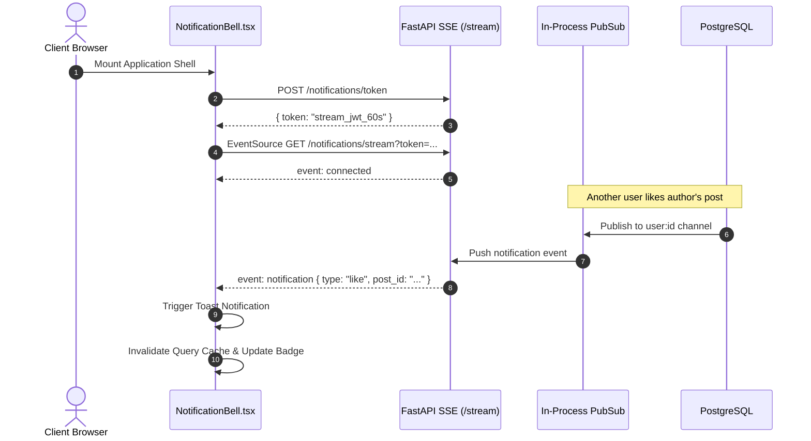

# Stage 8 — User App UI

> **Status:** ✅ Done · **Complexity:** High · **Depends on:** Stage 3, Stage 4, Stage 6, Stage 7

---

## 1. Purpose & Problem Solved

Stage 8 delivers the complete client-facing experience for Nexus Social. It provides an intuitive, high-performance, responsive interface connecting authenticated users to the social graph and Gemini-powered AI features.

Key problems resolved:
1. **Interactive Chronological Feed:** High-efficiency keyset cursor infinite scroll powered by TanStack `useInfiniteQuery`. Includes feed filtering ("All Posts" vs "My Posts"), real-time optimistic like toggling, and instant post creation.
2. **AI Post Assistant:** An integrated modal within the post composer that allows creators to brainstorm or polish drafts using Gemini across 4 selectable tones (*casual, professional, funny, inspirational*), generating 3 alternative variations with one-click insertion.
3. **Threaded Discussions & Smart Replies:** Single-level comment tree (`/posts/[id]`) with live comment count tracking, dynamic 3-pill smart reply suggestions generated from discussion context, and edit/delete controls.
4. **AI Discussion Summarization:** Automatic high-level summarization card on post detail pages when discussions reach 3 or more comments, highlighting the key discussion points and sentiment analysis (*positive, neutral, negative, mixed*).
5. **Real-Time Notification System:** Live Server-Sent Events (SSE) notification stream backed by short-lived 60-second tokens, toast banners for new interactions, an unread counter badge in the navbar with 30s polling fallback, and a dedicated notification center (`/notifications`) with single and batch mark-as-read actions.
6. **User Profiles & Self-Service Management:** Dedicated profile pages (`/profile/[username]`) displaying post count, likes received, bio, external link, and join date, accompanied by an interactive edit profile dialog.
7. **Floating Conversational AI Assistant:** A globally available floating chat widget providing streaming multi-turn conversations with Google Gemini, multi-session management, auto-scrolling message bubbles, and real-time daily quota indicators.

---

## 2. Architecture & Design Decisions

### Real-Time SSE Notification Pipeline with Polling Fallback

To achieve instantaneous feedback when users receive likes, comments, or moderation updates without straining infrastructure:
1. `NotificationBell` requests a single-purpose, 60-second JWT token via `POST /api/v1/notifications/token`.
2. Connects to `GET /api/v1/notifications/stream?token=...` via the browser's `EventSource` API.
3. Upon receiving a `notification` event:
   - TanStack query cache for unread count and notification list is invalidated.
   - An interactive toast appears alerting the user with direct context.
4. If connection drops or network fails, an automated 10-second exponential reconnect kicks in, while background TanStack Query refetches unread count every 30 seconds as a reliable fallback.



### Optimistic UI & Infinite Keyset Pagination

- **Infinite Scrolling Feed:** Uses `@tanstack/react-query`'s `useInfiniteQuery` with keyset cursor pagination (`created_at` + `id`), preventing duplicate or skipped posts during high-velocity insertions.
- **Optimistic Like Toggle:** Immediate state mutation on like click with instantaneous count increment/decrement. If backend returns an error, the component gracefully rolls back to previous state and displays a destructive toast.
- **AI Streaming Assistant:** Directly consumes the chunked Server-Sent Event stream from `POST /api/v1/ai/chat/message?stream=true` using standard `fetch` + `ReadableStreamDefaultReader`, parsing delta tokens into live assistant response bubbles.

---

## 3. Implemented Components & Routes

| Path / File | Type | Description |
| :--- | :--- | :--- |
| `src/types/index.ts` | Schema Types | 1:1 frontend TypeScript mirrors of backend Pydantic models. |
| `src/components/layout/navbar.tsx` | Component | Top navigation bar with logo, search placeholder, ThemeToggle, NotificationBell, and UserNav. |
| `src/components/layout/sidebar.tsx` | Component | Responsive desktop sidebar navigation and mobile bottom nav bar. |
| `src/app/(app)/layout.tsx` | Layout Shell | Protected App layout encapsulating Sidebar, Navbar, and Floating `AIChatWidget`. |
| `src/components/feed/post-composer.tsx` | Component | Rich post creation card with character count, image toggle, and AI modal assistant. |
| `src/components/feed/post-card.tsx` | Component | Individual feed item with optimistic like toggle, author metadata, edit/delete modals. |
| `src/app/(app)/feed/page.tsx` | Route Page | Keyset cursor infinite feed with All/My Posts filtering and skeleton loading states. |
| `src/components/ai/ai-summary-card.tsx` | Component | AI summarization component showing key takeaways and sentiment badge for posts with $\ge 3$ comments. |
| `src/components/ai/smart-replies-bar.tsx` | Component | Contextual 3-pill smart reply recommendation bar above comment input. |
| `src/components/ai/ai-chat-widget.tsx` | Component | Floating assistant with real-time SSE token streaming and quota usage bar. |
| `src/app/(app)/posts/[id]/page.tsx` | Route Page | Single post view, comment tree, smart replies, and AI discussion overview. |
| `src/components/profile/edit-profile-dialog.tsx` | Component | Dialog modal for modifying user bio, display name, location, website, and avatar. |
| `src/app/(app)/profile/page.tsx` | Route Page | Automatic client-side router redirect to `/profile/[username]`. |
| `src/app/(app)/profile/[username]/page.tsx` | Route Page | User profile with user stats (posts count, likes count), badges, and authored posts list. |
| `src/components/notifications/notification-bell.tsx` | Component | Live SSE event subscriber with badge count indicator and toast notifications. |
| `src/app/(app)/notifications/page.tsx` | Route Page | Centralized notifications center with All/Unread filtering and single/batch mark-as-read. |

---

## 4. Verification & Testing

### Frontend Lint & Compilation
- **ESLint:** Executed `npm run lint` — 0 errors, 0 warnings.
- **TypeScript:** Executed `npx tsc --noEmit` — 0 type errors across all schemas and UI components.
- **Production Build:** Executed `npm run build` — Clean build with 12 static/dynamic routes compiled and optimized:
  ```
  Route (app)                              Size     First Load JS
  ┌ ○ /                                    3.62 kB         137 kB
  ├ ○ /_not-found                          138 B          87.3 kB
  ├ ○ /feed                                5.35 kB         161 kB
  ├ ○ /forgot-password                     3.52 kB         132 kB
  ├ ○ /login                               4.71 kB         133 kB
  ├ ○ /notifications                       5.38 kB         112 kB
  ├ ƒ /posts/[id]                          4.25 kB         160 kB
  ├ ○ /profile                             2.35 kB        89.5 kB
  ├ ƒ /profile/[username]                  3.71 kB         159 kB
  ├ ○ /register                            5.07 kB         133 kB
  ├ ○ /reset-password                      5.06 kB         133 kB
  └ ○ /verify-email                        4.71 kB         107 kB
  ```

### Backend Regression Verification
- Executed `pytest backend/tests`:
  ```
  backend/tests/test_admin.py .....                                        [ 10%]
  backend/tests/test_ai.py .........                                       [ 29%]
  backend/tests/test_auth.py ......                                        [ 41%]
  backend/tests/test_db_integration.py ....                                [ 50%]
  backend/tests/test_health.py ..                                          [ 54%]
  backend/tests/test_models.py .........                                   [ 72%]
  backend/tests/test_notifications.py .....                                [ 83%]
  backend/tests/test_social.py ........                                    [100%]

  ============================= 48 passed in 37.66s =============================
  ```
- **Result:** 100% pass rate, zero regressions across auth, database, social graph, AI service, and notifications.
