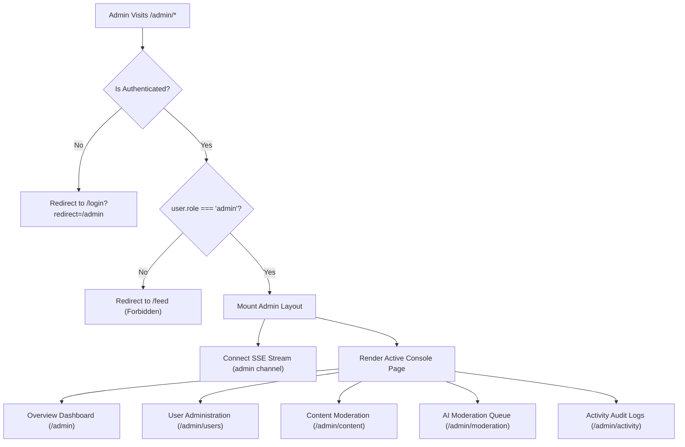

# Stage 9 — Admin Console UI

> **Status:** ✅ Done · **Complexity:** High · **Depends on:** Stage 5, Stage 7, Stage 8

---

## 1. Purpose & Problem Solved

Stage 9 builds out the complete, dedicated Administrative Console (`/admin`) for Nexus Social. It provides operators and moderators with a dense, powerful, and secure interface to monitor platform health, review automated AI moderation decisions, manage user permissions, and perform bulk content cleanup.

Key problems resolved:
1. **Administrative Access Boundary & Role Guarding:** Unauthenticated visitors are redirected to `/login?redirect=/admin`, while non-admin authenticated users are instantly bounced to `/feed` via Next.js Edge Middleware and client-side Auth Context (`isAdmin`) guards.
2. **Platform KPI Analytics:** Instant visualization of 6 core business metrics (*Total Users, Verified Users, New 7d Signups, Total Posts, Total Comments, and Pending Flagged Items*).
3. **Time-Series Growth Trends (30 Days):** Two interactive Recharts area charts displaying day-by-day user registration velocity and daily post creation activity.
4. **User Lifecycle & Permission Management:** Searchable, filterable, and dense user table allowing administrators to promote/demote roles (`user` $\leftrightarrow$ `admin`), toggle account suspensions with custom reason logging and immediate session revocation, or execute permanent account cascades.
5. **Content Moderation & Bulk Action Center:** Dual-tabbed interface for Posts and Comments with full-text search, public vs hidden state toggling, and multi-select batch operations (*Hide Selected, Restore Selected, Delete Selected*).
6. **AI Moderation Queue:** Review interface for posts and comments flagged by background Gemini AI analysis, complete with severity categorization (*critical, high, medium, low*), confidence scores, automated violation reasons, and immediate action workflows (*Approve, Hide, Delete*).
7. **Real-Time Security Feed & Activity Audit Trail:** Live Server-Sent Events subscriber listening on the shared `admin` channel for inbound security events (such as new admin logins), combined with a searchable, paginated activity audit log featuring an interactive JSON metadata inspector.

---

## 2. Architecture & Design Decisions

### Role-Guarded Dark Console Layout

- Designed with a high-density, professional zinc dark theme (`zinc-950`) distinct from the consumer-facing app layout to prevent accidental administrative actions.
- Features persistent sidebar navigation with quick breadcrumb tracking and a one-click *"Back to User Feed"* button.
- Subscribes to `/api/v1/notifications/stream` with single-purpose stream tokens to intercept `admin_alert` events (e.g. login alerts from unfamiliar IPs or new severe content flags), surfacing live toast alerts to administrators in real time.



### High-Density Controls & Bulk Mutations

- **Recharts Client Hydration:** Charts are encapsulated with mounted state guards (`isMounted`) ensuring zero hydration mismatches during Next.js SSR prerendering.
- **Bulk Action Endpoints:** Multi-select checkboxes trigger batch operations via `POST /api/v1/admin/posts/bulk` and `POST /api/v1/admin/comments/bulk`, executing unified SQL updates and invalidating TanStack caches in one network trip.
- **Immutable Audit Trail:** All administrative actions (suspensions, role updates, content deletes) trigger automated database writes to `activity_logs`, recording admin ID, client IP, timestamp, and detailed JSON payloads.

---

## 3. Implemented Components & Routes

| Path / File | Type | Description |
| :--- | :--- | :--- |
| `src/components/ui/table.tsx` | Component | Standard accessible shadcn/ui Table primitives (Header, Body, Row, Head, Cell). |
| `src/components/ui/select.tsx` | Component | Standard accessible shadcn/ui Select dropdown primitives powered by `@radix-ui/react-select`. |
| `src/components/ui/switch.tsx` | Component | Standard accessible shadcn/ui Switch toggle powered by `@radix-ui/react-switch`. |
| `src/types/index.ts` | Schema Types | Added comprehensive Admin schema interfaces matching backend Pydantic models. |
| `src/app/admin/layout.tsx` | Layout Shell | Protected admin console layout with dark sidebar, SSE stream listener, role guard, and quick navigation. |
| `src/app/admin/page.tsx` | Route Page | Executive dashboard with 6 KPI stat cards and 2 Recharts 30-day time-series area charts. |
| `src/app/admin/users/page.tsx` | Route Page | User management console with search, role/status filters, suspension modal, role change, and deletion dialogs. |
| `src/app/admin/content/page.tsx` | Route Page | Content management with Posts and Comments tabs, search, multi-select checkboxes, and bulk action toolbar. |
| `src/app/admin/moderation/page.tsx` | Route Page | AI moderation queue showing flagged items, severity badges, confidence scores, and Approve/Hide/Delete dialogs. |
| `src/app/admin/activity/page.tsx` | Route Page | Activity audit log viewer with action/resource filters, IP tracking, and JSON inspector modal. |

---

## 4. Verification & Testing

### Frontend Lint & Compilation
- **ESLint:** Executed `npm run lint` — **0 errors, 0 warnings**.
- **TypeScript:** Executed `npx tsc --noEmit` — **0 type errors**.
- **Production Build:** Executed `npm run build` — Clean build with all 17 routes prerendered and optimized:
  ```
  Route (app)                              Size     First Load JS
  ┌ ○ /                                    3.68 kB         139 kB
  ├ ○ /_not-found                          139 B          87.5 kB
  ├ ○ /admin                               106 kB          218 kB
  ├ ○ /admin/activity                      2.74 kB         145 kB
  ├ ○ /admin/content                       7.18 kB         159 kB
  ├ ○ /admin/moderation                    4.75 kB         149 kB
  ├ ○ /admin/users                         7.08 kB         159 kB
  ├ ○ /feed                                5.42 kB         162 kB
  ├ ○ /forgot-password                     3.57 kB         132 kB
  ├ ○ /login                               4.76 kB         133 kB
  ├ ○ /notifications                       5.67 kB         113 kB
  ├ ƒ /posts/[id]                          4.28 kB         161 kB
  ├ ○ /profile                             2.35 kB        89.8 kB
  ├ ƒ /profile/[username]                  3.75 kB         160 kB
  ├ ○ /register                            5.13 kB         134 kB
  ├ ○ /reset-password                      5.12 kB         134 kB
  └ ○ /verify-email                        4.77 kB         108 kB
  ```

### Backend Regression Verification
- Executed `pytest backend/tests`:
  ```
  backend/tests/test_admin.py .....                                        [ 10%]
  backend/tests/test_ai.py .........                                       [ 29%]
  backend/tests/test_auth.py ......                                        [ 41%]
  backend/tests/test_db_integration.py ....                                [ 50%]
  backend/tests/test_health.py ..                                          [ 54%]
  backend/tests/test_models.py .........                                   [ 72%]
  backend/tests/test_notifications.py .....                                [ 83%]
  backend/tests/test_social.py ........                                    [100%]

  ============================= 48 passed in 38.77s =============================
  ```
- **Result:** 100% pass rate across all 48 unit and integration tests.
