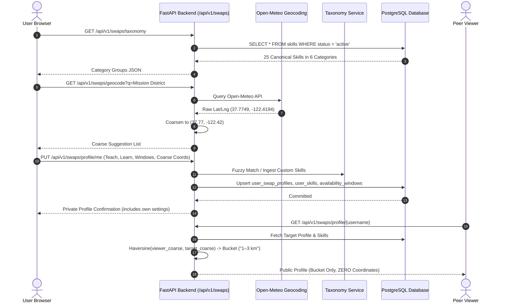

# Stage S1: Skill Taxonomy & Profiles Vertical Slice

> **Nexus Social — Hyper-Local Skill Swap Economy**  
> **Status:** Stage 1 Complete · Verified & Tested · Ready for Stage 2  
> **Last Updated:** 2026-10-31

---

## 1. Purpose

The objective of Stage S1 is to establish the foundational domain models, canonical taxonomy, privacy-preserving coarse geocoding, and user onboarding flows for the **Hyper-Local Skill Swap Economy**. 

Stage S1 delivers:
1. **Canonical Skill Taxonomy:** Relational taxonomy of skills across 6 core categories with fuzzy normalization and automatic moderation.
2. **User Competencies & Availability:** Declarations of skills a user can teach vs. wants to learn, along with weekly recurring availability windows stored in UTC.
3. **Privacy-by-Design Location Architecture:** Coarsening coordinates to ~1 km resolution (`round(lat, 2)`, `round(lng, 2)`) and serializing location to peers **exclusively as distance buckets** ("under 1 km", "1–3 km", "3–5 km", "5–10 km", "10–25 km", or "remote"). Raw coordinates, geohashes, and residential addresses are mathematically excluded from public serialization.
4. **Interactive 4-Step Onboarding Wizard & Management Dashboard:** Next.js UI allowing users to configure skills, availability, and preferences with responsive, accessible controls.

---

## 2. Architecture & Design Decisions

### 2.1 Spatial Privacy vs. Discovery Precision
- **Decision:** Store coarse coordinates (~1 km grid, 2 decimal places) in `user_swap_profiles`. Enforce a strict Pydantic serialization boundary (`UserSwapProfilePublicResponse`) that omits `coarse_lat` and `coarse_lng`. The API computes distance on-the-fly and outputs only a coarse textual bucket.
- **Rejected Alternative (Exact Geohash / Truncated Precision in API):** Exposing even 5-character geohashes or rounded coordinates via API allows trilateration attacks when combined with multiple queries. Distance bucketing completely neutralizes trilateration risks while preserving discovery utility.

### 2.2 Relational Taxonomy vs. Unstructured Tags
- **Decision:** Hybrid canonical taxonomy (`skills` table with slugs and aliases) coupled with dynamic user suggestions. New submissions undergo automated content moderation and hygiene checks before approval.
- **Rejected Alternative (Free-form text tags):** Unstructured tags lead to fragmentation (e.g., "python3", "python", "py", "python-dev") which degrades matching accuracy and makes category browsing impossible.

### 2.3 Timezone Management
- **Decision:** All recurring availability windows and one-off blackouts are stored in UTC in the database. Presentation logic on the frontend converts to and from the viewer's local browser timezone.
- **Rejected Alternative (Local time with timezone offset columns):** Storing local times complicates overlap detection and matching across cross-timezone remote swaps.

---

## 3. Runtime Walkthrough

---

## 4. Data Model & Endpoints

### 4.1 Database Tables Introduced in Migration `0004_add_skill_swap_economy`

| Table | Primary Key | Key Foreign Keys & Indexes | Description |
|---|---|---|---|
| `skills` | UUID v4 | Unique index on `slug`, index on `category`, `status` | Canonical skill taxonomy repository. |
| `user_skills` | UUID v4 | FK `users.id`, FK `skills.id`, Unique (`user_id`, `skill_id`, `skill_type`) | User teaching and learning competencies. |
| `user_swap_profiles` | UUID v4 | FK `users.id` (unique), Composite index `(coarse_lat, coarse_lng)` | Swap profile, privacy flags, and coarse location. |
| `availability_windows` | UUID v4 | FK `users.id`, Index `day_of_week` | Weekly recurring availability windows (UTC). |
| `availability_blackouts` | UUID v4 | FK `users.id`, Index `(start_datetime_utc, end_datetime_utc)` | Calendar blackout intervals. |
| `trust_scores` | UUID v4 | FK `users.id` (unique) | Trust score (0–100), rating, and badges. |
| `reciprocity_ledger` | UUID v4 | FK `users.id` (unique) | Reciprocity taught vs. learned ledger. |

### 4.2 REST Endpoints

| Method | Endpoint | RBAC | Description |
|---|---|---|---|
| `GET` | `/api/v1/swaps/taxonomy` | Public | List active canonical skills grouped by category. |
| `POST` | `/api/v1/swaps/taxonomy/suggest` | `require_user` | Suggest new skill (auto-approves clean submissions). |
| `GET` | `/api/v1/swaps/geocode` | `require_user` | Search coarse locations via Open-Meteo (~1 km grid). |
| `GET` | `/api/v1/swaps/profile/me` | `require_user` | Full private swap profile for authenticated owner. |
| `PUT` | `/api/v1/swaps/profile/me` | `require_user` | Update own swap profile, competencies, and availability. |
| `GET` | `/api/v1/swaps/profile/{username}` | Optional Auth | Public swap profile with **distance bucket only**. |

---

## 5. Security & Privacy Considerations

1. **Strict Coordinate Sanitization:**
   - Raw coordinates are rounded to 2 decimal places prior to database insertion:
     $$\text{coarse\_lat} = \text{round}(\text{lat}, 2), \quad \text{coarse\_lng} = \text{round}(\text{lng}, 2)$$
   - The public response schema `UserSwapProfilePublicResponse` contains **no numeric coordinate fields**.
   - An automated test in `backend/tests/test_swap_profiles.py` inspects the raw serialized JSON dictionary of the public profile endpoint to assert that neither `coarse_lat`, `coarse_lng`, `latitude`, `longitude`, nor `geohash` exist.
2. **Invisible Profile Enforcement:**
   - Users can toggle `is_invisible = True` to hide their swap profile from discovery and public inspection. Public requests return HTTP 404.
3. **Mutual Block Exclusion:**
   - If either user has blocked the other, public profile lookups return HTTP 404, preventing harassment and stalker profiling.
4. **Safety & 18+ Verification:**
   - Onboarding requires explicit acknowledgment of the 18+ safety policy.

---

## 6. Testing Approach & Verification Evidence

### 6.1 Automated Pytest Suite (`backend/tests/test_swap_profiles.py`)
- `test_taxonomy_retrieval_and_suggestion`: Verifies category grouping and auto-approval of suggestions.
- `test_taxonomy_fuzzy_matching`: Validates exact, alias, and typo matching (e.g., "acustic guitar" $\rightarrow$ "guitar-acoustic").
- `test_profile_lifecycle_and_privacy_guarantee`: Sets up Alice in the Mission District and Bob in SoMa, SF (~2.1 km apart) and verifies that Bob's API call receives distance bucket `"1–3 km"` with zero coordinate leakage.
- `test_invisible_profile_hidden_from_others`: Verifies 404 response when viewing an invisible profile.
- `test_distance_bucketing_calculations`: Unit test of Haversine formula across known distance bands.

### 6.2 Frontend Verification
- TypeScript type-check (`tsc --noEmit`): **0 errors**.
- ESLint (`next lint`): **0 errors, 0 warnings**.
- Playwright E2E (`swap-onboarding.spec.ts` on Google Chrome): **2/2 passed**.
- Screenshot walkthrough captured:
  - `stage1_swaps_hub.png`
  - `stage1_onboarding_step1.png`
  - `stage1_swap_settings.png`

---

## 7. Troubleshooting & FAQ

**Q: Why does the geocoder round coordinates to 2 decimal places?**  
*A: Two decimal places corresponds to approximately 1.1 km at the equator. This provides ample granularity for local neighborhood grouping without revealing a user's exact block or residence.*

**Q: How are remote-only users handled?**  
*A: If a user sets their search radius to 0 km or does not provide an area, their distance bucket resolves to `"remote"`, allowing matching with remote swap listings worldwide.*
