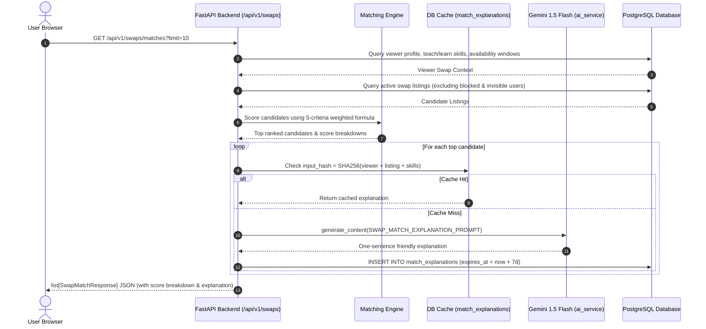

# Stage S2: Swap Listings, Discovery & Matching Engine Vertical Slice

> **Nexus Social — Hyper-Local Skill Swap Economy**  
> **Status:** Stage 2 Complete · Verified & Tested · Ready for Stage 3  
> **Last Updated:** 2026-10-31

---

## 1. Purpose

The objective of Stage S2 is to implement the end-to-end listing lifecycle, hyper-local spatial discovery query engine, transparent weighted matching algorithm, and social feed integration for the **Hyper-Local Skill Swap Economy**.

Stage S2 delivers:
1. **Swap Listings ("Offers") Lifecycle:** Creation, retrieval, update, status toggling (active, paused, closed), and strict enforcement of the `SWAP_MAX_ACTIVE_LISTINGS` quota (default: 5 active listings per user).
2. **Zero-Money Policy Enforcement:** Multi-layer defense against monetary solicitation (currency keywords, payment processor tokens, hourly fees) in listing titles, descriptions, and tags. Content moderation triggers asynchronous AI violation checks.
3. **Hyper-Local Discovery Query Engine:** Filterable search supporting skill categories, modes (video vs. in-person), distance buckets, and sorting (newest, nearest, highest trust). Strictly isolates coordinates—public outputs contain distance buckets only.
4. **Bi-directional Block & Privacy Isolation:** Blocked users (blocker or blocked) and users with invisible profiles are completely omitted from discovery and matching results.
5. **Transparent 5-Criteria Matching Engine:** Weighted recommendation score based on:
   - Mutual skill match ($W_1 = 0.35$)
   - Spatial proximity & remote mode overlap ($W_2 = 0.25$)
   - 14-day availability overlap ($W_3 = 0.20$)
   - Trust score ($W_4 = 0.15$)
   - Freshness & activity ($W_5 = 0.05$)
6. **Gemini "Why You Match" Explanations & SHA-256 Cache:** Context-aware one-sentence explanation stored in the `match_explanations` table with a 7-day TTL, preventing duplicate AI token consumption.
7. **Social Feed Integration:** Active listings can be shared into the main social feed with a single click, rendering an interactive "Skill Swap Offer" card with a direct "Propose a swap" CTA.
8. **Interactive Discovery UI & Leaflet Map:** Modern Next.js frontend with list/map toggle, coarse circular area clusters on OpenStreetMap tiles (never exact pins), Gemini AI listing draft helper, and dedicated "Matches for You" recommendations view.

---

## 2. Architecture & Design Decisions

### 2.1 Spatial Discovery Without Coordinate Leakage
- **Decision:** Perform coarse bounding box prefilters on `(coarse_lat, coarse_lng)` and compute distance using SQL Haversine math. Map results into coarse textual distance buckets (`under 1 km`, `1–3 km`, `3–5 km`, `5–10 km`, `10–25 km`, `remote`) before serialization in `SwapListingResponse`. Leaflet UI renders circular area bubbles (700m–1400m radius), never pinpoint markers.
- **Rejected Alternative (Returning approximate lat/lng to frontend):** Any client-side coordinate rendering allows trilateration across multiple sessions to pinpoint user neighborhoods. Textual bucketing on the server completely prevents client-side location extraction.

### 2.2 Strict Non-Monetary Exchange Architecture
- **Decision:** Multi-tier policy enforcement:
  1. Synchronous regex pre-filter rejecting currency symbols (`$`, `USD`, `EUR`, `INR`), payment app handles (`PayPal`, `Venmo`, `CashApp`, `Zelle`), and commercial terms (`hourly rate`, `per hour`, `pricing`).
  2. Asynchronous AI content moderation via Gemini evaluating content safety and payment solicitation.
- **Rejected Alternative (Allowing tips or cash-convertible tokens):** Undermines the core mission of accessible peer mentorship and triggers financial regulatory and KYC compliance overhead.

### 2.3 Transparent Matching Algorithm vs. Black-Box Embeddings
- **Decision:** Weighted composite formula parameterized in application configuration (`MATCH_WEIGHT_*`). Each candidate receives a normalized score $S \in [0.0, 1.0]$ alongside an inspectable sub-score breakdown (`skill_match`, `proximity`, `availability`, `trust`, `freshness`).
- **Rejected Alternative (Pure vector similarity):** Vector search cannot reliably enforce hard reciprocal criteria (e.g., A teaches B's want AND B teaches A's want) or calculate timezone-aware calendar overlap.

### 2.4 SHA-256 Explanation Caching
- **Decision:** Hash the composite match inputs `(viewer_id, listing_id, skill_offered, skill_wanted)` to query the `match_explanations` table. Cached entries bypass Gemini generation, drastically reducing latency and API cost.

---

## 3. Runtime Walkthrough



---

## 4. Data Model & Endpoint Reference

### 4.1 Endpoints Implemented in Stage S2

| Method | Endpoint | Auth | Purpose |
|---|---|---|---|
| `POST` | `/api/v1/swaps/listings` | Required | Create swap listing (enforces quota of 5, no-money policy, triggers AI moderation). |
| `GET` | `/api/v1/swaps/listings` | Optional | Discovery search with category, mode, distance bucket, and sorting filters. |
| `GET` | `/api/v1/swaps/listings/me` | Required | Retrieve all listings owned by the authenticated user. |
| `GET` | `/api/v1/swaps/listings/{id}` | Optional | Retrieve listing details with distance bucket computed relative to viewer. |
| `PUT` | `/api/v1/swaps/listings/{id}` | Required | Update listing title, description, modes, or status (active, paused, closed). |
| `POST` | `/api/v1/swaps/listings/{id}/share` | Required | Share active listing to social feed as an interactive Swap Offer post. |
| `POST` | `/api/v1/swaps/listings/ai-draft` | Required | Gemini-powered draft assistant generating title, description, and tags. |
| `GET` | `/api/v1/swaps/matches` | Required | Personalized top recommendations with cached Gemini match explanations. |

### 4.2 Matching Weight Configuration

```python
MATCH_WEIGHT_SKILL = 0.35        # Mutual teaching & learning alignment
MATCH_WEIGHT_PROXIMITY = 0.25    # Distance bucket or remote/video overlap
MATCH_WEIGHT_AVAILABILITY = 0.20 # 14-day recurring window overlap
MATCH_WEIGHT_TRUST = 0.15        # Peer trust score (0-100 normalized)
MATCH_WEIGHT_FRESHNESS = 0.05    # Recency decay (linear over 30 days)
```

---

## 5. Security & Privacy Considerations

1. **Zero Coordinate Exposure:** `SwapListingResponse` and `SwapListingListResponse` models omit `coarse_lat`, `coarse_lng`, and `geohash`. Distance is exclusively represented as safe distance buckets (`under 1 km`, `1–3 km`, `3–5 km`, `5–10 km`, `10–25 km`, `remote`).
2. **Bi-directional Block Enforcement:** If User A blocks User B or User B blocks User A, User B's listings are excluded from User A's discovery and vice versa. Direct lookups by ID return 404 Not Found.
3. **Invisible Profile Privacy:** If a user toggles `is_invisible = true`, their listings are suppressed from discovery and matching.
4. **Quota Limits:** Users cannot exceed `SWAP_MAX_ACTIVE_LISTINGS` (5 active offers), preventing spam or listing hoarding.
5. **No Money Checks:** Regex pre-filters and Gemini safety moderation prevent monetization, financial solicitation, or cash exchanges.

---

## 6. Testing Approach & Verification

### 6.1 Automated Backend Pytest Suite
- `backend/tests/test_swap_listings.py`:
  - `test_swap_listing_lifecycle`: Create, read, pause, reactivate. Asserts zero coordinate fields in public response.
  - `test_swap_listing_no_money_policy`: Validates rejection of `$20`, `paypal`, `cash`, `hourly rate`.
  - `test_swap_listing_max_limit_enforced`: Validates 400 error on 6th active listing creation.
  - `test_swap_listing_share_to_feed`: Verifies social post creation with `🔄 Skill Swap Offer:` format.
  - `test_swap_discovery_spatial_and_blocking`: Verifies spatial bucketing and exclusion of blocked peers.
  - `test_matching_engine_and_cached_explanation`: Validates 5-criteria weighted score and SHA-256 DB cache hit.
  - `test_listing_ai_draft_helper`: Validates Gemini/template draft generation.
- **Result:** 62/62 pytest tests passing in 51.8s.

### 6.2 Frontend Testing & Static Analysis
- **TypeScript:** `tsc --noEmit` clean (0 errors).
- **ESLint:** `next lint` clean (0 errors, 0 warnings).
- **Playwright E2E:** `frontend/tests/e2e/swap-discovery.spec.ts`:
  - Discovery page list & map view toggle: passed.
  - Create offer wizard with AI draft helper: passed.
  - Recommendations & score breakdown view: passed.
  - Combined Playwright suite: 5/5 passing in 7.3s on Chrome.

---

## 7. Artifacts & Screenshots

Screenshots captured and stored in brain directory:
1. `stage2_swaps_discovery_list.png`: Full discovery hub with search, filters, and swap offer cards.
2. `stage2_swaps_discovery_map.png`: OpenStreetMap Leaflet integration with coarse circular clusters.
3. `stage2_create_offer_wizard.png`: Listing creation wizard with Gemini AI Draft Helper and anti-monetary policy banner.
4. `stage2_swap_matches.png`: Personalized recommendations with Match Score, transparent breakdown, and "Why you match" explanation.
