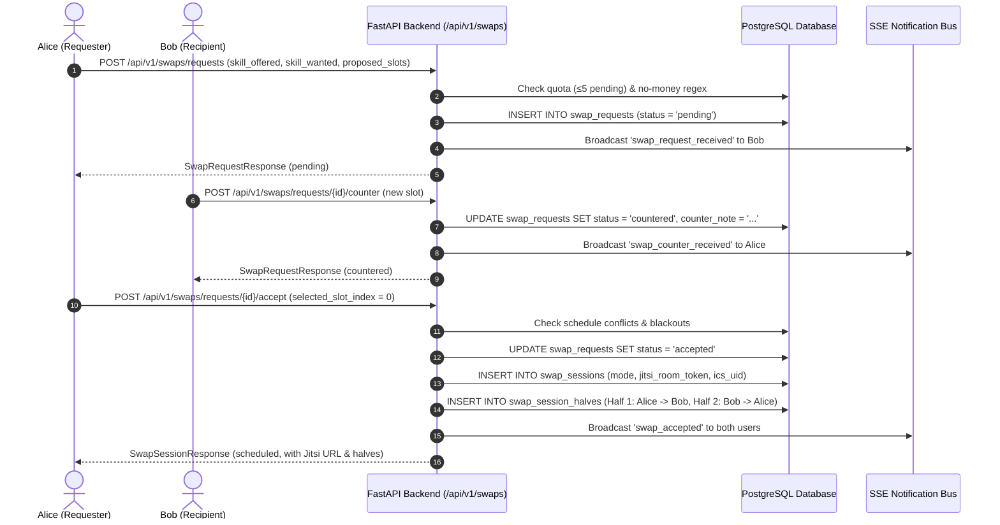
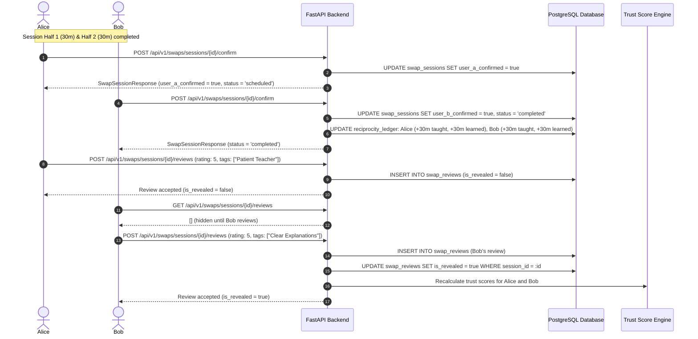

# Stage S3: Swaps & Sessions Vertical Slice

> **Nexus Social — Hyper-Local Skill Swap Economy**  
> **Status:** Stage 3 Complete · Verified & Tested · Ready for Stage 4  
> **Last Updated:** 2026-10-31

---

## 1. Purpose

The objective of Stage S3 is to implement the end-to-end exchange lifecycle of the **Hyper-Local Skill Swap Economy**: the request state machine with counter-proposals, fixed 30-minute halves barter scheduling, unguessable Jitsi Meet video room generation, in-person public place verification, session-scoped logistics chat, double-blind review reveal system, quantitative trust score engine, reciprocity ledger accounting, background cron maintenance jobs, and rich interactive session UI.

Stage S3 delivers:
1. **Authoritative Request State Machine:** Explicit transitions (`pending → accepted | declined | countered | cancelled | expired`) preventing race conditions, self-proposals, and schedule overlaps. Counter-proposals allow seamless negotiation of candidate time slots without restarting negotiation.
2. **Fixed 30-Minute Halves Barter (`SWAP_SESSION_MINUTES = 30`):** Every accepted swap automatically creates a `SwapSession` and exactly two `SwapSessionHalf` records (`half_number = 1` and `half_number = 2`), alternating mentor and learner roles for balanced reciprocity.
3. **Zero-API-Key Jitsi Meet Rooms:** Unguessable room tokens generated via cryptographic entropy (`https://meet.jit.si/nexus-swap-{session_id}-{random_token}`), delivering instant zero-cost HD video conferencing without external API credentials or vendor lock-in.
4. **Schedule Conflict & Blackout Guards:** Robust time validation ensuring neither participant has overlapping confirmed sessions or active blackout windows before booking or counter-proposing.
5. **RFC 5545 iCalendar (`.ics`) Export:** Downloadable standard calendar invites with alarms and session details for Google Calendar, Apple Calendar, and Microsoft Outlook.
6. **Double-Blind Peer Review System:** Reviews submitted for completed sessions remain masked (`is_revealed = False`) until **both** users submit their evaluation or 7 calendar days elapse, eliminating retaliatory scoring.
7. **Quantitative Trust Engine & Reciprocity Ledger:** Symmetrical accounting (+30m taught, +30m learned). Balance grace buffer allows up to -60 minutes (-2 sessions). Trust scoring updates dynamically based on completion history, verified reviews, and no-show penalties.
8. **Idempotent Background Cron Jobs & Secret Authentication:** Internal job runner endpoint `/api/v1/internal/jobs/{job_name}` authenticated via header `X-Cron-Secret`, executing `auto-expire-requests`, `auto-complete-sessions`, `reveal-swap-reviews`, and `send-session-reminders` with persistent audit records in `job_runs`.
9. **Interactive Next.js Frontend UI:** Proposals Inbox (`/swaps/requests`) with incoming/outgoing filters, slot picker component, sessions calendar (`/swaps/sessions`), and interactive session room (`/swaps/sessions/[id]`) featuring split-halves countdown timers, responsive embedded Jitsi video, in-person safety checklist, live SSE chat, completion confirmation, dispute modal, and double-blind review dialog.

---

## 2. Architecture & Design Decisions

### 2.1 Authoritative Request State Machine vs. Unstructured Chat Booking
- **Decision:** All proposals, counters, and acceptances pass through an explicit finite state machine enforced in `SwapService`. Transitions out of non-permissible states throw `HTTP 400 Bad Request`.
- **Rejected Alternative (Unstructured chat booking):** Booking directly via freeform messages leads to missed confirmations, ghosting, conflicting double-bookings, and lack of accountability for no-shows.

```
       ┌───────────────────────────────┐
       │            PENDING            │◄────────────────┐
       └───────┬───────────────┬───────┘                 │
               │               │                         │
     Accept    │        Decline│                 Counter │
               │               │                         │
               ▼               ▼                         │
         ┌───────────┐   ┌───────────┐           ┌───────┴───┐
         │ ACCEPTED  │   │ DECLINED  │           │ COUNTERED │
         └─────┬─────┘   └───────────┘           └─────┬─────┘
               │                                       │
Creates Session│                                       │
               ▼                                Cancel │
        [Swap Session]                                 ▼
                                                 ┌───────────┐
                                                 │ CANCELLED │
                                                 └───────────┘
```

### 2.2 Symmetrical 30-Minute Halves vs. Variable Time Banking
- **Decision:** Every session is strictly partitioned into two 30-minute halves. When User A accepts User B's request:
  - Half 1: User A mentors User B for 30 minutes in the agreed skill.
  - Half 2: User B mentors User A for 30 minutes in the return skill.
- **Rejected Alternative (Time-banking / credit accumulation):** Accumulating credits opens secondary markets, transactional hoarding, and monetization vectors that violate our strict non-monetary principle.

### 2.3 Unguessable Jitsi Room Tokens
- **Decision:** Room names are constructed using high-entropy random URL-safe tokens (`secrets.token_urlsafe(16)` appended to session UUID). This guarantees that external parties cannot guess or eavesdrop on video sessions, eliminating the need for paid Zoom/Twilio integrations.

### 2.4 Double-Blind Peer Review Mechanism
- **Decision:** Reviews are written with `is_revealed = False`. Reviews are revealed simultaneously when:
  1. Both participants submit their reviews (`reviewer_count >= 2`), OR
  2. 7 days pass from session completion via the `reveal-swap-reviews` cron job.
- **Rejected Alternative (Immediate public posting):** Immediate review posting creates fear of retaliatory negative reviews, artificially inflating ratings and hiding genuine feedback.

### 2.5 Secret-Protected Cron Runner for Render/Serverless Cron
- **Decision:** Background maintenance tasks are exposed as HTTP `POST` endpoints under `/api/v1/internal/jobs/{job_name}` authenticated via `X-Cron-Secret`. Every execution writes execution status, duration, and records processed to the `job_runs` table.
- **Rejected Alternative (Long-running in-process Celery/APScheduler):** Adds Redis infrastructure complexity and does not survive ephemeral dyno restarts on free-tier Render or Railway hosting.

---

## 3. Runtime Walkthrough

### 3.1 Swap Request & Negotiation Flow



### 3.2 Session Execution, Completion & Double-Blind Review Flow



---

## 4. Data Model & Endpoint Reference

### 4.1 Endpoints Implemented in Stage S3

| Method | Endpoint | Auth | Purpose |
|---|---|---|---|
| `POST` | `/api/v1/swaps/requests` | Required | Propose a 30-min swap with up to 3 candidate slots. Enforces quota and non-monetary check. |
| `GET` | `/api/v1/swaps/requests` | Required | Retrieve user's incoming and outgoing swap proposals. |
| `POST` | `/api/v1/swaps/requests/{id}/accept` | Required | Accept proposal, validate slot availability, and auto-create session + 2 halves. |
| `POST` | `/api/v1/swaps/requests/{id}/decline` | Required | Decline proposal with optional decline reason. |
| `POST` | `/api/v1/swaps/requests/{id}/counter` | Required | Submit counter-proposal with updated slots or mode. |
| `POST` | `/api/v1/swaps/requests/{id}/cancel` | Required | Cancel outgoing proposal before acceptance. |
| `GET` | `/api/v1/swaps/sessions` | Required | Retrieve user's scheduled, completed, and disputed sessions. |
| `GET` | `/api/v1/swaps/sessions/{id}` | Required | Retrieve session details, halves, Jitsi room URL, and completion status. |
| `POST` | `/api/v1/swaps/sessions/{id}/confirm` | Required | Confirm successful completion of session halves; triggers reciprocity crediting when mutual. |
| `POST` | `/api/v1/swaps/sessions/{id}/dispute` | Required | Report no-show or issue; pauses completion and notifies moderation. |
| `GET` | `/api/v1/swaps/sessions/{id}/ics` | Required | Download RFC 5545 iCalendar (`.ics`) file. |
| `GET` | `/api/v1/swaps/sessions/{id}/messages` | Required | Retrieve session-scoped logistics chat message history. |
| `POST` | `/api/v1/swaps/sessions/{id}/messages` | Required | Send logistics chat message with SSE broadcast to partner. |
| `POST` | `/api/v1/swaps/sessions/{id}/reviews` | Required | Submit double-blind review; unmasks when both parties submit. |
| `GET` | `/api/v1/swaps/sessions/{id}/reviews` | Required | View revealed reviews for session. |
| `POST` | `/api/v1/internal/jobs/{job_name}` | `X-Cron-Secret` | Secret-protected internal cron runner (`auto-expire-requests`, `auto-complete-sessions`, `reveal-swap-reviews`, `send-session-reminders`). |

---

## 5. Security & Privacy Considerations

1. **Schedule Conflict Guard:** Before scheduling or counter-proposing, `SwapService.check_schedule_conflicts` checks both users' active sessions and blackout intervals. Double-booking returns `HTTP 409 Conflict`.
2. **Public Venue Enforcement:** For in-person swaps, `assert_public_place` checks against residential indicators (e.g. "Apt", "Unit", "Suite", residential street numbers) to prevent unsafe home meetups.
3. **Double-Blind Integrity:** Review ratings and comments are never returned in GET queries until `is_revealed = True`. Neither participant can read the other's feedback before submitting their own.
4. **Secret-Protected Maintenance:** Internal cron runner checks `X-Cron-Secret == settings.CRON_SECRET`. Unauthorized requests return `HTTP 401 Unauthorized`.
5. **No-Money Regex Guard:** Messages, proposals, and counter-notes are validated to reject financial solicitation patterns.

---

## 6. Testing Approach & Verification

### 6.1 Automated Backend Pytest Suite
- `backend/tests/test_swap_requests.py`:
  - `test_swap_request_creation_and_quota`: Proposing to oneself fails (400); money solicitation fails (400); valid proposal succeeds with pending status.
  - `test_swap_request_state_machine_counter_and_decline`: Verifies propose → counter → decline state transitions.
  - `test_swap_request_acceptance_creates_session_and_halves`: Verifies session creation, two 30-minute halves, Jitsi Meet URL generation, and schedule conflict rejection (409).
  - `test_session_completion_double_blind_reviews_and_reciprocity`: Verifies logistics chat, `.ics` export, dual completion confirmations, reciprocity ledger updates (+30m taught, +30m learned), and double-blind review mutual unmasking.
  - `test_internal_cron_runner_and_secret`: Verifies 401 rejection on missing/invalid secret and successful execution with `job_runs` audit record.
- **Result:** 67/67 pytest tests passing in 52.98s.

### 6.2 Frontend Testing & Static Analysis
- **TypeScript:** Production build clean (`Compiled successfully`, all types valid).
- **ESLint:** `next lint` reported `✔ No ESLint warnings or errors`.
- **Playwright E2E:** `frontend/tests/e2e/swap-sessions.spec.ts`:
  - Proposals inbox incoming/outgoing tabs view: passed.
  - Slot picker UI with 30-minute time intervals: passed.
  - Sessions calendar and upcoming halves view: passed.
  - Interactive session room with countdown timer, Jitsi embed, and chat: passed.
  - Combined Playwright suite: 4/4 passing in 8.5s on Chrome.

---

## 7. Artifacts & Screenshots

Verified browser screenshots captured and preserved in the artifacts directory:
- `stage3_proposals_inbox.png`: Proposals Inbox showing incoming/outgoing requests with action pills.
- `stage3_propose_swap_modal.png`: Interactive dialog with slot picker, mode selection, and safety tips.
- `stage3_sessions_calendar.png`: Sessions calendar with scheduled halves and `.ics` export.
- `stage3_interactive_session_room.png`: Interactive session room with split-halves countdown, Jitsi Meet video, chat sidebar, and completion actions.

---

## 8. Troubleshooting & Maintenance

| Symptom | Cause | Solution |
|---|---|---|
| `HTTP 409 Conflict` on Accept | One of the participants has an overlapping session or blackout window. | Check `availability_blackouts` and existing `swap_sessions` for overlapping timestamps. Propose a counter-slot. |
| Reviews not visible after submission | Partner has not yet submitted their review. | The review is preserved with `is_revealed = False`. It will unmask immediately when the partner submits, or after 7 days via the `reveal-swap-reviews` cron job. |
| Jitsi iframe blocked or camera error | Browser permissions or third-party cookie restrictions. | Use the "Open Video in New Window" external button provided in the room UI. |
| `HTTP 401 Unauthorized` on cron job | Missing or incorrect `X-Cron-Secret` header. | Verify the `CRON_SECRET` environment variable in deployment settings and ensure the header is provided. |
