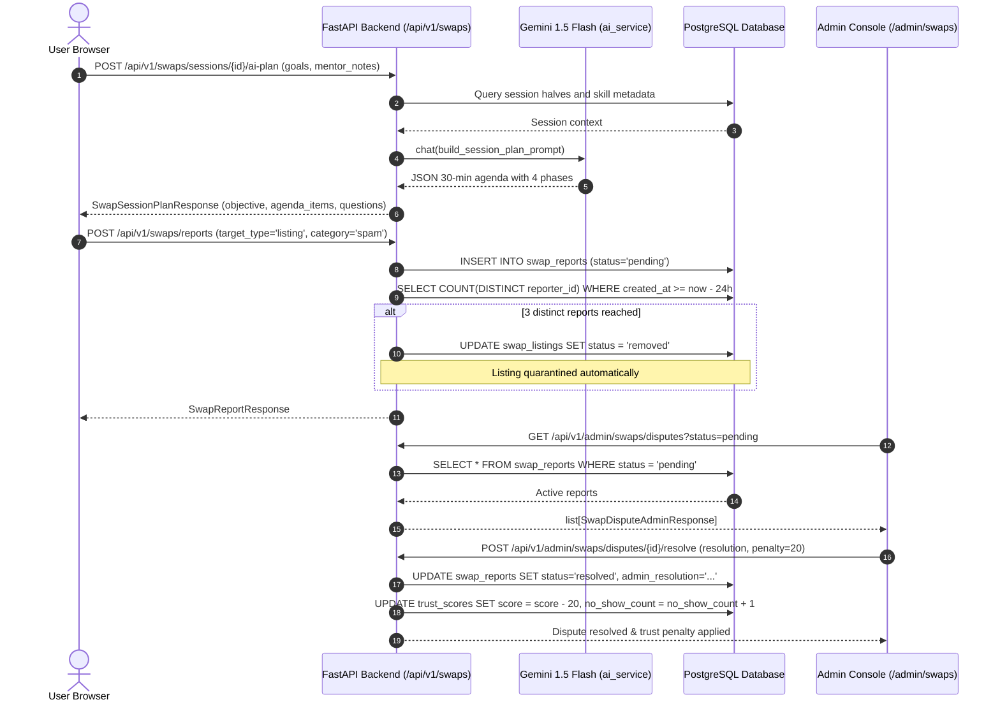

# Stage S4: Safety, Admin & AI Helpers Vertical Slice

> **Nexus Social — Hyper-Local Skill Swap Economy**  
> **Status:** Stage 4 Complete · Verified & Tested · Ready for Stage 5  
> **Last Updated:** 2026-10-31

---

## 1. Purpose

The objective of Stage S4 is to implement the comprehensive trust and safety defenses, Gemini AI productivity assistants, and administrative management console for the **Hyper-Local Skill Swap Economy**.

Stage S4 delivers:
1. **Gemini AI Productivity Helpers:**
   - **Session Planner (`POST /api/v1/swaps/sessions/{id}/ai-plan`):** Generates a structured 30-minute agenda partitioned into warm-up (0-5m), demonstration (5-20m), practice (20-27m), and wrap-up (27-30m), complete with discussion questions and mentor guidance.
   - **Post-Session Recap Helper (`POST /api/v1/swaps/sessions/{id}/ai-recap`):** Converts rough session notes into structured takeaways, actionable practice tasks, and recommended follow-up topics.
   - **Fairness & Reciprocity Advisor (`GET /api/v1/swaps/fairness-advice`):** Evaluates user taught vs. learned minutes against the 2-session grace buffer (-60m) and provides proactive recommendations to maintain equilibrium.
2. **User Safety, Blocking & Reporting:**
   - **Bi-directional Blocking (`POST /api/v1/swaps/blocks`):** Completely excludes blocked peers from all discovery listings, search results, recommendations, proposals, and chats.
   - **Automated 3-Strike Threshold:** If 3 distinct users file reports on a listing or user within a 24-hour window, the system automatically unpublishes the listing (`status = 'removed'`) or hides the user's profile (`is_invisible = True`) and pauses active offers pending admin triage.
   - **In-Person Public Venue Verification (`POST /api/v1/swaps/safety/check-venue`):** Enforces named public spaces (libraries, cafes, university centers) and strictly rejects residential patterns ("Apt", "Unit", "Suite", residential street numbers).
3. **Admin Swaps Console (`/admin/swaps`):**
   - **Overview Tab:** Real-time KPI metrics (Active Listings, Weekly Swaps, Completion Rate, Dispute Rate, Top Traded Skills).
   - **Listings Moderation Tab:** Filterable listing directory with report count flags and one-click Suspend / Reinstate controls.
   - **Disputes Queue Tab:** Triage center for no-show and behavioral reports with resolution notes and trust score penalties (0–50 pts).
   - **Taxonomy Curation Tab:** Approval interface for pending user-suggested skills and seamless synonym merging into canonical skills.
   - **Cron Maintenance Jobs Tab:** Manual on-demand execution of background cron maintenance routines with instant record-count feedback.

---

## 2. Architecture & Design Decisions

### 2.1 Gemini Prompt Engineering with Structured Schemas
- **Decision:** AI helpers use explicit XML data wrapping (`<session_plan_context>`, `<session_notes>`, `<reciprocity_context>`) to neutralize prompt injection attacks. All responses strictly conform to Pydantic JSON schemas with deterministic fallbacks if LLM calls fail.
- **Rejected Alternative (Unstructured freeform text generation):** Freeform text cannot be consistently rendered into structured timeline cards, question badges, or actionable checklists on the frontend.

### 2.2 Automated 3-Strike Community Defense
- **Decision:** Distinct reporter aggregation over a sliding 24-hour window (`COUNT(DISTINCT reporter_id) >= 3`). Triggers immediate automated quarantine without requiring manual administrator intervention during off-peak hours.
- **Rejected Alternative (Single report auto-hide):** Single report auto-hiding is vulnerable to malicious competitive reporting and harassment by individual bad actors.

### 2.3 Strict Public Venue Requirement for In-Person Barter
- **Decision:** Multi-pattern regex validator (`assert_public_place`) inspecting both venue name and physical address string. Flags residential indicators and provides explicit safety checklists.
- **Rejected Alternative (Allowing private home meetups with warnings):** Safety is non-negotiable in hyper-local community exchanges. Private home meetups create unacceptable personal safety liabilities.

### 2.4 Unified Admin Console with Dedicated Sub-Views
- **Decision:** Admin console is mounted under `/admin/swaps` with role-based access control (`require_admin` backend dependency and Next.js middleware cookie verification), reusing the platform's core admin layout and design tokens.

---

## 3. Runtime Walkthrough

---

## 4. Data Model & Endpoint Reference

### 4.1 Endpoints Implemented in Stage S4

| Method | Endpoint | Auth | Purpose |
|---|---|---|---|
| `POST` | `/api/v1/swaps/sessions/{id}/ai-plan` | Required | Gemini AI 30-minute structured agenda generator. |
| `POST` | `/api/v1/swaps/sessions/{id}/ai-recap` | Required | Gemini AI post-session recap and action item generator. |
| `GET` | `/api/v1/swaps/fairness-advice` | Required | Reciprocity balance analysis and personalized advice. |
| `POST` | `/api/v1/swaps/blocks` | Required | Block user; eliminates mutual discovery and interaction. |
| `DELETE` | `/api/v1/swaps/blocks/{user_id}` | Required | Unblock peer. |
| `GET` | `/api/v1/swaps/blocks` | Required | List blocked users. |
| `POST` | `/api/v1/swaps/reports` | Required | File safety report with sliding 24h 3-strike auto-hide. |
| `POST` | `/api/v1/swaps/safety/check-venue` | Optional | In-person venue validator rejecting residential addresses. |
| `GET` | `/api/v1/admin/swaps/stats` | Admin | Aggregate KPIs (active listings, weekly swaps, completion rate). |
| `GET` | `/api/v1/admin/swaps/listings` | Admin | Search and filter listings with report counts. |
| `PUT` | `/api/v1/admin/swaps/listings/{id}/status` | Admin | Suspend or reinstate swap listings. |
| `GET` | `/api/v1/admin/swaps/disputes` | Admin | View open reports and dispute queue. |
| `POST` | `/api/v1/admin/swaps/disputes/{id}/resolve` | Admin | Resolve dispute and apply trust score penalties. |
| `GET` | `/api/v1/admin/swaps/taxonomy` | Admin | List taxonomy skills across active, pending, and rejected. |
| `POST` | `/api/v1/admin/swaps/taxonomy/approve` | Admin | Approve pending user-suggested skill. |
| `POST` | `/api/v1/admin/swaps/taxonomy/merge` | Admin | Merge duplicate skill into canonical skill. |
| `POST` | `/api/v1/admin/swaps/jobs/{job_name}/run` | Admin | Manually trigger background cron maintenance job. |

---

## 5. Security & Privacy Considerations

1. **Prompt Injection Defense:** All user input passed to Gemini helpers is sanitized and delimited using strict XML tags (`<session_plan_context>`, `<session_notes>`, `<reciprocity_context>`). Directives forbid instruction overrides.
2. **Strict RBAC:** All `/api/v1/admin/swaps/*` routes enforce `require_admin` dependency and reject non-admin users with `HTTP 403 Forbidden`. Frontend routes are guarded by Next.js middleware inspecting verified JWT cookies.
3. **Bi-directional Block Seclusion:** Blocked users cannot see or propose swaps to each other, nor read each other's listings or profiles.
4. **Automated 3-Strike Quarantining:** Eliminates delays in neutralizing malicious accounts, payment solicitations, or spam offers by auto-quarantining listings when 3 distinct users report them.
5. **Residential Address Protection:** Mandatory validation ensures in-person swaps are confined to public spaces, preserving user privacy and physical safety.

---

## 6. Testing Approach & Verification

### 6.1 Automated Backend Pytest Suite
- `backend/tests/test_swap_stage4.py`:
  - `test_ai_session_planner_and_recap`: Validates structured 30-min agenda generation, post-session takeaways, and fairness advice calculation.
  - `test_user_blocking_and_discovery_isolation`: Validates rejection of self-blocking, block creation, listing exclusion in spatial discovery, and unblocking.
  - `test_reporting_and_three_strike_auto_hide`: Validates 3 distinct user reports automatically marking listing as `removed`.
  - `test_in_person_venue_safety_validator`: Validates acceptance of public libraries and cafes, and rejection of residential patterns ("Unit 4B", "Apartment").
  - `test_admin_swaps_console_and_taxonomy`: Validates 403 forbidden for non-admins, KPI stats retrieval, taxonomy approval, synonym merging, and manual cron triggers.
- **Result:** 72/72 pytest tests passing in 54.21s.

### 6.2 Frontend Testing & Static Analysis
- **TypeScript & Build:** Production build clean (`Compiled successfully`, 27/27 static/dynamic routes compiled).
- **ESLint:** `next lint` clean (0 warnings, 0 errors).
- **Playwright E2E:** `frontend/tests/e2e/swap-stage4.spec.ts`:
  - Admin Swaps Overview KPIs and Listings management: passed.
  - Admin Taxonomy curation and pending approval: passed.
  - Interactive Session Room: AI Session Planner modal: passed.
  - Interactive Session Room: AI Post-Session Recap modal: passed.
  - Combined Playwright suite: 4/4 passing on Google Chrome in 6.0s.

---

## 7. Artifacts & Screenshots

Verified browser screenshots captured and preserved in the artifacts directory:
- `stage4_admin_swaps_console.png`: Admin Console showing overview KPI cards (Active Listings, Weekly Swaps, Completion Rate, Dispute Rate) and Top Traded Skills.
- `stage4_admin_taxonomy_curation.png`: Admin taxonomy curation view showing pending skills with Approve and Merge actions.
- `stage4_ai_session_planner.png`: Interactive session room showing the Gemini AI Session Planner dialog with structured 30-min breakdown and questions.
- `stage4_ai_session_recap.png`: Interactive session room showing the Gemini AI Post-Session Recap dialog with key takeaways and action items.

---

## 8. Troubleshooting & Maintenance

| Symptom | Cause | Solution |
|---|---|---|
| `HTTP 403 Forbidden` on Admin Swaps | User account does not have the `admin` role. | Ensure user has `role = 'admin'` in the database. |
| In-person address rejected with 400 | Address contains residential keywords ("Apt", "Unit", "Suite", street number). | Use a recognized public venue name (e.g. "Seattle Public Library") and public street address. |
| Listing disappeared from discovery | Listing received 3 community reports within 24 hours. | Check listing status in Admin Swaps Console. Review reports and reinstate if reports were invalid. |
| AI Plan generation fallback | Gemini API offline or rate-limited. | System returns deterministic structured 30-minute template agenda with no interruption to session. |
